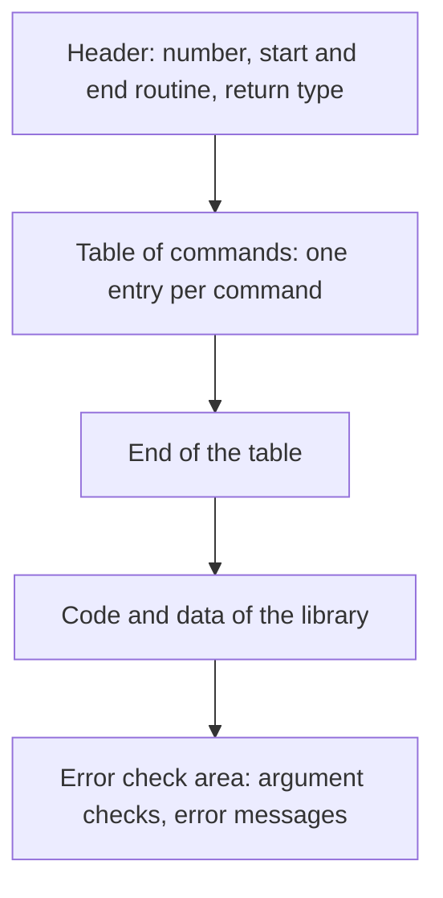

Before this page you should know the kinds of libraries and what a token
is ([Libraries: acidlibs, deflibs, userlibs]()
and [Tokenised sources]()).

A Blitz library is an AmigaOS executable with exactly one code hunk. It
is never run as a program: blitz2 loads it, reads the table at its start,
and copies its code into the programs that use it. This page explains the
parts of such a file, using a small real library as the example.

## The layout of the file



The **header** gives the library's number and the addresses of its
optional start and end routines. The start routine runs when a program
starts; if it returns a value, such as the base of an AmigaOS library it
opened, the compiler keeps that value in a global variable of the program,
and the commands can ask for it.

The **table of commands** has one entry per command, in order: the first
entry is the command with token number 1 of the library, the second with
2, and so on. An entry says what kind of command it is, which arguments
it takes, which values it needs from other libraries, which routine
implements it, and its name and help text.

The **code** follows the table, and last comes the **error check area**:
routines that check a command's arguments, and the texts of the error
messages. The compiler copies this area into a program only when runtime
error checking is on. That is how runtime error checking costs nothing in
a program compiled without it.

## An example: the command line arguments

The library for the arguments of a program has four functions: `NumPars`,
`Par$`, `FromCLI` and `ParPath$`. In the BB2 C port it is a C file whose
declaration part reads, for `Par$`:

```c
BLITZ_LIBHEADER(LIB_cliargslib, 0, BL_NORET, 0, BLITZ_ERROR_AREA);

BLITZ_AFUNCTION(BL_STRING);
BLITZ_ARGS(BL_LONG);
BLITZ_LIBS(LIB_wbstartuplib, BL_LA(0));
BLITZ_SUBS(GetParString, CheckParNum, 0);
BLITZ_NAME("Par$", "  parameter$=Par$(Paramter#)   Returns the string value of a parameter.");
```

Line by line:

* **`BLITZ_LIBHEADER`**: the library has the number `LIB_cliargslib`, no
  start routine, no return value, no end routine, and an error check area.
  The numbers of all libraries are defined in one place, so that a library
  never names a number directly ([Library variants]()).
* **`BLITZ_AFUNCTION(BL_STRING)`**: the command is a function that returns
  a string. A statement, which returns nothing, is `BLITZ_ASTATEMENT()`; a
  command that can be used both ways is `BLITZ_ACOMMAND`.
* **`BLITZ_ARGS(BL_LONG)`**: one form of the command, with one argument of
  type long. A command can have several forms with different numbers of
  arguments; the compiler picks the one that fits the call. A form can
  also end in a group of arguments that may repeat, as `Print` has.
* **`BLITZ_LIBS(LIB_wbstartuplib, BL_LA(0))`**: before the call, put the
  value of the library with the start-up arguments into register a0. This
  is how one library uses what another library's start routine prepared.
  It also makes the compiler copy that other library into the program.
* **`BLITZ_SUBS(GetParString, CheckParNum, 0)`**: the routine that
  implements the command, and the check routine called before it when
  runtime error checking is on (here: is the argument number valid?). A
  third routine would be called after it.
* **`BLITZ_NAME`**: the name the editor and the compiler know, and the help
  text the editor shows for it.

After the last command, `BLITZ_LIBFIN()` ends the table. The complete
file is
[the cliargslib source](https://github.com/fubar-coder/bb2-c/blob/main/libs/acidlibs/cliargslib.c)
on GitHub.

## How arguments arrive

The compiler evaluates the arguments of a command into the data
registers, the first into d0, the next into d1 and so on. The values a
command asks for with `BLITZ_LIBS` go into the registers it names. The
result goes back in d0.

Strings are special. A string argument arrives as the address of its
characters in the program's string work area, and its length is put on
the stack; register a2 points just above those lengths. A function that
returns a string writes its characters into the work area, at register
a3, and returns their length in d0.

The program's own registers stay untouched: a5 points to the program's
global variables, a4 to the local variables of the current procedure,
and a3 into the string work area. A library routine must keep a4 and a5,
and change a3 only the way a string result requires.

## The names in C and in the original

The original libraries were written as Blitz Basic programs with inline
assembler, and their table was built by a set of macros of Blitz Basic 2
(`!libheader`, `!afunction`, `!args`, `!libs`, `!subs`, `!name` and the
others). The C macros of the BB2 C port have the same names and produce
the same bytes, so a library in C can be compared byte for byte with the
original. The full list, with the original macro next to each C macro, is
at the start of
[the header for libraries](https://github.com/fubar-coder/bb2-c/blob/main/libs/include/blitzlib.h).
