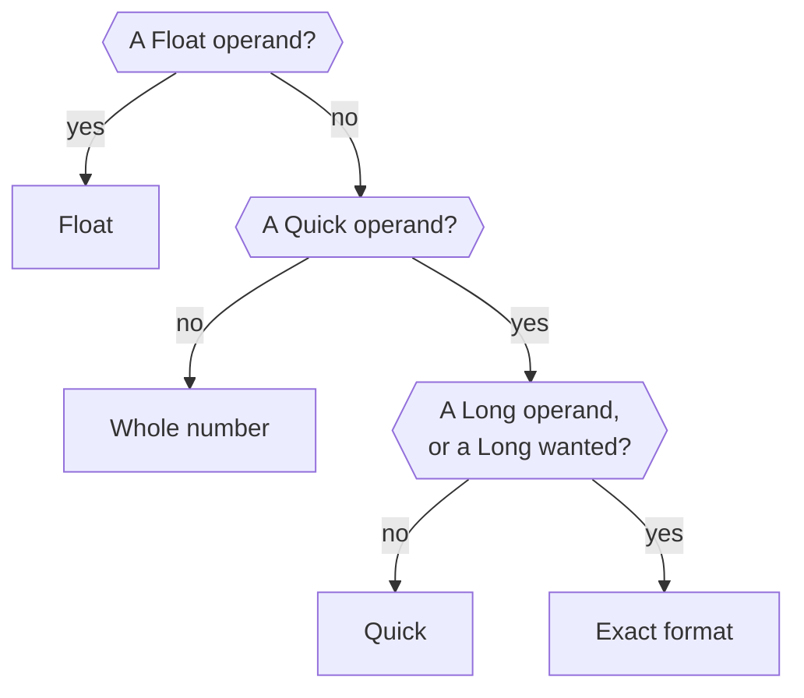

The same sum, written in another order, gives another result in Blitz
Basic 2:

```blitzbasic
q.q=1.5 : w.w=3 : v.w=4
NPrint w+v+q     ; original: 8      port: 8.5
NPrint q+w+v     ; original: 8.5    port: 8.5
```

The original reads an expression from left to right and keeps one type,
the *type so far*. In `w+v+q` the two Words come first, their sum is a
whole number, and the Quick that follows is cut to 1. In `q+w+v` the
Quick comes first, so the whole sum is a Quick. The BB2 C port decides
each operation by its own two operands, so both orders give 8.5: the
order in which you write the operands should not change what a program
computes.

A Quick is the default type of a variable without a suffix: 16 bits for
the whole part and 16 bits for the fraction, from -32768 to 32767.99998.
The type so far and the five number types are explained in
[The type of an expression]().
Each section below has a program to copy; its comments give the output
of the original, blitz2 1.95 from the Blitz Basic 2 CD recorded in an
emulator, and the port's output, which the project's tests check. AB3
mode computes expressions in the same way as BB2 mode; AmiBlitz3 itself
keeps the original's rule.

## How the port chooses the type {#rule}

The port first reads the whole expression, then decides every operation
by three things: the operator, the types of its two operands and the
*wanted type*, the type of the destination or the parameter (a Long for
an array index). `If`, `While`, `Until`, `Select`, `Print` and the two
sides of a comparison want no type.



Whole numbers are computed in their own types, as in the original (in a
comparison at least as a Long). A Quick operation uses the original's
routines, with 16 bits for the whole part and 16 for the fraction. The
*exact format* has a whole part of 48 bits and 16 bits of fraction, so it
holds any Long with a fraction.

An operand counts as a Long when it is a Long variable or function, a
constant above 32767, the address of a variable, the product of two
Words or a shift of a whole number. A constant written with a point, such
as `1.5` or `2.0`, counts as a Float for a whole destination (Byte, Word
or Long) and beside whole numbers only, otherwise as a Quick beside a
Quick; it is never a whole number.

The result is rounded once, where it is taken: rounded down to a whole
number for a whole destination (a `/` as the last operation towards zero,
and under a Long every `/`), to a Quick for a Quick destination. Where nothing is wanted it stays a Quick
if it fits, otherwise it is rounded down to a whole number. A product or
a quotient in the exact format is cut to 1/65536 in the same direction,
so `r.l=q*p+l` with `q=-0.5`, `p=1/65536` and `l=5` is 4, the exact
value 4.99999 rounded down.

The original's Quick routines stay wherever no Long is involved, so most
programs compute exactly as before; the exact format is used only where a
Quick, which holds at most 32767, would lose the value.

## The order of the operands {#order}

In the original the first operands set the type so far, so a Quick
further right is cut and a division of whole numbers changes with its
place.

```blitzbasic
q.q=1.5 : w.w=3 : v.w=4
NPrint 1+1+1+q                 ; original: 4      port: 4.5
NPrint w*v+q                   ; original: 13     port: 13.5
q=0.5
NPrint q+w/2                   ; original: 2      port: 2
NPrint w/2+q                   ; original: 1.5    port: 2
q=1.2
If w/2>q Then NPrint "w/2>q"   ; original: no line    port: w/2>q
```

In the original `1+1+1` and `w*v` are whole numbers that become a Long,
and a Quick after a Long is cut to 1. `w/2` is the whole-number division
(1) when it stands first and 1.5 when the Quick stands first. In the port
a whole number beside a Quick is computed with the fraction in either
order, so `w/2` is 1.5 in all three lines.

One thing still depends on the order, in both compilers: an intermediate
value that leaves its type's range.

```blitzbasic
q.q=300 : q2.q=300 : r.q=0.25
x.q=q*q2*r : NPrint x          ; original: 6116     port: 6116
x.q=r*q*q2 : NPrint x          ; original: 22500    port: 22500
```

`q*q2` is 90000, beyond a Quick, and wraps; `r*q` is 75 and does not.

## A chain under a Long {#chains}

A Long destination makes the type so far Long from the start in the
original, so every Quick of the chain is cut to a whole number as soon as
it is read.

```blitzbasic
l.l=10 : q.q=1.5 : p.q=2.75 : f.f=0.5 : w.w=3 : v.w=4
r.l=l+q+p : NPrint r           ; original: 13    port: 14
r.l=(q+p)*l : NPrint r         ; original: 30    port: 42
r.l=l+q+f : NPrint r           ; original: 11    port: 12
r.l=f+q+l : NPrint r           ; original: 12    port: 12
x.w=w+v+q*2 : NPrint x         ; original: 9     port: 10
p=1.5
r=(l+q+p) AND 255 : NPrint r   ; original: 12    port: 13
r=(l+q+p) LSL 1 : NPrint r     ; original: 24    port: 26
r=Not (l+q+p) : NPrint r       ; original: -13   port: -14
```

The original computes `l+q+p` as 10+1+2 and `(q+p)*l` as (1+2)*10. A
Float raises the type so far to Float, so `f+q+l`, with the Float first,
keeps every fraction even in the original.

The port computes the chain in the exact format and rounds once, when the
result is stored: 10+1.5+2.75 is 14.25, stored as 14, and (1.5+2.75)*10
is 42.5, stored as 42. A bit operator or a shift takes the rounded value
of the chain. More single operations of a Quick in a Long computation,
such as `r.l=q*2` and `r.l=l/q`, are on
[A Quick in a Long computation]().

## A Quick beside a Long {#quick-and-long}

Where nothing is wanted, the original converts a Long that comes after a
Quick into a Quick, and a Quick holds only up to 32767.

```blitzbasic
q.q=1.5 : l.l=100000
NPrint q*l             ; original: 18928      port: 150000
NPrint q+l             ; original: -31070.5   port: 100001
NPrint Int(q)*100000   ; original: 100000     port: 100000
```

In the original 100000 wraps to -31072 as a Quick, and the product wraps
again. The port computes both in the exact format. 150000 and 100001.5
do not fit a Quick, so `NPrint` gets their whole parts. `Int(q)` gives a
whole number and keeps the original's result in both.

## `Mod` with a fraction {#mod}

The original computes `Mod` of these operands on their whole parts and
loses the fraction of the remainder.

```blitzbasic
q.q=7.5 : f.f=2.5 : b.b=4
x.q=q Mod 2 : NPrint x         ; original: 1    port: 1.5
NPrint f Mod 1.5               ; original: 0    port: 1
NPrint b Mod 1.5               ; original: 0    port: 1
```

The port computes `Mod` exactly whenever an operand has a fraction (a
Quick, a Float or a constant with a point), with the sign rule of the
whole-number `Mod`. Whole operands keep the whole-number `Mod`.

A Quick divisor below 1 stops the original's program:

```blitzbasic
q.q=7.75 : p.q=0.5
x.q=q Mod p : NPrint x         ; original: "Software Failure"    port: .25
```


A `Mod` of two constants is computed by the compiler itself. With a
divisor whose whole part is 0, such as `rq.q=5 Mod 0.5`, the compiler
stops with a "Software Failure", in the original as in the port. This is
an open bug:
[A constant Quick Mod by a divisor below 1 crashes the compiler (#1219)](https://github.com/fubar-coder/bb2-c/issues/1219).


## Comparisons {#comparisons}

A comparison gives -1 (true) or 0 (false). In the original the type of
the destination also reached the left side, which was computed in that
type before the comparison was read.

```blitzbasic
q.q=1.25 : l3.l=100000000 : l1.l=40000 : ld.l=10
r.l=(q*2>2.4) : NPrint r                ; original: 0    port: -1
r.l=(q*2=2.5) : NPrint r                ; original: 0    port: -1
rf.f=(100000001>l3) : NPrint rf         ; original: 0    port: -1
rq.q=(l1+1>40000) : NPrint rq           ; original: 0    port: -1
r.l=(ld/3>3.2) : NPrint r               ; original: 0    port: -1
If ld/3>3.2 Then NPrint "ld/3>3.2"      ; original: no line    port: ld/3>3.2
w.w=20000 : v.w=20000 : c.w=0
rw.w=(w+v>c) : NPrint rw                ; original: 0    port: -1
If w+v>c Then NPrint "w+v>c"            ; original: no line    port: w+v>c
```

Under the Long destination the original cuts `q` to 1, so `q*2` is 2.
Under the Float destination it makes the Long constant a Float, which
holds only about seven digits, so 100000001 is not greater than
100000000. Under the Quick destination the Long sum keeps only 16 bits of
its whole part, and under the Word one the sum 40000 overflows. In the
`ld/3` lines it divides whole numbers and compares 3 with 3.2.

The port computes each side by its own operands and compares the two
sides in a common type: whole numbers at least as a Long, a Quick with
whole numbers in the exact format, anything with a Float as a Float.
Since the right side of `ld/3>3.2` has a fraction, the division is
computed with its fraction too. The destination only receives the -1 or
0. A comparison whose left side is a single variable, such as `r.l=(q>1)`,
is on
[A comparison with a Quick, or of large Longs]().

## Bit operators with a fraction {#bit-operators}

`AND`, `OR`, `EOR` and `NOT` work on whole numbers. Many programs use
Quick variables as whole numbers or as on/off flags with them, so the
port accepts an operand with a fraction on either side and takes its
whole part, rounded down: 1.5 counts as 1 and -1.5 as -2.

```blitzbasic
vb.b=3
rb.b=vb AND 1.5 : NPrint rb    ; original: 1     port: 1
rb=1.5 AND vb : NPrint rb      ; original: 1     port: 1
rb=NOT 1.5 : NPrint rb         ; original: -2    port: -2
vb=-3
rb=vb AND -1.5 : NPrint rb     ; original: -3    port: -4
rb=NOT -1.5 : NPrint rb        ; original: 0     port: 1
```

Under a Byte destination the original cut such a constant towards zero,
so -1.5 became -1. Under a Word, Long or Float type so far it made the
constant a Float and refused the operator:

```blitzbasic
vw.w=1000
rw.w=vw OR 1.5 : NPrint rw     ; original: "Illegal Operator for Type"    port: 1001
```

The port takes the whole part in the same way for a Quick, a value in the
exact format and a constant with a point, under every wanted type. A
Float variable is still refused with "Illegal Operator for Type", as in
the original.

## Shifts {#shifts}

The count of `LSL`, `LSR`, `ASL` and `ASR` is a number of bits. The port
accepts a whole constant, or a variable or expression, as the count; a
Quick variable counts with its whole part, as in the original. A
constant written with a point is refused as the count with "Illegal
Operator for Type", whatever its value. The original accepted such a count
only in some places (2.5 under a Byte or Quick type so far, 2.0 only
under a Byte one); the port makes this one rule. These lines compile in the original, not in the port:

```
vb.b=3 : vq.q=1.5
rb.b=vb LSL 2.5      ; original: 12   port: Illegal Operator for Type
NPrint vb LSL 2.5    ; original: 12   port: Illegal Operator for Type
rb.b=vb LSL 2.0      ; original: 12   port: Illegal Operator for Type
rb.b=vq LSL 2.5      ; original: 6    port: Illegal Operator for Type
```

Write the count as a whole number (`vb LSL 2`), or use a variable. The
compile error is also on
[A constant with a point as a shift count]().

A constant with a point as the value that is shifted is taken as a Quick
variable of that value:

```blitzbasic
rb.b=1.5 LSL 2 : NPrint rb     ; original: 4    port: 6
```

The original cut the constant to 1 first; a Quick variable holding 1.5
is shifted with its fraction in both.

## `Select` and `Case` {#select}

`Select` computes its value once and compares it with each `Case` in
turn. Whole, Quick and Float values work as in the original. A value
that the port computes in the exact format, because a Quick meets a Long,
is kept in that format, and each `Case` is compared with it exactly (a
Float `Case` as a Float):

```blitzbasic
q.q=1.5 : p.q=0.5 : l.l=100000
Select q*l+p
  Case 150000 : NPrint "Case 150000"
  Case 150000.5 : NPrint "Case 150000.5"
  Default : NPrint "Default"
End Select
; original and port: Case 150000.5
```

The value 150000.5 is beyond a Quick; kept exact, it matches
`Case 150000.5` and not `Case 150000`. The original matches the same
`Case` here and in the other forms the tests check, so a program with
such a `Select` gives the same results with both.

A whole `Select` value with a `Case` that has a fraction is not brought
to a common type: each `Case` is compared in the whole type, as in the
original.

## Edge cases {#edge-cases}

**"Expression too Complex".** A value in the exact format takes two of
the processor's eight data registers. An expression that would need a
register beyond the eighth is the compile error "Expression too Complex",
as for the ninth register of
[An operator too deep in an expression]().

```blitzbasic
q.q=1.5 : l.l=2 : c1.l=1 : c2.l=2 : e.l=3 : h.l=4 : i.l=5
r.l=c1+(c2+(e+(h+(i+(q*l*l))))) : NPrint r   ; original: 19   port: 21
```

The original cuts `q` to 1 and adds 4; the port adds 6. One more level
of brackets, with a sixth Long `j`,
`r.l=c1+(c2+(e+(h+(i+(j+(q*l*l))))))`, compiles in the original and is "Expression too Complex" in the port.
The port finds this only after it has read the whole expression: if the
same expression contains another error further right, such as a string
where a number belongs ("Type Mismatch"), that error is reported first.

**A power.** `^` always works with Floats: both operands are converted
to Float with their own values.

```blitzbasic
l.l=100000 : n.q=2
rq.q=l^n : NPrint Hex$(Peek.l(&rq))   ; original: E5400000   port: FFFFFFFF
```

1e10 is far beyond a Quick, and the port's conversion gives $FFFFFFFF.
The original converted the base to a Quick first.

**A division inside an expression.** Under a Byte or Word destination
only a `/` that is the last operation of the expression gives its
quotient towards zero; a `/` inside it is rounded down with the rest of
the expression. With `n=-10`, `q=3` and `z=0`, `x.w=n/q` is -3 but
`x.w=n/q+z` is -4; under a Long destination both are -3.

**Very deep expressions.** The port decides the types over the whole
expression only up to 64 levels of nesting. An expression nested deeper
is computed by the original's rule, from left to right with the type so
far.

**Other places without a type.** The arguments of functions that take any
number type, such as `Int`, want no type. A value in the exact format is
passed to them as it would be stored in a Quick variable, so a value
beyond the Quick range wraps there.

**A constant alone.** A constant on its own keeps the original's rule:
`rb.b=2.0` stores the whole number 2. Only as an operand does a constant
with a point count as a number with a fraction.

**`Mod` by 0.** A `Mod` by a variable that holds 0 behaves by type, as in
the original: a Byte, Word or Quick `Mod` raises the processor's division
trap ("GURU! - Division by Zero" with runtime error checking), a Long or
Float `Mod` gives the dividend. A `Mod` by a constant 0 is the compile
error "Division by Zero".

**Division by 0 in the exact format.** It gives the largest value of the
wanted type with the dividend's sign: with `l.l=100` and `q=0`, `x.q=l/q`
is $7FFFFFFF, `x.w=l/q` 32767 and `x.b=l/q` 127. A division of two Quicks
by 0 stays the original's Quick routine: `rb.b=q/p` with `q=1`, `p=0`
gives -1.

**Products of two constants.** The compiler computes an operation of two
constants itself, but a Long or Quick `*` of two constants still runs the
multiplication routine of the loaded libraries, as in the original,
because its result on an overflow depends on that library set.

**Speed.** An operation in the exact format calls a routine of the
compiler's own small library, slower than the Quick operation: on an
A500 an addition takes about 54 cycles, a multiplication 372 to 1316 and
a division 1045 to 3183.

## Developer documentation and issues

The developer documentation of the rule, with the table of every
operation:
[Expression type tables](https://github.com/fubar-coder/bb2-c/blob/main/docs/blitz2/expression-type-tables.md)
and
[the operand typing](https://github.com/fubar-coder/bb2-c/blob/main/docs/blitz2/expression-types.md#the-operand-typing-rule-p-1216).
The fixes:

* [The type of an operation depends on the order of its operands and its place in a chain (#1216)](https://github.com/fubar-coder/bb2-c/issues/1216)
* [A comparison with a compound left operand is still done in the type of the context: a Quick inside it is cut (#1183)](https://github.com/fubar-coder/bb2-c/issues/1183)
* [A comparison with a Quick operand is done in Long when the context or the left operand is Long (#1177)](https://github.com/fubar-coder/bb2-c/issues/1177)
* [Arithmetic with a Quick operand is done in Long when the context or the left operand is Long: the fraction is cut before the operation (#1178)](https://github.com/fubar-coder/bb2-c/issues/1178)
* [Under a Byte destination a constant with a fraction is cut before the operation (#1188)](https://github.com/fubar-coder/bb2-c/issues/1188)
