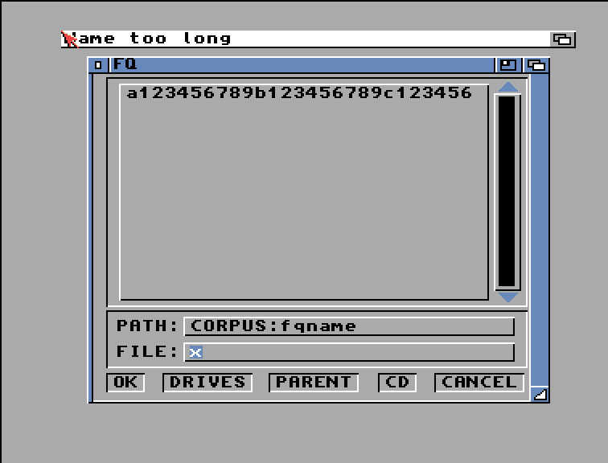



## File requesters

### `FileRequest$` left the old lengths in the path and the file name {#filerequest-lengths}

`FileRequest$` takes two string variables, the path and the file name to
start with, and after OK writes the ones the user chose back into them,
so that the next call starts there again. The original wrote the new
characters but left the lengths of both variables as they were. `Len`,
`Print` and every string expression with these variables then saw the
old length: a path that was empty before stayed empty for them, and a
name that was longer before kept characters of the old one at its end.
The result of `FileRequest$` itself was right.

**What happened**

```
Screen 0,0,0,320,256,2,0,"freqlib",1,2
Use Screen 0
MaxLen p$=160
MaxLen f$=64
p$=""
f$="x"+Chr$(0)+"yz"
r$=FileRequest$("FQ",p$,f$)
NPrint "ok ",Len(r$)," [",r$,"]"
NPrint "path ",Len(p$)," [",p$,"]"
NPrint "file ",Len(f$)
End
```

The path starts empty, and the file name is `x`, a 0 byte and `yz`, 4
characters, of which the requester shows the `x`. The program runs in the
drawer `a` of the volume `CORPUS:`, and the user clicks PARENT, which
with an empty path goes to the parent of the current directory, and then
OK. The original prints

```
ok 8 [CORPUS:x]
path 0 []
file 4
```

The path holds `CORPUS:` but has the length 0, and the file name `x`
still has the length 4.

**With the port**

```
ok 8 [CORPUS:x]
path 7 [CORPUS:]
file 1
```

After OK both variables have the lengths of their new contents. Cancel
and the close gadget leave them as they were.

Issue: [FileRequest$ changed the path and file name without setting their lengths (#153)](https://github.com/fubar-coder/bb2-c/issues/153).

### Long file names overwrote memory {#filerequest-long-names}

The file requester keeps the path in a field of 160 bytes and the file
name in one of 64 bytes, so it has room for a path of 159 and a name of
63 characters. The original copied names and paths into these fields
without looking at their length. On the classic Amiga file system a name
has at most 30 characters, but the newer file systems (FFS with long
names, PFS, SFS) and the host directories of an emulator allow much
longer ones. A click on a file name of 64 or more characters in the list
wrote it behind the file name field, and OK then copied on through memory
until the program crashed. A long path, or a path the program's string
variable had no room for, overwrote memory the same way.

The port refuses a name or a path that does not fit. It also respects
the room the program gives: a name longer than the `MaxLen` of the
file name variable, or a path longer than the `MaxLen` of the path
variable, is refused too. The requester then stays open, keeps what its
fields held, and shows "Name too long" or "Path too long" in the title
bar of the screen until the user clicks the next button, field or line.

**What happened**

```
Screen 0,0,0,320,256,2,0,"freqlib",1,2
Use Screen 0
d$="CORPUS:fqname/"
If WriteFile(0,d$+"a123456789b123456789c123456789d123456789e123456789f123456789g123456789") Then CloseFile 0
MaxLen p$=160
MaxLen f$=64
p$="CORPUS:fqname"
f$="x"
r$=FileRequest$("FQ",p$,f$)
NPrint Len(r$)," [",r$,"] file ",Len(f$)," [",f$,"]"
End
```

The program creates a file with a name of 70 characters and opens the
requester in its drawer. The user clicks the name in the list and then
OK. The original copies all 70 characters into the 64-byte field, and OK
crashes the program.

**With the port**

The click is refused, and the screen's title bar says so:



OK then returns the file the requester held before:

```
15 [CORPUS:fqname/x] file 1 [x]
```

A program that wants names of up to 63 characters gives its file name
variable a `MaxLen` of 64 and its path variable one of 160, as the
page of [freqlib]()
shows. A program whose screen has no visible
title bar does not see the message, but the name is refused all the
same. The editor's file requester is the same code and has the same
limits.

Issue: [The file requester copied names longer than 63 characters without a limit (#1042)](https://github.com/fubar-coder/bb2-c/issues/1042).

## Other fixes {#other-fixes}

In the lists of this part, each point says first what the original did
and then what the port does, unless the introduction of a list says
otherwise.

### File requesters {#file-requester-fixes}

`FileRequest$` opens the file requester of Blitz Basic 2; the editor's
file requester is the same code and has the same fixes, except for the
[lengths of the path and the file name](#filerequest-lengths), which only
`FileRequest$` sets. `ASLFileRequest$`, `ASLPathRequest$` and
`ASLScreenRequest` open the requesters of the system's `asl.library`.

* A file name of 64 or more characters, or a path of 160 or more, was
  copied into the requester's fields without a limit and overwrote
  memory; the requester refuses it and says "Name too long" or "Path too
  long" in the screen's title bar
  ([Long file names overwrote memory](#filerequest-long-names),
  [#1042](https://github.com/fubar-coder/bb2-c/issues/1042)).
* `FileRequest$` on a screen of 645 lines or more, such as a 1280×1024
  RTG Workbench, wrote far behind its data and could crash the program
  after the requester closed; the list shows at most 64 lines and the
  window is at most 597 lines high
  ([#160](https://github.com/fubar-coder/bb2-c/issues/160)).
* Every list entry of the requester had room for a name of 34
  characters, so a longer name, on a file system with long names, was
  written behind it, and an entry for which no memory was left was
  written from address 0 on and crashed the system; each entry gets the
  room its name needs, and an entry without memory is left out of the
  list ([#159](https://github.com/fubar-coder/bb2-c/issues/159)).
* The CD button made the drawer shown the program's current directory and
  released the directory the program had been started in, which belongs
  to the shell that started it, and the program ended in the new drawer.
  CD still changes the current directory while the program runs, but the
  start directory is kept and is current again when the program ends,
  unless the program has changed the current directory itself since
  ([#157](https://github.com/fubar-coder/bb2-c/issues/157)).
* After CD, every later click into the path gadget, the field with the
  path, made the system copy the path into the first 64 KB of memory, in
  that requester and in all later ones, because CD damaged the gadget's
  data instead of resetting its cursor; CD resets the cursor and the scroll position of the path
  ([#345](https://github.com/fubar-coder/bb2-c/issues/345)).
* PARENT with an empty path and CD, which find the path of the current
  directory, left every parent directory in use until the next reboot,
  so that such a disk could not be renamed or ejected cleanly; the
  directories are released
  ([#158](https://github.com/fubar-coder/bb2-c/issues/158)).
* DRIVES read the system's list of volumes, assigns and devices without
  locking it, so a disk change, an assign or a mount at that moment could
  make the requester read freed memory; it locks the list while it reads
  it, and shows the same entries
  ([#156](https://github.com/fubar-coder/bb2-c/issues/156)).
* Every call opened the DOS, Intuition and graphics libraries of the
  system and never closed them, so their use counts rose with every
  requester; they are closed at the end of each call
  ([#154](https://github.com/fubar-coder/bb2-c/issues/154)).

{}
