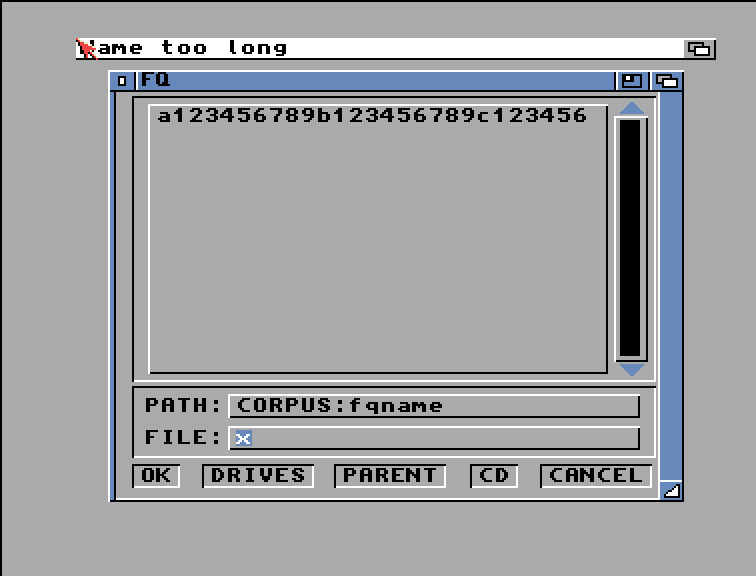

These bugs are in the libraries that provide the commands of Blitz Basic
2 ([Libraries]()). A fix in a library
changes only that library, and a program behaves differently only where
it ran into the bug. The first sections show the ones an ordinary program
can run into, each with a short program; the other fixes follow as a
list, one sentence each with a link to its issue.
The table on [Important Fixes & Breaking Changes]()
lists all fixed bugs by what they can change in a program.

The outputs shown were recorded in an emulator: the original is the
program compiled with the libraries of the Blitz Basic 2 CD, the port the
same program compiled with the port's libraries. The programs run without
runtime error checking unless the text says otherwise.

## Changes for existing programs

The fixes in this part change the result of a program that ran correctly
with the original: what it computes, draws or sends, or which way it
takes. Check your sources for the commands they name.

Two of them concern programs that were written to make up for the bug,
drawing on bitmaps; no known example program, demo or game uses these
commands this way, but a program of your own might. `CustomSprites` takes
its offset in the unit it is documented with, which changes every program
that gives it an offset other than 0. `LoadShape` stops with a runtime
error on pictures too large to blit, which it loaded before. `ReplyRexxMsg`
changes which ARexx replies carry a result string, and two serial port
commands take the flags their help text names. `GetMedVolume` no longer
silences the channel it reads, and so no longer gives 0 on the next read,
and `Translate$` returns its phonemes without an extra 0 byte. Blitz code
with runtime error checking that runs in supervisor mode outside a
`SetInt` routine hangs at its first trap. One concerns tapes of mouse and
keyboard events: a simulated event no longer ends a running recording or
playback. The last ones are in the RWE userlibs: `BlockToShape` copies
the whole of a shape wider than 16 pixels, `RTEZGetLong` without a
default value no longer offers and returns the number of the call
before, `BankLimit n` and `FindVolume` return the numbers their manual
gives instead of an address, `PutIconObject` reports an icon it could
not write and keeps it open, and `SetToolValue` no longer replaces a
tool type whose name only begins with the name given.

The fixes that leave a program doing its job, but change something you
may notice, such as its sound or the events on a tape, follow in
[Changes you may notice](#noticeable-changes).

### `RenderToBitmap` with a dither bitmap drew on the wrong bitmap {#rendertobitmap-dither}

`RenderToBitmap BitMap#,DitherBitMap#` makes `RenderPoly` draw on
`BitMap#`, filled with the pattern of `DitherBitMap#`, as `BitMapPoly`
does with a dither bitmap.

**What happened.** The original took the two bitmaps the other way
round: after

```
RenderToBitmap 0,1
RenderPoly 3,&pts(0),2
```

it drew the polygon on bitmap 1, with bitmap 0 as the pattern, and left
bitmap 0 unchanged. A program that wanted to draw on bitmap 0 had to write
`RenderToBitmap 1,0`.

**With the port.** `RenderPoly` draws on the first bitmap with the second
as the pattern, as the command is documented: the lines above draw on
bitmap 0. `RenderToBitmap` with one bitmap is not affected.

**What to change.** A program that swapped the two arguments to get the
polygon on the right bitmap now draws on the dither bitmap. Write the
bitmap to draw on first and the dither bitmap second.

Issue: [RenderToBitmap b,d and RenderPoly drew on the dither bitmap (#421)](https://github.com/fubar-coder/bb2-c/issues/421).

### `Box` added the bitmap origin twice {#box-origin}

`BitMapOrigin` moves the point 0,0 of a bitmap for the drawing commands.
`Line`, `Boxf` and `Plot` add the origin to their coordinates once;
`Box` added it twice, so after `BitMapOrigin 0,50,50` the line
`Box 0,0,10,10,1` drew its corner at 100,100.

**With the port.** `Box` adds the origin once, like the others: the corner
is at 50,50. Without `BitMapOrigin`, or with the origin 0,0, nothing
changes.

**What to change.** A program that gave `Box` coordinates reduced by the
origin to make up for the doubling now draws the box displaced. Give
`Box` the same coordinates as `Line` and `Boxf`.

Issue: [Box added the bitmap origin twice (#391)](https://github.com/fubar-coder/bb2-c/issues/391).

### `CustomSprites` took its offset 16 times too large {#customsprites-ccoffset}

A copper list of the display library can hold custom copper
instructions, reserved with the `numcustoms` of `InitCopList`.
`CustomColors`, `CustomString`, `CustomSprites` and `CustomChunky` fill
them at a line of the display, `CCOffset` instructions into that space;
an instruction is four bytes. `CustomSprites CopList#,CCOffset,YPos,NumSprites`
sets up the further sprites, the channels 8 to 15 of a list with 8.

**What happened.** The original took the `CCOffset` of `CustomSprites`
as a number of 16 instructions: `CustomSprites 0,2,14,2` put its
instructions 32 instructions into the custom space instead of 2, over
those of other custom commands or behind the space. With runtime error
checking, an offset above the sprite maximum of the compiler options
was the error "Value out of Maximum Range".

**With the port.** `CCOffset` counts instructions, as for the other
custom commands and as the command is documented: the line above starts
the sprite instructions 2 instructions into the custom space. An offset
of 0 is not affected, and the offset is not checked against the sprite
maximum.

**What to change.** A program that gives `CustomSprites` a `CCOffset`
other than 0 now puts the sprite instructions at another place. Give
the offset in instructions, counted like those of `CustomColors` and
`CustomString`. To keep the place the original used, multiply the old
offset by 16.

Issue: [CustomSprites misused CCOffset as a sprite object number (#324)](https://github.com/fubar-coder/bb2-c/issues/324).

### `LoadShape` refuses pictures too large to blit {#loadshape-blit-size}

The blitter draws a shape in one go, with its size given as one word: 10
bits for the height and 6 for the width in 16 pixel words. A shape
keeps that word, so it can be at most 1023 rows high and 62 words, 992
pixels, wide.

**What happened.** `LoadShape` loaded a taller or wider picture all the
same. The size word wrapped, and every blit of the shape drew a wrong
part of it: a picture 1100 rows high was blitted 76 rows high.

**With the port.** `LoadShape` of a picture taller than 1023 rows or
wider than 992 pixels is the runtime error "Can't Read/Write Shapes
File", also without runtime error checking, and the shape stays empty.
This can stop a program that ran with the original: one that loaded
such a picture as a shape only to read its size with `ShapeWidth` and
`ShapeHeight`, and never blitted it.

**What to change.** Load such a picture as a bitmap, with `LoadBitMap`,
or cut it into shapes of at most 1023 rows and 992 pixels
([`LoadShape` of a picture too large to blit]()).

**A plane just under 64 KB.** A shape also keeps the size of one plane
with an extra word per row in 16 bits: `BBlit` saves that many bytes of
the background per plane. The original kept only the lower 16 bits of it
for a picture whose plane alone is just under 64 KB, so `BBlit` saved and
restored the wrong amount. `LoadShape` refuses such a picture with the
same runtime error, as `InitShape` and `GetaShape` refuse a shape of its
size with runtime error checking. The size that counts is the width in
bytes, rounded up to whole 16 pixel words and plus 2, times the height,
and it must stay below 64 KB: a picture of 992 by 520 pixels loads, one
of 992 by 528 is refused. Only pictures 512 to 992 pixels wide and 521
to 1023 rows high can fall into this band; a program that loaded one and only
blitted it with `Blit` stops here too
([`LoadShape` of a picture with very large planes]()).

Issues: [The blit size word of a shape taller than 1023 rows overflows (#1046)](https://github.com/fubar-coder/bb2-c/issues/1046),
[LoadShape and the shape creation checks use different 64 KB plane limits (#1055)](https://github.com/fubar-coder/bb2-c/issues/1055).

### `ReplyRexxMsg` gave the result string to the wrong messages {#replyrexxmsg-result}

A program that sends an ARexx message can ask for a result string: it
sets the flag RXFF_RESULT ($00020000) in the action it gives
`SendRexxCommand`, as an ARexx script does with `OPTIONS RESULTS`. The
program that gets the message answers with
`ReplyRexxMsg msg,Result1,Result2,ResultString`. If `Result1` is 0 and
the sender asked for a result, `ResultString` goes back as the result
string, in place of the number `Result2`, and the sender reads it with
`GetResultString`.

**What happened.** The original tested another bit of the action, the one
that marks a function call (RXFUNC, $02000000). A command that asked for
a result got none, only the number `Result2`, and a function call that
had not asked for one got the string in place of its number. In this
program `rp` is the program's own reply port and `rx` a port at which it
gets its own messages, so that it plays both sides:

```
SendRexxCommand r,"cmd",$01020000    ; a command (RXCOMM) with RXFF_RESULT
q.l=RexxEvent(rx)
ReplyRexxMsg q,0,7,"sent"
q=RexxEvent(rp)
NPrint "comm [",GetResultString(q),"]"
SendRexxCommand r,"func",$02000000   ; a function call without RXFF_RESULT
q=RexxEvent(rx)
ReplyRexxMsg q,0,7,"not sent"
q=RexxEvent(rp)
NPrint "func ",GetRexxResult(q,2)=7
```

**With the original**

```
comm []
func 0
```

**With the port**

```
comm [sent]
func -1
```

The command gets its result string, and the function call keeps the
number 7. Nothing changes for a function call that sets RXFF_RESULT,
which gets the string from the original and the port alike, nor for a
reply with a `Result1` other than 0, which carries the number in both.

**What to change.** A program that answers ARexx scripts needs no change:
a script that asks for a result gets `ResultString`. A program that sends
commands with RXFF_RESULT and read the number `Result2` of the reply with
`GetRexxResult` now finds the address of the result string there; read
the string with `GetResultString`. A program that sends function calls
without RXFF_RESULT and read their answer with `GetResultString` now gets
the empty string; set RXFF_RESULT, or read the number with
`GetRexxResult(msg,2)`.

Issue: [ReplyRexxMsg made the result string for the wrong messages (#48)](https://github.com/fubar-coder/bb2-c/issues/48).

### The flags of `WriteSerialString` and `ReadSerial` {#serial-flags}

`WriteSerialString unit#,string,Flags` sends a string to a serial unit
opened with `OpenSerial`. Its help text names two flags: 1 makes the
command wait until the string is sent, and 2 sends the whole string,
zero bytes included, where without it the string ends at its first zero
byte. `ReadSerial(unit#,flags)` returns the next byte that came in, or
-1 if none is waiting; its help text says that the flag 1 makes it wait
for a byte instead.

**What happened.** The original took both meanings of
`WriteSerialString` from the flag 2 and never looked at the flag 1. A
program that passed 2 got the whole string and a command that waited; a
program that passed 1 got neither. `ReadSerial` waited only with the
flag 2, and with the flag 1 returned -1 at once when nothing had come.

**With the port.** Both commands take the flags of their help text:

```
WriteSerialString 0,a$,2   ; original: the whole string, waits until it is sent
                           ; port:     the whole string, goes on at once
WriteSerialString 0,a$,3   ; both:     the whole string, waits until it is sent
WriteSerialString 0,a$,1   ; original: up to the first zero byte, goes on at once
                           ; port:     up to the first zero byte, waits
c.w=ReadSerial(0,1)        ; original: -1 if no byte is waiting
                           ; port:     waits for the next byte
c.w=ReadSerial(0,2)        ; both:     waits for the next byte
```

**What to change.** A program that passes 2 to `WriteSerialString` and
counts on the command waiting passes 3; that works with the original and
the port alike. A write that does not wait is still going on when the
command returns: wait for it, with `Wait` and `SerialEvent`, before the
next command that writes to the same unit. A program that calls
`ReadSerial` with the flag 1 to look for a byte without waiting passes 0,
or leaves the flag out.

Issues: [WriteSerialString took TrueString and DoIO both from the flag 2 (#254)](https://github.com/fubar-coder/bb2-c/issues/254),
[ReadSerial waited with the flag 2, not 1 (#255)](https://github.com/fubar-coder/bb2-c/issues/255).

### `GetMedVolume` silenced the channel it read {#getmedvolume-clears}

`GetMedNote`, `GetMedInstr` and `GetMedVolume` tell what a channel of a
MED module plays, for example for graphics that follow the music.
`GetMedNote` and `GetMedInstr` give 0 once they have been read, until the
channel plays its next note, so that a program can see when a new note
starts.

**What happened.** The original's `GetMedVolume` also set its value to 0
after reading it. But that value is the volume the player gives the
channel in every step of the music: after the first `GetMedVolume` the
channel was silent until a note with an instrument number or a volume
command set the volume again. A program that shows the volume in every
frame silenced its own music:

```
LoadMedModule 0,"song.med"
StartMedModule 0
Repeat
  VWait
  PlayMed
  NPrint GetMedVolume(0)
Until Joyb(0)
StopMed
End
```

With the original, every note on channel 0 sounded only until the next
call of `PlayMed`, and the program printed its volume
once and then 0. With the port, the channel plays as it does without
`GetMedVolume`, and the program prints the volume of the note in every
frame.

**What to change.** A program that used the 0 after the first read to see
that a new note has started reads `GetMedNote` instead, which still gives
0 once it has been read. A program that reads the volume only to show it
needs no change.

Issue: [GetMedVolume clears the volume, the channel goes silent (#212)](https://github.com/fubar-coder/bb2-c/issues/212).

### `Translate$` added a 0 byte to its result {#translate-length}

`Translate$` turns a text into phonemes, the form `PhoneticSpeak` speaks.

**What happened.** The original's result was one character too long: it
ended in the 0 byte that ends the phonemes in memory, and text added
after it came after that 0. This program prints the length and the last
character of the result, and of the result with an `x` added:

```
t$=Translate$("hello")
NPrint "len ",Len(t$)," last ",Asc(Right$(t$,1))
u$=Translate$("hello")+"x"
NPrint "len ",Len(u$)," 9th ",Asc(Mid$(u$,9,1))," 10th ",Asc(Mid$(u$,10,1))
End
```

**With the original**

```
len 10 last 0
len 11 9th 32 10th 0
```

**With the port**

```
len 9 last 32
len 10 9th 32 10th 120
```

The phonemes are `/HEH4LOW ` with a blank at the end, and the `x`
follows them.

**What to change.** A program that removed the last character of the
result itself, for example with `Left$(t$,Len(t$)-1)`, now removes a
real one: drop that step.

Issue: [Translate$ returns the length including the terminating 0 (#277)](https://github.com/fubar-coder/bb2-c/issues/277).

### Runtime error checking in supervisor mode outside `SetInt` {#supervisor-mode-traps}

A program compiled with runtime error checking, or one that uses
`SetErr`, handles its own runtime errors. Each program takes only its
own traps, through the trap handler of its task, so two such programs can
run at the same time without taking away each other's error handling.
The original put its handlers into the trap vectors of the whole
machine, and the program that ended first removed those of the other.

**What changes.** AmigaOS calls the trap handler of a task only while
the task runs in user mode. A `SetInt` routine runs in supervisor mode,
and its traps are handled as before. Other Blitz code compiled with
runtime error checking that runs in supervisor mode, such as a routine
called through exec's `Supervisor()` or an interrupt server installed by
hand, hangs the machine at its first trap; the original's handlers took
such a trap. AmiBlitz3 behaves like the port.

**What to change.** Compile the code that runs in supervisor mode
without runtime error checking, between `RunErrsOff` and `RunErrsOn`, or
make it a `SetInt` routine.

Issue: [Runtime error checking takes the global trap vectors: two programs break each other (#1069)](https://github.com/fubar-coder/bb2-c/issues/1069).

### A simulated event ended a running `Record` or `PlayBack` {#simulated-event-ends-tape}

A *tape* holds mouse and keyboard events: `Record` records what the user
does onto it, and `PlayBack` plays it back. The commands `Type`,
`AbsMouse`, `RelMouse`, `MouseButton` and `ClickButton` make such events
themselves, as if the user typed or moved the mouse; they can be used
while a tape records or plays, for example to type a text into the
program that a tape drives.

**What happened.** Each of these commands ended a running recording or
playback, whether its event was executed or went onto a tape with
`TapeTrap`. `XStatus` was 0 from then on, and the rest of a tape that was
playing was lost. This program moves the pointer while it records:

```
Record 0
VWait 10
AbsMouse 40,30
VWait 10
NPrint "status ",XStatus
Record
NPrint "stopped ",XStatus
End
```

**With the original**

```
status 0
stopped 0
```

**With the port**

```
status 1
stopped 0
```

The recording goes on after `AbsMouse`, with the same time base, and the
pointer move is on the tape; `Record` without a tape ends it.

**What to change.** A program that used one of these commands to stop a
recording or a playback ends it with `Record` or `PlayBack` without a
tape number.

Issue: [Appending to a tape clears the mode, Record and PlayBack stop (#96)](https://github.com/fubar-coder/bb2-c/issues/96).

### `BlockToShape` copied only part of a wide shape {#blocktoshape-width}

[bb_blitlib]() holds
the blitter routines of the game Blitz Bombers. Its `BlockToShape`
copies the data of one shape into another shape of the same size.

**What happened.** The command copied one word, 16 pixels, of every line
of the shape, whatever the shape's width. The planes of a shape lie one
after another, so of a wider shape only the first part of its data
reached the other shape: of a shape 32 pixels wide the first half, its
first planes. This program copies a box of colour 15, 32 by 16 pixels in
four planes, and draws the copy:

```
BitMap 0,320,64,4
Boxf 0,0,31,15,15
GetaShape 0,0,0,32,16
GetaShape 1,0,20,32,16
OwnBlitter_
BlockToShape 0,1
WaitBlit_
DisownBlitter_
Cls
Block 1,0,0
WaitBlit_
NPrint Point(8,8)," ",Point(24,8)
End
```

**With the original**

```
3 3
```

**With the port**

```
15 15
```

The original copied two of the four planes, so the copy came out in
colour 3. The port copies the whole shape, whatever its width; shapes
16 pixels wide are copied as before. With runtime error
checking, a shape that one blit cannot copy, one whose height times its
depth is more than 1024 or one wider than 1024 pixels, is the error
"Shape too large for BlockToShape!"
([`BlockToShape` with a shape too large for one blit]()).

**What to change.** A program that copies shapes wider than 16 pixels
with `BlockToShape` now gets the whole shape. One that relied on the
part the original copied has to copy that part itself.

Issue: [BlockToShape copies one word per line: shapes wider than 16 pixels are copied only in part (#425)](https://github.com/fubar-coder/bb2-c/issues/425).

### `RTEZGetLong` offered the number of the call before {#rtezgetlong-previous}

[neilsreqtoolslib]()
makes the requesters of reqtools.library usable from Blitz Basic 2.
`RTEZGetLong(Title$,BodyText$ [,DefaultValue])` asks the user for a
number; `DefaultValue` is the number the input field starts with.

**What happened.** The library kept the number of one call for the
next. A call without `DefaultValue` started with the number of the call
before, entered or given as its default, and when the user cancelled it
returned that number as if it had been entered. This program asks
twice; the user enters 42 in the first requester and cancels the
second:

```
n=RTEZGetLong("Age","How old are you?",30)
NPrint n
m=RTEZGetLong("Count","How many?")
NPrint m
```

The outputs are worked out from the library's code, not recorded from a
run of this program; the library's test checks the same with a stand-in
for reqtools.library.

| | With the original | With the port |
|---|---|---|
| The second requester starts with | 42 | 0 |
| The program prints | `42` and `42` | `42` and `0` |

**With the port.** A call without `DefaultValue` starts with 0 and
returns 0 when the user cancels. A call with `DefaultValue` returns the
default when the user cancels, as before. `RTReturnValue` is 0 after a
cancel and tells it from a number that was entered.
`RTEZGetLongRange` also starts with 0 without `DefaultValue`, even when
0 lies outside `Min` and `Max`; reqtools then asks for a number in the
range when the user confirms. It returned 0 on a cancel already.

**What to change.** A program that wants the requester to offer the
number entered last gives it as `DefaultValue`:
`m=RTEZGetLong("Count","How many?",m)`.

Issues: [RTEZGetLong returns the value also when the requester is cancelled (#457)](https://github.com/fubar-coder/bb2-c/issues/457),
[RTEZGetLongRange without a default shows the previous call's number (#1078)](https://github.com/fubar-coder/bb2-c/issues/1078).

### `BankLimit n` returned an address {#banklimit-result}

[riamosfunclib]()
holds AMOS-style helpers by Red When Excited, among them memory banks:
blocks of memory with a number, from 0 to 49 at the start. `BankLimit`
without an argument gives the number of banks, and `BankLimit n` sets a
new number and frees every bank in use. The manual gives its syntax as
`[numbanks=]BankLimit[(maxbanks)]`: used as a function, the form with an
argument returns the number of banks as well.

**What happened.** The form with an argument returned the address of the
library's new table of banks instead of the number. This program sets 60
banks and tests the result:

```
DEFTYPE .l
s=BankLimit(60)
If s=60 Then NPrint "result 60" Else NPrint "result not the limit"
NPrint BankLimit
End
```

**With the original**

```
result not the limit
60
```

**With the port**

```
result 60
60
```

**What to change.** Nothing, unless a program used the result of
`BankLimit n` as an address: it gets the number of banks now. The banks
themselves are reached with `Start` and `Length`, as before.

Issue: [BankLimit n returns the address of the new start table (#483)](https://github.com/fubar-coder/bb2-c/issues/483).

### `FindVolume` returned an address instead of -1 {#findvolume-result}

`FindVolume(name)` of
[riamosfunclib]()
tells whether a device, volume or assign of that name is there; the
argument is the address of the name without the colon, for example
`&v$`. The manual says that it returns -1 if the name is there and 0 if
it is not.

**What happened.** For a name that is there, the original returned the
address of its entry in the system's list of devices, volumes and
assigns instead of -1. As a truth value, in `If FindVolume(&v$)`, that
worked; a program that compared the result with -1 never found the
volume. This program asks for `RAM`, which is always there, and for a
name that is not:

```
DEFTYPE .l
v$="RAM"
r=FindVolume(&v$)
If r=-1 Then NPrint "RAM: -1" Else If r=0 Then NPrint "RAM: 0" Else NPrint "RAM: other"
v$="RWENOSUCHVOLUME"
NPrint "missing: ",FindVolume(&v$)
End
```

**With the original**

```
RAM: other
missing: 0
```

**With the port**

```
RAM: -1
missing: 0
```

**What to change.** A program that tests the result as a truth value or
compares it with -1 or 0 works as it is. One that used the address of
the entry gets -1 now; the original gave that address out after it had
released the list, so the entry could change or go away at any time.

Issue: [FindVolume returns the DosList entry instead of -1 (#1082)](https://github.com/fubar-coder/bb2-c/issues/1082).

### `PutIconObject` reported a failed write as success {#puticonobject-result}

[ritooltypeslib]()
reads and changes the icons of files. It works on one icon at a time:
`GetIconObject` loads it, the other commands change it, and
`PutIconObject` writes it to the icon of a file and drops it.
`FreeIconObject` drops it without writing it. While an icon is loaded,
`GetIconObject` returns 0.

**What happened.** `PutIconObject` returned -1, success, also when the
icon could not be written, for example into a directory that does not
exist, and dropped the icon all the same. The program could not tell
that the icon was lost. This program loads the icon of `SYS:Prefs`,
writes it where no directory is and then drops it:

```
If GetIconObject("SYS:Prefs")
  NPrint "icon"
  NPrint PutIconObject("RAM:bug-orig-no-such-dir/test")
  NPrint FreeIconObject
Else
  NPrint "no icon"
EndIf
End
```

**With the original**

```
icon
-1
0
```

**With the port**

```
icon
0
-1
```

With the original, `PutIconObject` reported success and `FreeIconObject`
found no icon. With the port, `PutIconObject` returns 0 and the icon
stays loaded, so `FreeIconObject` drops it and returns -1. A successful
write is as before.

**What to change.** Test the result of `PutIconObject`. After a failed
write, write the icon again, for example to another file, or drop it
with `FreeIconObject`: until then, `GetIconObject` returns 0 because an
icon is still loaded.

Issue: [PutIconObject returns -1 even when PutDiskObject fails (#851)](https://github.com/fubar-coder/bb2-c/issues/851).

### `SetToolValue` replaced a tool type whose name only began with the name given {#settoolvalue-prefix}

Tool types are the lines `NAME=value` or `NAME` in the information
window of an icon. `SetToolValue tooltype$,value$` of
[ritooltypeslib]()
replaces the tool type `tooltype$` of the loaded icon.

**What happened.** The original replaced the first tool type that only
began with `tooltype$`: `SetToolValue "FL","x"` replaced `FLAG` by
`FL=x` when `FLAG` came before `FL`. This program makes the two tool
types `FLAG` and `FL=1` and sets `FL`:

```
If GetIconObject("SYS:Prefs")
  ClearToolTypes
  r=NewToolType("FLAG","")
  r=NewToolType("FL","1")
  NPrint SetToolValue("FL","x")
  NPrint FindToolNumber(0)
  NPrint FindToolNumber(1)
Else
  NPrint "no icon"
EndIf
End
```

**With the original**

```
-1
FL=x
FL=1
```

**With the port**

```
-1
FLAG
FL=x
```

The port replaces only the tool type of that name, switched off in
brackets or not, and `FLAG` stays.

**What to change.** A program that gave `SetToolValue` an abbreviation
of a name on purpose has to give the whole name; with an abbreviation,
`SetToolValue` returns 0 now.

Issue: [SetToolValue replaces the first entry that only begins with the name ("FL" replaces "FLAG") (#853)](https://github.com/fubar-coder/bb2-c/issues/853).

## Changes you may notice {#noticeable-changes}

With the fixes in this part, a program that ran correctly with the
original still does its job, but something differs that you may notice
and may want to adapt. `CustomColors` with a `thru256flag` of 0 makes the
next colour change below line 255 of the display at its own line.
`Filter On` and `Filter Off` switch the audio filter the other way round.
A tracker module with a pattern break in its last song position loops at
its song length, and a MED module with more than 8 tracks no longer runs
the commands of tracks 8 to 11, as a MED player does (in the list of
[music players](#music-players)). Four smaller changes concern tapes of
mouse and keyboard events and the keyboard in Blitz mode.

### `CustomColors` with a `thru256flag` of 0 acted as 1 {#customcolors-thru256flag}

A copper wait holds only the lower 8 bits of a line, so a custom
command at line 256 of the display or below first adds a wait for the
end of line 255. The last argument of
`CustomColors CopList#,CCOffset,YPos,Palette,startcol,numcols,thru256flag`
tells the display library that the colour change itself runs on past
line 255, as a large AGA palette change can: the custom commands after it
then add no second wait for line 255.

**What happened.** The original did not read the value of the flag: a
`thru256flag` of 0 acted as 1. After

```
InitCopList 0,44,256,3,8,8,20
CustomColors 0,0,20,0,0,1,0
CustomColors 0,4,220,0,0,1
```

the second colour change, at line 264 of the display, had no wait for
line 255, and the copper made it about 256 lines too early.

**With the port.** A `thru256flag` of 0 is the same as leaving the flag
out; any other value sets it. The second colour change above gets its
wait for line 255 and comes at its line.

**What to change.** A program that gives a `thru256flag` of 0 and needs
the flag set has to give 1.

Issue: [CustomColors ignored the value of thru256flag (#951)](https://github.com/fubar-coder/bb2-c/issues/951).

### `Filter On` switched the audio filter off {#filter-on-off}

The Amiga has a low-pass filter on its audio output that softens the
sound, and `Filter On` and `Filter Off` are meant to switch it on and
off. The filter is controlled by bit 1 of port A of the CIA-A chip, the
same bit that sets the power light: a 0 switches the filter on and makes
the light bright, a 1 switches the filter off and dims the light.

**What happened.** The original had the two the wrong way round: `Filter
On` set the bit and so switched the filter off, and `Filter Off` switched
it on. This program reads the bit after each command:

```
Filter 1 : f1=Peek.b($BFE001) AND 2
Filter 0 : f0=Peek.b($BFE001) AND 2
NPrint "filter ",f1," ",f0
```

**With the original**

```
filter 2 0
```

**With the port**

```
filter 0 2
```

`Filter On` clears the bit, so the filter is on and the power light
bright, as the manual says; `Filter Off` sets it.

**What to change.** Every program that uses `Filter` now gets the other
filter state. A program that was written for the sound of the original,
with `Filter Off` for a soft sound or `Filter On` for a bright one, swaps
the two. A program that followed the manual needs no change: it now gets
the filter it asked for.

Issue: [Filter On switches the audio low-pass filter off (and dims the power LED), Filter Off switches it on (#985)](https://github.com/fubar-coder/bb2-c/issues/985).

### A pattern break in the last song position played on behind the end {#tracker-break-song-end}

A tracker module plays its patterns in the order of its song positions.
The song length says how many positions the song uses, and after the last
one the song starts again at its restart position. A pattern break
(effect D) or a position jump (effect B) ends a pattern early and goes on
at the next position.

**What happened.** After a D or B in the last song position, the
original's `PlayModule` compared the next position with a byte of the
pattern data instead of the song length, and took the restart position
from the byte after it. So it could miss the end of the song and play
on into the unused positions behind it, with whatever patterns they
name. A module with two song
positions, patterns 0 and 1, a break `D00` in row 16 of pattern 1 and
pattern 2 in the unused position 2 behind them, plays like this:

| | Positions played |
|---|---|
| With the original | 0, 1 (to row 16), 2, and on behind the end |
| With the port | 0, 1 (to row 16), 0, 1, … |

**What to change.** Nothing for a module that is to loop as it does in
the tracker: it now loops at its song length, as at the end of a pattern
without a break. A module that relied on playing on behind its end needs
a song length that covers all the positions it is to play.

Issue: [After a pattern break or position jump the song end is compared with the wrong byte (#292)](https://github.com/fubar-coder/bb2-c/issues/292).

### More changes of tapes and the keyboard {#more-tape-and-keyboard-changes}

These four fixes change what a program sees in a smaller way. Each is
described in the lists of the other fixes below.

* `XStatus` gives only 0, 1 or 2; the original added 32768 right after
  `Record`, `PlayBack` or a simulated event. A program that compared the
  value with `And 255` sees no difference
  ([Tapes and simulated input](#tapes)).
* `ClickButton` releases the button it pressed, also after an executed
  `ClickButton 1`, where the original released the left button
  ([Tapes and simulated input](#tapes)).
* `RelMouse` makes a relative mouse event, so a tape records it as
  such; the pointer moves as before ([Tapes and simulated input](#tapes)).
* `BlitzKeys Off` gives the keyboard input back to the input used before
  `BlitzKeys On` ([Input](#input)).

## Dates

### `Date$` showed 1 January after a leap year as 32 December {#date-after-leap-year}

`Date$` turns a day number, the days since 1 January 1978 that
`SystemDate` returns, into a date string. For one day in every four years
it gave a date that does not exist: the 1 January after each leap year,
such as 1 January 1981 or 1 January 2025, came out as the 32nd of
December of the leap year. A program that shows today's date showed it
wrong on that day.

**What happened**

```
NPrint Date$(1095)
NPrint Date$(1096)
NPrint Date$(1097)
End
```

Day 1096 is 1 January 1981. The original prints

```
31/12/1980
32/12/1980
02/01/1981
```

`Days`, `Months` and `Years` after that `Date$` return 32, 12 and 1980
as well. Day 17167, 1 January 2025, comes out as `32/12/2024`.

**With the port**

```
31/12/1980
01/01/1981
02/01/1981
```

`Days`, `Months` and `Years` return 1, 1 and 1981, and day 17167 is
`01/01/2025`.

Issue: [Date$ showed the 1st of January after a leap year as "32/12" (#120)](https://github.com/fubar-coder/bb2-c/issues/120).

## Printing numbers

### Quicks were printed with a stray point or one too low {#quick-print}

A Quick has 16 bits after the point, so its fraction is a multiple of
1/65536. `Print`, `NPrint` and `Str$` show it rounded to four decimals
and leave out the trailing zeros. When the fraction rounded to `.0000`,
the original removed the zeros but kept the point, and when it rounded up
to a whole number, it lost the carry into the part before the point. A
Quick that is the result of a calculation often lies just above or below
a whole number, so a program printed `2.` where it should print `3`.

**What happened**

The program sets the 32 bits of a Quick directly, to get these values
exactly: 1.00002, 0.00002, 2.99998 and 32767.99998.

```
Statement pq{x.l}
  q.q=0 : Poke.l &q,x
  NPrint "quick ",Hex$(x)," <",q,"> <",Str$(q),">"
End Statement
pq{$00010001} : pq{$00000001} : pq{$0002FFFF} : pq{$7FFFFFFF}
End
```

The original prints

```
quick 00010001 <1.> <1.>
quick 00000001 <.> <.>
quick 0002FFFF <2.> <2.>
quick 7FFFFFFF <32767.> <32767.>
```

**With the port**

```
quick 00010001 <1> <1>
quick 00000001 <0> <0>
quick 0002FFFF <3> <3>
quick 7FFFFFFF <32768> <32768>
```

A negative value that rounds to 0, such as -0.00002, prints `0` as well,
without a minus sign.

Issues: [A Quick whose fraction rounds to 0 kept the point (#234)](https://github.com/fubar-coder/bb2-c/issues/234),
[a Quick whose fraction rounds up lost the carry (#233)](https://github.com/fubar-coder/bb2-c/issues/233).

### `Format` rounded wrongly and lost the minus sign {#format}

`Format` sets a format string, such as `"###.##"`, for the numbers that
`Print`, `NPrint` and `Str$` write. The original had four faults there.
A carry that rounded out of the first digit was lost, so 999.96 with
`"####.#"` became ` 000.0`. A number below 1 was cut instead of
rounded. A negative number lost its minus sign when the format string
had no `-` or `+`. And a number with more digits before the point than
the format has places gave a `?` followed only by spaces.

**What happened**

```
f.f=999.96 : Format "####.#" : NPrint "a <",f,">"
f=0.567 : Format ".##" : NPrint "b <",f,">"
Format "###" : NPrint "c <",-7,">"
Format "##" : NPrint "d <",1234,">"
Format ""
End
```

The original prints

```
a < 000.0>
b <.56>
c <  7>
d <?  >
```

**With the port**

```
a <1000.0>
b <.57>
c < -7>
d <?34>
```

The carry makes a new first digit, and if that digit does not fit, the
number gives a `?` like any other number that is too large. The minus
sign takes the place in front of the number, also in front of the zeros
of `0` places: -7 with `"000"` prints `-07`. A number that is too large
prints the `?` and then its lowest digits.

Issues: [Format lost a carry out of the first digit (#235)](https://github.com/fubar-coder/bb2-c/issues/235),
[Format did not round numbers below 1 (#236)](https://github.com/fubar-coder/bb2-c/issues/236),
[Format without "-" or "+" lost the sign (#237)](https://github.com/fubar-coder/bb2-c/issues/237),
[Format with too many digits printed "?" and only spaces (#238)](https://github.com/fubar-coder/bb2-c/issues/238).

## Text

### Umlauts were not drawn {#umlauts}

The text commands draw a character only when it lies in the range of the
font. The original compared the character with the font's first
character as a signed byte, so every character 128 or more above it was
taken as lying below the font. With the standard font, which starts at
the space, that is every character from code 160 on: the umlauts and
the other accented letters were not drawn, and the cursor did not move.

**What happened**

```
BitMap 0,320,16,1
BitMapOutput 0
Print "A"
a.l=CursX
Print Chr$(196)
b.l=CursX
DefaultOutput
NPrint "after A: ",a
NPrint "after umlaut: ",b
End
```

The program prints "A" and the umlaut Ä (code 196) on a bitmap, and after
each the column of the cursor. The original prints

```
after A: 1
after umlaut: 1
```

The Ä is not drawn, and the cursor stays where it was.

**With the port**

```
after A: 1
after umlaut: 2
```

Issue: [Characters far above the font's first character were not drawn (#148)](https://github.com/fubar-coder/bb2-c/issues/148).

### `LoadFont` lost the style {#loadfont-style}

`LoadFont` takes a style as its last argument: 1 underlined, 2 bold, 4
italic, 8 extended, or a sum of them. The original wrote this value
one byte too far into the font object, the one that describes the font
to the system. The style itself stayed 0, and the value went into the
flags of the font, which tell the system where to look for it. A font
loaded with a style came out without it.

**What happened**

```
DEFTYPE .l
LoadFont 1,"topaz.font",9,1
a=Addr IntuiFont(1)
NPrint "style ",Peek.b(a+6)," flags ",Peek.b(a+7)
End
```

The program loads topaz 9 underlined and reads the style and flags bytes
of the font object. The original prints

```
style 0 flags 1
```

**With the port**

The style is set and the flags are 0:

```
style 1 flags 0
```

A style above 255 counts only with its low byte.

Issue: [LoadFont wrote the style into the font flags (#197)](https://github.com/fubar-coder/bb2-c/issues/197).

## Strings

### Text after a string function lost its last character {#text-after-string-function}

A string expression such as `FileRequest$(...)+".bak"` or
`ProgDir$+"/data"` is built in a work area, one part behind the other. A
function that returns a string writes its result there and leaves the
place where the next part goes. Several library functions left that place
one byte too far, behind the 0 byte that ends their result. The joined
string had the right length, but it held a 0 byte between the result and
the next part, and the last character of the next part was missing. A
program that adds an extension to a chosen file name, or a directory to
the program's own one, got a name that no file has.

**What happened**

```
Screen 0,0,0,320,256,2,0,"freqlib",1,2
Use Screen 0
MaxLen p$=160
MaxLen f$=64
p$="RAM:"
f$="x"
r$=FileRequest$("FQ",p$,f$)+".bak"
NPrint Len(r$)," ",Asc(Mid$(r$,6))," ",Asc(Mid$(r$,9))
End
```

The file requester starts with the path `RAM:` and the file `x`, and
the user clicks OK. The program prints the length of the result and the
codes of its 6th and 9th characters. The original prints

```
9 0 97
```

The 6th character is a 0 byte instead of the dot, and the 9th is an `a`:
the result is `RAM:x`, a 0 byte and `.ba`.

**With the port**

```
9 46 107
```

The result is `RAM:x.bak`.

Issue: [FileRequest$ followed by more text lost its last character (#161)](https://github.com/fubar-coder/bb2-c/issues/161).

The same fault was in `GetRexxCommand` and `GetResultString`
([#52](https://github.com/fubar-coder/bb2-c/issues/52)), and in several
functions of the [RWE userlibs](#rwe-text-after-string-function).
`Translate$` also counted the 0 byte as part of its result
([`Translate$` added a 0 byte to its result](#translate-length)). Two
more functions left the place of the next part wrong in other ways:

* `Replace$` with an empty search string left it behind its arguments,
  so a byte of the arguments took the place of the text that followed:
  `Replace$("ab","","c")+"x"` gave `ab` and a 0 byte instead of `abx`
  ([#424](https://github.com/fubar-coder/bb2-c/issues/424)).
* `GTGetAttrs` and `GTSetAttrs`, used as functions in a string
  expression, left it on a tag list inside the library: the joined string
  came out wrong, and the rest of the expression was written over that
  list and the memory behind it
  ([#328](https://github.com/fubar-coder/bb2-c/issues/328)).

## Files

### `Loc` and `Lof` were one too high after `Eof` {#loc-lof-after-eof}

`Eof` tells whether the position in a file is at its end. To find out,
the original tried to move one byte further, and when that failed at the
end of the file it kept the new position all the same. Once `Eof` had
been true, `Loc` and `Lof` were one too high: a file of 3 bytes had the
length 4. A program that adds to a file with `FileSeek f,Lof(f)`, as the
manual shows, then asked for a position behind the end of the file.

**What happened**

```
f$="RAM:abc.dat"
KillFile f$
If WriteFile(0,f$)
  e=Eof(0)
  NPrint "new eof ",e
  FileOutput 0 : Print "abc" : DefaultOutput
  l1.l=Loc(0) : l2.l=Lof(0)
  NPrint "written loc ",l1," lof ",l2
  CloseFile 0
EndIf
NPrint "exists ",Exists(f$)
If ReadFile(1,f$)
  FileInput 1 : a$=Inkey$(3) : DefaultInput
  e=Eof(1)
  l1.l=Loc(1) : l2.l=Lof(1)
  NPrint "read [",a$,"] eof ",e," loc ",l1," lof ",l2
  CloseFile 1
EndIf
KillFile f$
End
```

The program asks `Eof` of a new, empty file and writes the 3 bytes `abc`
into it, then reads them back and asks `Eof` again. The original prints

```
new eof -1
written loc 4 lof 4
exists 3
read [abc] eof -1 loc 4 lof 4
```

The file has 3 bytes, as `Exists` shows, but `Loc` and `Lof` say 4.

**With the port**

```
new eof -1
written loc 3 lof 3
exists 3
read [abc] eof -1 loc 3 lof 3
```

Positions count from 0, and at the end of the file `Loc` and `Lof` are
both its length, so `FileSeek f,Lof(f)` goes to the end.

Issue: [Loc and Lof were one too high after Eof at the end of a file (#144)](https://github.com/fubar-coder/bb2-c/issues/144).

## File requesters

### `FileRequest$` left the old lengths in the path and the file name {#filerequest-lengths}

`FileRequest$` takes two string variables, the path and the file name to
start with, and after OK writes the ones the user chose back into them,
so that the next call starts there again. The original wrote the new
characters but left the lengths of both variables as they were. `Len`,
`Print` and every string expression with these variables then saw the
old length: a path that was empty before stayed empty for them, and a
name that was longer before kept characters of the old one at its end.
The result of `FileRequest$` itself was right.

**What happened**

```
Screen 0,0,0,320,256,2,0,"freqlib",1,2
Use Screen 0
MaxLen p$=160
MaxLen f$=64
p$=""
f$="x"+Chr$(0)+"yz"
r$=FileRequest$("FQ",p$,f$)
NPrint "ok ",Len(r$)," [",r$,"]"
NPrint "path ",Len(p$)," [",p$,"]"
NPrint "file ",Len(f$)
End
```

The path starts empty, and the file name is `x`, a 0 byte and `yz`, 4
characters, of which the requester shows the `x`. The program runs in the
drawer `a` of the volume `CORPUS:`, and the user clicks PARENT, which
with an empty path goes to the parent of the current directory, and then
OK. The original prints

```
ok 8 [CORPUS:x]
path 0 []
file 4
```

The path holds `CORPUS:` but has the length 0, and the file name `x`
still has the length 4.

**With the port**

```
ok 8 [CORPUS:x]
path 7 [CORPUS:]
file 1
```

After OK both variables have the lengths of their new contents. Cancel
and the close gadget leave them as they were.

Issue: [FileRequest$ changed the path and file name without setting their lengths (#153)](https://github.com/fubar-coder/bb2-c/issues/153).

### Long file names overwrote memory {#filerequest-long-names}

The file requester keeps the path in a field of 160 bytes and the file
name in one of 64 bytes, so it has room for a path of 159 and a name of
63 characters. The original copied names and paths into these fields
without looking at their length. On the classic Amiga file system a name
has at most 30 characters, but the newer file systems (FFS with long
names, PFS, SFS) and the host directories of an emulator allow much
longer ones. A click on a file name of 64 or more characters in the list
wrote it behind the file name field, and OK then copied on through memory
until the program crashed. A long path, or a path the program's string
variable had no room for, overwrote memory the same way.

The port refuses a name or a path that does not fit. It also respects
the room the program gives: a name longer than the `MaxLen` of the
file name variable, or a path longer than the `MaxLen` of the path
variable, is refused too. The requester then stays open, keeps what its
fields held, and shows "Name too long" or "Path too long" in the title
bar of the screen until the user clicks the next button, field or line.

**What happened**

```
Screen 0,0,0,320,256,2,0,"freqlib",1,2
Use Screen 0
d$="CORPUS:fqname/"
If WriteFile(0,d$+"a123456789b123456789c123456789d123456789e123456789f123456789g123456789") Then CloseFile 0
MaxLen p$=160
MaxLen f$=64
p$="CORPUS:fqname"
f$="x"
r$=FileRequest$("FQ",p$,f$)
NPrint Len(r$)," [",r$,"] file ",Len(f$)," [",f$,"]"
End
```

The program creates a file with a name of 70 characters and opens the
requester in its drawer. The user clicks the name in the list and then
OK. The original copies all 70 characters into the 64-byte field, and OK
crashes the program.

**With the port**

The click is refused, and the screen's title bar says so:



OK then returns the file the requester held before:

```
15 [CORPUS:fqname/x] file 1 [x]
```

A program that wants names of up to 63 characters gives its file name
variable a `MaxLen` of 64 and its path variable one of 160, as the
page of [freqlib]()
shows. A program whose screen has no visible
title bar does not see the message, but the name is refused all the
same. The editor's file requester is the same code and has the same
limits.

Issue: [The file requester copied names longer than 63 characters without a limit (#1042)](https://github.com/fubar-coder/bb2-c/issues/1042).

## GadTools gadgets

### A gadget took over the values of the one before {#gadtools-values}

Several GadTools gadget commands take optional values: the active entry
of `GTCycle` and `GTMX`, the start text of `GTString`, the position of
`GTScroller` and `GTSlider`, the selected entry of `GTListView`. The
original kept these values from one gadget to the next, so a gadget
created without the value got the one of the gadget created before it.

**What happened**

```
DEFTYPE .l
WbToScreen 0
GTCycle 0,1,10,10,100,14,"A",0,"x|y|z",2
GTCycle 0,2,10,30,100,14,"B",0,"p|q|r"
a1=GTGetAttrs(0,1,$8008000F)
a2=GTGetAttrs(0,2,$8008000F)
NPrint "cycle ",a1," ",a2
Free GTList 0
End
```

The first cycle gadget starts at its entry 2, the second has no start
value. `GTGetAttrs` with the tag `$8008000F` reads the active entry of
each. The original prints

```
cycle 2 2
```

so the second gadget starts at "r" instead of "p".

**With the port**

A gadget without the value starts with the default:

```
cycle 2 0
```

Issue: [GadTools gadgets took over optional values of an earlier gadget (#169)](https://github.com/fubar-coder/bb2-c/issues/169).

## Windows

### Closing a window lost the events of the others {#closewindow-events}

All windows of a program share one message port for their events. When
the original closed a window, it threw away every event waiting at that
port, also those of the other windows. A program with two windows that
closed one of them lost, for example, a click in the other one that it
had not read yet.

**What happened**

An event cannot be clicked in a recorded test, so the test program puts
an event for window 1 into the shared port itself, the way Intuition
delivers one. Then it closes window 0 and reads the next event of
window 1:

{}

```
DEFTYPE .l
WbToScreen 0
DefaultIDCMP $400|$100|8|$40|$20
Window 0,20,30,200,100,$000E,"Close 0",1,2
Window 1,240,30,200,100,$000E,"Close 1",1,2
DefaultOutput
w1=Peek.l(Addr Window(1))
port=Peek.l(w1+86)
rport=CreateMsgPort("")
Dim mb.l(16)
pm=&mb(0)
Poke.l pm+14,rport : Poke.w pm+18,52
Poke.l pm+20,4 : Poke.w pm+24,7 : Poke.l pm+44,w1
GetReg d0,pm : MOVE.l d0,a1 : GetReg d0,port : MOVE.l d0,a0
MOVE.l 4,a6 : JSR -366(a6)
CloseWindow 0
Use Window 1 : DefaultOutput
e=Event : c=EventCode : NPrint "event ",Hex$(e)," code ",c
CloseWindow 1
End
```

{}

The original prints

```
event 00000000 code 0
```

The event is gone.

**With the port**

Only the closed window's events are thrown away:

```
event 00000004 code 7
```

Issue: [Closing one window discarded the events of all other windows (#322)](https://github.com/fubar-coder/bb2-c/issues/322).

### `WSize` and `WMove` hung at a limit {#wsize-wmove}

`WSize` and `WMove` ask Intuition to change a window and then wait until
the window has the new size or position. Intuition does not go beyond
the size limits of a window or the edge of the screen, and the original
then waited forever.

**What happened**

```
DEFTYPE .l
WbToScreen 0
SizeLimits 50,50,250,150
Window 0,0,20,200,100,$000F,"Limits",1,2
DefaultOutput
WSize 300,100
NPrint "size ",WindowWidth," ",WindowHeight
WMove 2000,20
NPrint "moved ",WindowX>0 AND WindowX<2000," ",WindowY
CloseWindow 0
End
```

The window may be at most 250 pixels wide, and `WSize` asks for 300.
The original hangs in `WSize` and prints nothing.

**With the port**

Both commands return, and the window has the size and position Intuition
gave it:

```
size 250 100
moved -1 20
```

With runtime error checking, a size outside the limits of a window with a
sizing gadget, as here, is the error "Can't Size Window", and the program
above stops at `WSize`
([Sources that compile differently]()).

Issue: [WMove and WSize hung when Intuition limited the new position or size (#320)](https://github.com/fubar-coder/bb2-c/issues/320).

### Window titles were never freed {#window-titles}

`Window`, `WindowTags` and `WTitle` copy the titles they get into new
memory. The original never freed these copies, so every window opened
and every new title cost memory until the program ended. A program that
shows changing information in a title bar lost memory all the time.

**What happened**

```
DEFTYPE .l
WbToScreen 0
Window 0,20,30,200,100,$000E,"Leak",1,2
DefaultOutput
t$=String$("t",1000)
m1=AvailMem_(0)
For i=1 To 100
  WTitle t$,t$
Next
m2=AvailMem_(0)
NPrint "lost over 100000: ",m1-m2>100000
CloseWindow 0
End
```

The program sets a window title and a screen title of 1000 characters a
hundred times. The original prints

```
lost over 100000: -1
```

**With the port**

The copies are freed with the window or the next title:

```
lost over 100000: 0
```

Issue: [Window titles were copied and never freed (#318)](https://github.com/fubar-coder/bb2-c/issues/318).

### `WCls` left the top line of the window {#wcls-top-line}

`WCls` clears the used window with colour 0 or the colour given. The
original cleared it from its second pixel line on, so the top line kept
what was drawn there. This shows most in a window without a border,
where that line is the first line of the contents.

**What happened**

The program opens a window without a border on a screen of its own,
clears it with colour 2 and reads the colours of the pixels 5,0 and 5,1
through the graphics library:

{}

```
DEFTYPE .l
Screen 0,0,0,320,200,3,0,"wcls",1,2
Dim nm.l(8) : Poke.s &nm(0),"graphics.library"
GetReg d0,&nm(0) : MOVE.l d0,a1 : MOVE.l 4,a6 : JSR -408(a6) : PutReg d0,gfx
Window 0,20,30,100,50,$0800,"",0,1
DefaultOutput
rp=RastPort(0)
x=5 : y=0 : Gosub pix : a=v : y=1 : Gosub pix : b=v
NPrint "before ",a," ",b
WCls 2
x=5 : y=0 : Gosub pix : a=v : y=1 : Gosub pix : b=v
NPrint "after ",a," ",b
CloseWindow 0
CloseScreen 0
End

; colour of the pixel x,y of rp -> v
pix:
  GetReg d0,gfx : MOVE.l d0,a6
  GetReg d0,rp : MOVE.l d0,a1
  GetReg d1,y
  GetReg d0,x
  JSR -318(a6)
  PutReg d0,v
Return
```

{}

The original prints

```
before 0 0
after 0 2
```

The top line is still colour 0.

**With the port**

The whole window is cleared:

```
before 0 0
after 2 2
```

Issue: [WCls only cleared from the second line (#314)](https://github.com/fubar-coder/bb2-c/issues/314).

## Screens and palettes

### Decoded palettes were black on Kickstart before 3.0 {#palette-kickstart-13}

Before Kickstart 3.0 the palette library sets colours with 4 bits per
component, and it took these from the wrong byte of the 32-bit colour
values that `DecodePalette` and the fades produce. Such colours came out
black on an Amiga with Kickstart 1.3 or 2.0.

**What happened**

On Kickstart 1.3:

```
DEFTYPE .l
Screen 0,0,0,320,200,3,0,"pal",1,2
Dim mm.l(20) : a=&mm(0)
Poke.l a,$464F524D : Poke.l a+4,24 : Poke.l a+8,$494C424D
Poke.l a+12,$434D4150 : Poke.l a+16,12
For i=0 To 11 : Poke.b a+20+i,i*21+5 : Next
DecodePalette 0,a : ShowPalette 0
DefaultOutput
For i=1 To 3 : NPrint Red(i)," ",Green(i)," ",Blue(i) : Next
CloseScreen 0
End
```

The program builds a small IFF colour map in memory, decodes it into a
palette, shows it, and prints the red, green and blue of colours 1 to 3.
The original prints

```
0 0 0
0 0 0
0 0 0
```

**With the port**

```
4 5 6
8 9 10
12 13 14
```

Issue: [Faded and decoded palettes were wrong or black on Kickstart before 3.0 (#224)](https://github.com/fubar-coder/bb2-c/issues/224).

## Other fixes in the command libraries

### Files and banks

* `OpenFile`, `ReadFile` or `WriteFile` on a file number whose file was still
  open with `Fields` cut the new file name short, so a long name was not
  found; the name stays whole
  ([#138](https://github.com/fubar-coder/bb2-c/issues/138)).
* `CloseFile` freed the record fields but kept the record length and a
  pointer to the freed fields, so a `Fields` before the next open added
  to the old record; closing clears both
  ([#140](https://github.com/fubar-coder/bb2-c/issues/140)).
* `Exists` returned -1 only for a drawer: the root of a volume, on file
  systems that report it as a root, gave its size, normally 0, and a
  file that could not be examined gave the size of an earlier file; every
  kind of directory gives -1, and a file that cannot be examined gives 0
  ([#1026](https://github.com/fubar-coder/bb2-c/issues/1026)).
* `LoadBank` of a drawer could turn the bank into one of size -1 at
  another address; a drawer leaves the bank as it is, like a missing file
  ([#72](https://github.com/fubar-coder/bb2-c/issues/72)).

### Decrunchers

`CrMDecrunch` and `PPDecrunch` unpack data packed with Crunch-Mania and
PowerPacker. They trust the data they are given; these fixes stop the
cases in which a wrong value in the data made them run away.

* `CrMDecrunch` in place, or with buffers that overlap, of data whose
  header gave a packed length below 4 overwrote the whole memory; it
  copies the few bytes there are
  ([#115](https://github.com/fubar-coder/bb2-c/issues/115)).
* `CrMDecrunch` of Crunch-Mania data with corrupt tables (CrM2) wrote
  behind its tables, into the library; it stops unpacking at such a
  table
  ([#117](https://github.com/fubar-coder/bb2-c/issues/117)).
* `PPDecrunch` of PowerPacker data with an efficiency value of 0 or
  above 15 in the header unpacked garbage around the destination; it
  unpacks nothing, as for data that are not PowerPacker data
  ([#118](https://github.com/fubar-coder/bb2-c/issues/118)).

### File requesters {#file-requester-fixes}

`FileRequest$` opens the file requester of Blitz Basic 2; the editor's
file requester is the same code and has the same fixes, except for the
[lengths of the path and the file name](#filerequest-lengths), which only
`FileRequest$` sets. `ASLFileRequest$`, `ASLPathRequest$` and
`ASLScreenRequest` open the requesters of the system's `asl.library`.

* A file name of 64 or more characters, or a path of 160 or more, was
  copied into the requester's fields without a limit and overwrote
  memory; the requester refuses it and says "Name too long" or "Path too
  long" in the screen's title bar
  ([Long file names overwrote memory](#filerequest-long-names),
  [#1042](https://github.com/fubar-coder/bb2-c/issues/1042)).
* `FileRequest$` on a screen of 645 lines or more, such as a 1280×1024
  RTG Workbench, wrote far behind its data and could crash the program
  after the requester closed; the list shows at most 64 lines and the
  window is at most 597 lines high
  ([#160](https://github.com/fubar-coder/bb2-c/issues/160)).
* Every list entry of the requester had room for a name of 34
  characters, so a longer name, on a file system with long names, was
  written behind it, and an entry for which no memory was left was
  written from address 0 on and crashed the system; each entry gets the
  room its name needs, and an entry without memory is left out of the
  list ([#159](https://github.com/fubar-coder/bb2-c/issues/159)).
* The CD button made the drawer shown the program's current directory and
  released the directory the program had been started in, which belongs
  to the shell that started it, and the program ended in the new drawer.
  CD still changes the current directory while the program runs, but the
  start directory is kept and is current again when the program ends,
  unless the program has changed the current directory itself since
  ([#157](https://github.com/fubar-coder/bb2-c/issues/157)).
* After CD, every later click into the path gadget, the field with the
  path, made the system copy the path into the first 64 KB of memory, in
  that requester and in all later ones, because CD damaged the gadget's
  data instead of resetting its cursor; CD resets the cursor and the scroll position of the path
  ([#345](https://github.com/fubar-coder/bb2-c/issues/345)).
* PARENT with an empty path and CD, which find the path of the current
  directory, left every parent directory in use until the next reboot,
  so that such a disk could not be renamed or ejected cleanly; the
  directories are released
  ([#158](https://github.com/fubar-coder/bb2-c/issues/158)).
* DRIVES read the system's list of volumes, assigns and devices without
  locking it, so a disk change, an assign or a mount at that moment could
  make the requester read freed memory; it locks the list while it reads
  it, and shows the same entries
  ([#156](https://github.com/fubar-coder/bb2-c/issues/156)).
* Every call opened the DOS, Intuition and graphics libraries of the
  system and never closed them, so their use counts rose with every
  requester; they are closed at the end of each call
  ([#154](https://github.com/fubar-coder/bb2-c/issues/154)).
* `ASLFileRequest$` and `ASLPathRequest$` without `asl.library`, such as
  on Kickstart 1.3, returned a string whose length was the address of the
  title, so an assignment copied that many bytes; they return the empty
  string, as Cancel does
  ([#62](https://github.com/fubar-coder/bb2-c/issues/62)).
* `ASLFileRequest$` and `ASLPathRequest$` asked `asl.library` to free a
  requester at address 0 when the requester could not be allocated; they
  free only one that was allocated
  ([#403](https://github.com/fubar-coder/bb2-c/issues/403)).
* Every `ASLFileRequest$` and `ASLPathRequest$` kept a copy of its title
  and pattern in memory until the program ended; the copies are freed
  after each request
  ([#63](https://github.com/fubar-coder/bb2-c/issues/63)).
* `ASLPathRequest$` wrote the file name of the requester, after OK, to an
  address it had not been given: in the form with a position, the value
  of `x`, so `x=20` overwrote two exception vectors of the processor; it
  writes nothing there, and the result is the same
  ([#61](https://github.com/fubar-coder/bb2-c/issues/61)).
* `ASLPathRequest$` without a position and size, after an
  `ASLFileRequest$` with a pattern, showed a pattern gadget with that
  pattern; it shows none
  ([#64](https://github.com/fubar-coder/bb2-c/issues/64)).
* `ASLScreenRequest` freed the requester and then returned its address,
  so the program read the chosen mode from freed memory; it returns the
  address of a copy of the requester's fields, which stays valid until
  the next `ASLScreenRequest`
  ([#60](https://github.com/fubar-coder/bb2-c/issues/60)).

### Strings {#other-strings}

* `Right$` and `UnRight$` took their characters from before the string
  when the part they leave out was 32768 characters or longer, so
  `Right$(a$,3)` of a string of 40003 characters did not give its last
  three; they take the right end of any string
  ([#285](https://github.com/fubar-coder/bb2-c/issues/285)).
* `Mid$` with a length so large that the start plus the length passed
  $7FFFFFFF returned a string of that length, far beyond the string and
  the string buffer: `Len(Mid$("Hello",2,$7FFFFFFF))` gave 2147483647;
  the result stops at the end of the string, and that length is 4
  ([#286](https://github.com/fubar-coder/bb2-c/issues/286)).
* `Instr` with a start position of 0 or less compared the bytes before
  the string, so an empty search string was found at position 0 or at
  the negative start (`Instr(a$,"",-5)` gave -5); a start position below
  1 searches from the first character, as `Instr` without a start
  position does, and with runtime error checking it is the error
  "Instr Startpos MUST be greater than zero"
  ([#287](https://github.com/fubar-coder/bb2-c/issues/287)).
* `Instr` with a start position near $7FFFFFFF went on searching in
  memory far from the string, until it found the text there or hung; it
  returns 0
  ([#1030](https://github.com/fubar-coder/bb2-c/issues/1030)).
* `Cvi` always read two bytes of its string and `Cvl` and `Cvq` four, so
  a shorter string gave whatever an earlier string expression had left
  behind it; the missing bytes count as 0, so `Cvl("ab")` is $61620000
  and `Cvi("")` is 0. With runtime error checking a string that is too
  short is the error "Cvi needs a String of at least 2 Characters", or
  the same for `Cvl` and `Cvq` with 4
  ([#288](https://github.com/fubar-coder/bb2-c/issues/288)).
* `Peeks$` with a negative length copied up to 4 GB into the string
  buffer and crashed the program; it returns the empty string, as a
  length of 0 does, and with runtime error checking it is the error
  "Can't Peeks$ a negative number of Characters!"
  ([#214](https://github.com/fubar-coder/bb2-c/issues/214)).

### Input

* `Inkey$(0)` returned a string of a random length; it returns the empty
  string ([#128](https://github.com/fubar-coder/bb2-c/issues/128)).
* `Edit` with a default value in a window overwrote the last character
  of the default with a space, so `Edit(9.5,5)` offered `9.` and gave 9
  when the user just pressed Return, and `Edit(25,4)` gave 2; the whole
  default is shown, and Return gives 9.5 and 25
  ([#129](https://github.com/fubar-coder/bb2-c/issues/129)).
* `Edit$` at the end of its input, such as a file given to the program
  with `<` in the shell, returned a string of the length -1; it returns
  the empty string, and `Edit` there returns 0
  ([#132](https://github.com/fubar-coder/bb2-c/issues/132)).
* The runtime error of `Inkey$` from the default input read "Can't Input
  Character from Defualt Input"; it reads "Default"
  ([#193](https://github.com/fubar-coder/bb2-c/issues/193)).
* `BlitzKey` gives no character for the raw key codes above 104, such as
  the reset warning and the extra keys of some keyboards; the original
  read a character of another key or a byte of the library's own code
  ([#245](https://github.com/fubar-coder/bb2-c/issues/245)).
* `BlitzKeys Off` gives the keyboard input back to the input used before
  `BlitzKeys On`, unless the program chose another input in between,
  such as with `FileInput`, which stays. The original left the input with
  the keyboard reading of Blitz mode, and after a second `BlitzKeys On`
  reading a line, such as with `Edit$`, hung for ever
  ([#408](https://github.com/fubar-coder/bb2-c/issues/408)).
* `Inkey$` with a negative count tried about 4 billion times to read a
  character and added every character it got behind the end of the
  string buffer; with runtime error checking a negative count is the
  error "Can't Inkey$ a negative number of Characters!"
  ([#1031](https://github.com/fubar-coder/bb2-c/issues/1031)).
* With runtime error checking, the first `PopInput` or `PopOutput` with
  no switch of the channel left to undo, such as one at the start of the
  program, passed the check and left the program without a channel; the
  error came only at the pop after it. It is reported at the first such
  pop
  ([#1032](https://github.com/fubar-coder/bb2-c/issues/1032)).
* `Mouse On` took the start values of the two mouse counters from each
  other's place, so the mouse jumped once, by the difference of the
  counters, at the first reading; it starts where it is
  ([#223](https://github.com/fubar-coder/bb2-c/issues/223)).
* `Gameb(0)` left the control lines of the game pad as if it had read
  port 1: it changed a line of port 1 and left that line of port 0 low.
  It sets back the lines of port 0 only
  ([#415](https://github.com/fubar-coder/bb2-c/issues/415)).

### Tapes and simulated input {#tapes}

These are the commands that record mouse and keyboard events onto tapes
and play them back (`Record`, `PlayBack`, `PlayWait`, `LoadTape`), and
the ones that make such events themselves (`Type`, `AbsMouse`,
`RelMouse`, `MouseButton`, `ClickButton`). One more fix of them changes
what an existing program sees:
[a simulated event ended a running `Record` or `PlayBack`](#simulated-event-ends-tape).

* `TapeTrap` without a tape number ends the redirection of the simulated
  events to a tape; the original went on trapping them and chained the
  next events into the program's string memory instead of executing them
  ([#95](https://github.com/fubar-coder/bb2-c/issues/95)).
* `ClickButton` releases the button it pressed. The original released
  the left button after an executed `ClickButton 1`, and under `TapeTrap`
  with `QuietTrap On` it recorded `ClickButton 0` as the left button
  pressed and the right one released
  ([#97](https://github.com/fubar-coder/bb2-c/issues/97)).
* `RelMouse` makes a relative mouse event (RAWMOUSE), as a real mouse
  does; the original made a pointer position event (POINTERPOS), which
  moved the pointer the same way but gave tapes, saved tapes and
  programs that look at the events another kind of event
  ([#98](https://github.com/fubar-coder/bb2-c/issues/98)).
* `PlayWait` without a tape number waits until the running playback has
  finished, as its help says; the original refused this form with
  "Syntax Error". `PlayWait Tape#` works as in the original, which plays
  `Tape#` in place of a running playback and waits for its end, but
  returns at once for an empty tape, where the original waited for ever
  ([#99](https://github.com/fubar-coder/bb2-c/issues/99);
  [`PlayWait` without a tape number]()).
* `PlayBack` plays a recorded event in front of the first input event
  that came after its time; the original compared the times only with
  the first of the input events that arrived together, so it could play
  a tape event behind input that came after it
  ([#100](https://github.com/fubar-coder/bb2-c/issues/100)).
* `LoadTape` of a file shorter than the 8 bytes of the start time leaves
  the tape empty; the original took the bytes of the file as the start
  time ([#101](https://github.com/fubar-coder/bb2-c/issues/101)).
* `Type` skips a character that has no key; the original typed the key
  code $FFFF with the Shift key
  ([#102](https://github.com/fubar-coder/bb2-c/issues/102)).
* `XStatus` returns 0, 1 or 2; right after `Record`, `PlayBack` or an
  executed simulated event the original returned 32768 more, until the
  system had handled the next input event
  ([#103](https://github.com/fubar-coder/bb2-c/issues/103)).
* Without a free signal, `PlayWait` returns at once instead of waiting
  for ever, and the end of the program frees no signal that the library
  did not get
  ([#104](https://github.com/fubar-coder/bb2-c/issues/104)).

### Arrays and sorting

* A `Dim` of an array of 4 GB or more, such as `Dim a.l(32767,32767)`,
  computed a wrong, tiny size and gave an array of a few bytes; it stops
  with the error "Out of Memory!", and with runtime error checking with
  "Array Size out of Range"
  ([#58](https://github.com/fubar-coder/bb2-c/issues/58)).
* A dimension of an array or list has at most 65535 elements, the indexes
  0 to 65534. `Dim a(65535)` and `Dim List a(65535)` gave an array or
  list of no elements, and every access to it lay outside its memory, but
  runtime error checking refused only an index of 65536 and more; it
  refuses 65535 too, with the error "Array Dimension out of Range"
  ([#1037](https://github.com/fubar-coder/bb2-c/issues/1037)).
* A program that caught "Out of Memory!", for example of a `Dim`, with
  `SetErr` and went on lost the list of its memory blocks, so its next
  allocation overwrote the pointer to exec at address 4, which the whole
  system uses; the error frees the memory but keeps the list, so later
  allocations work
  ([#1071](https://github.com/fubar-coder/bb2-c/issues/1071)).
* `Sort` on a string array read the length of an element that was never
  given a value from address -4 and its characters from address 0, so
  such elements sorted to places that depended on that memory; they
  count as empty strings and come first, or last after `SortDown`
  ([#276](https://github.com/fubar-coder/bb2-c/issues/276)).
* `Sort` on a word array took the word after the middle element as the
  value it compares with, so for an array of one element it read the word
  behind the array and searched the memory behind and possibly before it;
  it takes the middle element. The sorted array is the same
  ([#275](https://github.com/fubar-coder/bb2-c/issues/275)).

### Lists

* `Dim List` with size 0 wrote behind its memory block; nothing is
  written there ([#59](https://github.com/fubar-coder/bb2-c/issues/59)).
* `SortList` put keys more than 2^31 apart in the wrong order, so
  2000000000 came before -2000000000; it sorts every key in ascending
  order ([#201](https://github.com/fubar-coder/bb2-c/issues/201)).

### GadTools

* All `GTShape` gadgets showed the images of the last one, and GadTools'
  own image was overwritten; each gadget keeps its own images
  ([#173](https://github.com/fubar-coder/bb2-c/issues/173)).
* `GTShape` wrote to low memory when the gadget could not be created; a
  failed gadget is left alone
  ([#327](https://github.com/fubar-coder/bb2-c/issues/327)).
* `GTPalette` with a colour ignored the colour and broke a following tag
  list; the colour is set
  ([#168](https://github.com/fubar-coder/bb2-c/issues/168)).
* Cycle and MX gadgets had room for a limited number of labels without a
  check, and their memory was never freed; the labels are counted and the
  memory is freed with the gadget
  ([#174](https://github.com/fubar-coder/bb2-c/issues/174)).
* A toggle `GTButton` whose gadget could not be made wrote to address 14;
  only a gadget that was made is changed
  ([#171](https://github.com/fubar-coder/bb2-c/issues/171)).
* The flags 64 (disabled) and 128 (immediate) of `GTShape` had no effect;
  they work
  ([#990](https://github.com/fubar-coder/bb2-c/issues/990)).
* A `GTShape` gadget got the label of the gadget made before it; it has
  none ([#172](https://github.com/fubar-coder/bb2-c/issues/172)).
* After `GTFreeGadget` of the last gadget of a GadTools list, the next
  gadget was linked to the freed one and was neither shown nor freed; it
  becomes part of the list
  ([#962](https://github.com/fubar-coder/bb2-c/issues/962)).

### Gadgets

* `SelectMode` had no effect, so `SelectMode 1` did not give new gadgets
  a box as their highlight; it does
  ([#952](https://github.com/fubar-coder/bb2-c/issues/952)).
* `Free GadgetList` did not free the text buffers of string gadgets and
  the data of prop gadgets, which stayed allocated until the program
  ended; they are freed with the list
  ([#163](https://github.com/fubar-coder/bb2-c/issues/163)).
* `StringGadget` after `Borders Off` wrote to the addresses 0, 2, 36 and
  38; it writes nothing there
  ([#164](https://github.com/fubar-coder/bb2-c/issues/164)).
* `StringGadget` with a `Maxlen` of 0 cleared 65536 bytes of memory and
  crashed the program; with runtime error checking it is the error
  "Maxlen MUST be greater than zero"
  ([#165](https://github.com/fubar-coder/bb2-c/issues/165)).
* A `ShapeGadget` of a shape of depth 0 got a broken image; with runtime
  error checking such a shape cannot be made, as `InitShape` refuses a
  depth of 0
  ([#167](https://github.com/fubar-coder/bb2-c/issues/167)).

### Menus

* A menu, item or subitem with an empty text read its text from address
  0, and the item got the width of whatever was there; the text is empty,
  and an empty item is as wide as its gaps
  ([#981](https://github.com/fubar-coder/bb2-c/issues/981)).
* `MenuState` of a single menu changed the wrong bit, so a menu could not
  be disabled or enabled on its own; it can
  ([#216](https://github.com/fubar-coder/bb2-c/issues/216)).
* `MenuChecked` of any entry but the first item and subitem of a menu
  walked the menu lists again and gave the state of another entry, or
  read unrelated memory; it gives the state of the entry asked for
  ([#217](https://github.com/fubar-coder/bb2-c/issues/217)).
* `ShapeItem` and `ShapeSub` ignored small flag values such as toggle,
  exclude and checked; they take their flags as `MenuItem` does
  ([#218](https://github.com/fubar-coder/bb2-c/issues/218)).
* Item flags such as $10000 were taken as 4, a checked toggle item that
  excludes all others; they are taken as given
  ([#219](https://github.com/fubar-coder/bb2-c/issues/219)).
* Replacing a subitem moved the subitems behind it by a wrong amount, so
  they covered it or left a gap; they move by the change of its height
  ([#220](https://github.com/fubar-coder/bb2-c/issues/220)).

### Blitz mode boxes

The Blitz OS commands give a Blitz mode program pages of boxes as its
user interface
([Blitz OS]()).

* `AddBox` of a string box 8 to 15 pixels wide, whose text has room for
  one byte, wrote 65536 spaces behind that byte; it writes none
  ([#84](https://github.com/fubar-coder/bb2-c/issues/84)).
* On a page of more than 1024 boxes, the box numbers from 1024 on reached
  the memory before the box table or, from 2048 on, the boxes from 0 on,
  and `BoxSelected` returned a wrong number; every box number reaches its
  own box, and `BoxSelected` returns it
  ([#81](https://github.com/fubar-coder/bb2-c/issues/81)).
* `BoxString` of an answer of spaces only, such as that of a string box
  never typed into, removed the spaces beyond the start of the answer
  and could copy up to 65535 bytes into the string buffer; it returns the
  empty string
  ([#85](https://github.com/fubar-coder/bb2-c/issues/85)).
* A box added again with `AddBox` without a text printed the memory from
  address 0 on when it was drawn; it prints nothing
  ([#89](https://github.com/fubar-coder/bb2-c/issues/89)).
* Cursor up or down in `BlitzEvent` with no box selected, such as right
  after `InitPage`, read low memory as a box and could write to it; it
  does nothing
  ([#90](https://github.com/fubar-coder/bb2-c/issues/90)).
* In a string box, Backspace at the start of the text and control keys
  such as Return, Esc and Tab turned the cursor off and left it off; it
  is drawn again
  ([#91](https://github.com/fubar-coder/bb2-c/issues/91)).
* `DeSelectBox` left the box selected, so it was still drawn as selected
  and `BoxSelected` still returned it; the selection is cleared, and
  `BoxSelected` returns -1
  ([#94](https://github.com/fubar-coder/bb2-c/issues/94)).
* `BoxPrint Box#,Bank#,Line` replaced the line feed at the end of the
  printed line by a 0 in the bank itself; the bank stays as it is
  ([#87](https://github.com/fubar-coder/bb2-c/issues/87)).
* A list box made with `AddBox` and a text, or given a text with
  `SetBoxTitle`, got no entries: it showed nothing, and `SetBox` on it
  always failed with "Value Out of Range"; it gets one entry for each part
  of the text
  ([#989](https://github.com/fubar-coder/bb2-c/issues/989)).
* `SpotBox` on a page that was not made with `InitPage`, was freed or has
  no boxes searched 65536 boxes in the memory behind the page and could
  return one found there; with runtime error checking it is the error
  "UnInitialised Page"
  ([#83](https://github.com/fubar-coder/bb2-c/issues/83)).
* `SelectBox Box#` with a number the page does not have selected and drew
  whatever lay behind the box table; with runtime error checking it is
  the error "Illegal Box# For Page"
  ([#82](https://github.com/fubar-coder/bb2-c/issues/82)).
* `InitPage` with 32768 boxes or more took the number as a negative one
  and asked for a box table of a wrong size, which stopped the program
  with "Out of Memory!"; with runtime error checking it is the error
  "Illegal Number of Boxes"
  ([#1043](https://github.com/fubar-coder/bb2-c/issues/1043);
  [`InitPage` with 32768 boxes or more]()).

### Windows and screens

* `WindowTags` with a long tag list overwrote code of the library; a long
  list is copied only in part and the rest is linked
  ([#317](https://github.com/fubar-coder/bb2-c/issues/317)).
* A screen mode with a monitor part, such as PAL or NTSC, opened on the
  default monitor; the whole mode is used
  ([#250](https://github.com/fubar-coder/bb2-c/issues/250)).
* `Screen`, `ScreenTags`, `WbToScreen` and `FindScreen` on a screen
  object that had used `ShowBitMap`, on Kickstart 3.0 or later, crashed
  the program when they freed the old screen; it is freed properly
  ([#247](https://github.com/fubar-coder/bb2-c/issues/247)).
* `FindScreen`, `WbToScreen` and `CloseScreen` on an object that had only
  found a screen another object had opened closed that screen, and the
  other object was left with a closed screen; a found screen is only
  forgotten
  ([#248](https://github.com/fubar-coder/bb2-c/issues/248)).
* `ScreenTags` with the address of a tag list of more than 15 tags
  overwrote code behind the library; up to 15 tags are copied and the
  rest of the list is linked, as for `WindowTags`
  ([#249](https://github.com/fubar-coder/bb2-c/issues/249)).
* `ScreenTags` with 16 or more tag and data pairs as arguments wrote
  behind its tag buffer, over code of the libraries; with runtime error
  checking more than 15 pairs are the error "Too Many Tags", as for
  `WindowTags`
  ([#1039](https://github.com/fubar-coder/bb2-c/issues/1039)). A longer
  list can be given as the address of a tag list.
* `Menus`, `MenusOn` and `MenusOff` reached only the windows in the
  lower half of the window numbers, so `MenusOff` left the menus of the
  others on; they reach every window
  ([#310](https://github.com/fubar-coder/bb2-c/issues/310)).
* `WindowTags` without tags opened the window with the extra tags of the
  previous `WindowTags`, such as its position and size; it uses none
  ([#316](https://github.com/fubar-coder/bb2-c/issues/316)).
* `WindowTags` with 16 or more tag and data pairs as arguments wrote
  behind its tag buffer, over data and code of the library; with runtime
  error checking more than 15 pairs are the error "Too Many Tags"
  ([#961](https://github.com/fubar-coder/bb2-c/issues/961)). A longer
  list can be given as the address of a tag list.
* A `Window` with the super bitmap flag `$80` but without a `BitMap#`
  got the bitmap of the last `Window` that named one; only the form with
  `BitMap#` gives a super bitmap window
  ([#319](https://github.com/fubar-coder/bb2-c/issues/319)).
* `WScroll` and `WPrintScroll` set the drawing colour of the window to 0;
  it stays as it was
  ([#315](https://github.com/fubar-coder/bb2-c/issues/315)).
* `Edit$` in a window with a proportional font took the normal width of the font
  for every character from code 160 on, such as the
  umlauts, so the cursor and the typed text were in the wrong place; every
  character has its own width
  ([#321](https://github.com/fubar-coder/bb2-c/issues/321)).
* After a gadget down of a string gadget, `Event` reports a gadget up at
  once, which programs rely on. When another event came in between, the
  real gadget up of that gadget was reported as well, two for one entry;
  it is reported once
  ([#311](https://github.com/fubar-coder/bb2-c/issues/311)).
* The extra menu event of a menu choice with several items picked had
  its qualifier from memory that was never set, so `EventQualifier` of it
  was random; it has the qualifier of the menu choice
  ([#312](https://github.com/fubar-coder/bb2-c/issues/312)).
* `Qualifier` set only the lower half of its long result, so the upper
  half held whatever was there before; the whole result is set
  ([#313](https://github.com/fubar-coder/bb2-c/issues/313)).

### Fonts

* Every `LoadFont` on the same IntuiFont object lost the memory of the
  copy of the previous font name; the old copy is freed. See also
  [`LoadFont` lost the style](#loadfont-style)
  ([#198](https://github.com/fubar-coder/bb2-c/issues/198)).
* `LoadBlitzFont` of a font that is not 8 by 8 pixels stopped with the
  error "Can't Open Font" and left the font open after the program; it
  closes the font before the error
  ([#150](https://github.com/fubar-coder/bb2-c/issues/150)).

### Dates and numbers

* `Date$` and `NumDays` made every hundredth year a leap year, so dates
  before 1 March 1900 and from 1 March 2100 on were a day off per
  century; they follow the Gregorian calendar, in which 1900, 2100, 2200
  and 2300 are not leap years
  ([#1001](https://github.com/fubar-coder/bb2-c/issues/1001)).
* `WeekDay` was two days off for a few dates, such as 15 and 16
  September 1973; it is right for every date
  ([#121](https://github.com/fubar-coder/bb2-c/issues/121)).
* `NumDays("31/12/1977")` gave 65535 instead of -1, and the day 65535, in
  the year 2157, came back from `NumDays(Date$(65535))` as 131071; both
  are right
  ([#122](https://github.com/fubar-coder/bb2-c/issues/122)).
* `NumDays` of a date with an empty field, such as `"/5/1990"`, took the
  empty field as 47; it returns 0, as for other dates it cannot read
  ([#123](https://github.com/fubar-coder/bb2-c/issues/123)).
* `NumDays` of a month outside 1 to 12 returned a number taken from
  unrelated memory; it returns 0
  ([#124](https://github.com/fubar-coder/bb2-c/issues/124)).
* `NumDays` of a year with fewer than four digits at the end of the
  string, such as `"1/1/78"`, read past the end of the string, and the
  result depended on the memory behind it; the year ends with the
  string, so `"1/1/78"` is the year 78, and an empty year gives 0
  ([#125](https://github.com/fubar-coder/bb2-c/issues/125)).
* `NumDays` of a string too short for its day or month, such as `""`,
  read on into the bytes behind the string and could return a date made
  of them; such a string gives 0
  ([#1029](https://github.com/fubar-coder/bb2-c/issues/1029)).
* `QAngle` gave a wrong angle for points 32768 or more apart in x or y;
  it gives the right one
  ([#1003](https://github.com/fubar-coder/bb2-c/issues/1003)).
* `Sgn` of a float was always 1; it is -1, 0 or 1 by the value
  ([#301](https://github.com/fubar-coder/bb2-c/issues/301)).
* `Frac` of a Quick with an integer part of 256 or more lost the low bits
  of the fraction, because the Quick was turned into a float first, so
  the Quick 30000 + 10/65536 gave 0; `Frac` takes a value of any numeric
  type and gives the exact fraction of a Quick, 0 for an integer type,
  and the same as before for a float
  ([#1064](https://github.com/fubar-coder/bb2-c/issues/1064); see
  [`Frac` of a string]()).
* `Val` of a string longer than 32768 characters gave 0 or read only a
  part of it; it reads the whole string
  ([#303](https://github.com/fubar-coder/bb2-c/issues/303)).
* `Val` of a number with 10 or more decimal places gave a wrong fraction,
  and from 32 places on dropped it, so `Val("1.5000…")` with 32 places
  gave 1; the first 9 places count and the others are skipped
  ([#304](https://github.com/fubar-coder/bb2-c/issues/304)).
* `Val` of a hexadecimal, binary or negative number read one character
  behind the string and took a digit there as part of the number; it
  reads only the string
  ([#302](https://github.com/fubar-coder/bb2-c/issues/302)).
* A Quick 0 assigned to a float gave a negative zero instead of 0; it
  gives 0 ([#146](https://github.com/fubar-coder/bb2-c/issues/146)).
* The Quick -32768 assigned to a float gave +32768; it keeps its minus
  sign ([#147](https://github.com/fubar-coder/bb2-c/issues/147)).
* A division of longs or quicks by 0 gave the largest positive number for
  every dividend, so -5/0 was 2147483647; it gives the largest number with
  the sign of the dividend, so -5/0 is -2147483647, and it is still no
  error without runtime error checking. With runtime error checking, it
  stops with "GURU! - Division by Zero", as a Word division by 0 does
  ([#200](https://github.com/fubar-coder/bb2-c/issues/200); see
  [A Long or Quick division by 0]()).
* A multiplication of longs or quicks whose product does not fit added
  part of the lost high bits back into the result, so `196608*30000` gave
  1603272705 instead of 1603272704, and the quick `300*300` came out
  1/65536 too large (a long was off by at most 65534, a quick by at most
  0.25); it gives the product with the bits that do not fit cut off, and a
  product that fits is the same as before
  ([#199](https://github.com/fubar-coder/bb2-c/issues/199)); see
  [Getting the old products](#old-products).
* `Str$` and `UStr$` of a string gave a number made from the string's
  address; they give the string
  ([#242](https://github.com/fubar-coder/bb2-c/issues/242)).
* A float below 1E-17 printed in fixed point form, with `FloatMode -1`
  or a format string set by `Format`, overwrote a table of the library,
  so numbers of 1E18 and more printed wrong digits afterwards (5E+18 as
  `9.5E+19`); they print right
  ([#241](https://github.com/fubar-coder/bb2-c/issues/241)).

#### Getting the old products {#old-products}

A program that lets a long or quick product overflow on purpose and needs
the same numbers as with the original, for example a random number
generator, can compute them with these two functions. Each multiplication
inside them has factors below 65536, which the original and the port both
compute exactly, so they give the original's products with either
library. A call is much slower than the `*` operator.

```
; a*b as the original gave it, for longs
Function.l OldMul{a.l,b.l}
  n.l=0
  If a<0 Then a=-a : n=1-n
  If b<0 Then b=-b : n=1-n
  ah.l=(a LSR 16) AND $FFFF : al.l=a AND $FFFF
  bh.l=(b LSR 16) AND $FFFF : bl.l=b AND $FFFF
  c1.l=ah*bl : c2.l=al*bh
  p.l=al*bl+(((c1+c2) AND $FFFF) LSL 16)+((c1 LSR 16) AND $FFFF)+((c2 LSR 16) AND $FFFF)
  If n Then p=-p
  Function Return p
End Function

; the same for quicks
Function.q OldQMul{a.q,b.q}
  ra.l=Peek.l(&a) : rb.l=Peek.l(&b) : n.l=0
  If ra<0 Then ra=-ra : n=1-n
  If rb<0 Then rb=-rb : n=1-n
  ah.l=(ra LSR 16) AND $FFFF : al.l=ra AND $FFFF
  bh.l=(rb LSR 16) AND $FFFF : bl.l=rb AND $FFFF
  hh.l=ah*bh
  p.l=(((al*bl) LSR 16) AND $FFFF)+ah*bl+al*bh+(hh LSL 16)+((hh LSR 16) AND $FFFF)
  If n Then p=-p
  r.q=0 : Poke.l &r,p
  Function Return r
End Function

NPrint OldMul{196608,30000}   ; 1603272705, as with the original
```

### Palettes

These are the palette objects, their colour cycles and the commands that
read colours from IFF pictures.

* `DecodePalette` and `LoadPalette` cycled a colour range that the
  picture marks as disabled, and ran ranges backwards without their
  reverse flag; a range cycles only when enabled, backwards only when
  marked so
  ([#1002](https://github.com/fubar-coder/bb2-c/issues/1002)).
* `DecodePalette` did not skip the pad byte behind a chunk of odd length,
  such as a name or a short text in the picture, so it missed the colours
  or the colour cycles behind it; it finds them
  ([#225](https://github.com/fubar-coder/bb2-c/issues/225)).
* `DecodePalette` with an offset into a palette too small for the
  colours cleared the palette first, so its colours below the offset were
  lost; the palette grows and keeps them, as with `PalRGB`
  ([#226](https://github.com/fubar-coder/bb2-c/issues/226)).
* The list of colour cycles of a palette object that was never used has
  no end mark. `InitPalette`, and `PalRGB` or `AGAPalRGB` on such a
  palette, left it so, and `CyclePalette` and `Cycle` read on into the
  next palette object; they end the list
  ([#229](https://github.com/fubar-coder/bb2-c/issues/229)).
* `PaletteRange` with the same start and end colour divided by zero; it
  sets that colour to the start colour of the gradient
  ([#227](https://github.com/fubar-coder/bb2-c/issues/227)).
* After `StopCycle`, a new `Cycle` did not start the colour cycling
  again; it does
  ([#228](https://github.com/fubar-coder/bb2-c/issues/228)).

### Animations

These are the anim objects, which play IFF ANIM files on bitmaps.

* `NextFrame` of an anim with a single change read its next change from
  address 0, and so did the first `NextFrame` of an anim without any; such
  an anim plays once and stays on its last frame
  ([#401](https://github.com/fubar-coder/bb2-c/issues/401)).
* `LoadAnim` of a file without a first picture (BODY) took the value for
  "not found" as the length of the picture, and `InitAnim` then unpacked
  whatever lay in memory; such an anim has no first picture, and
  `InitAnim` draws nothing
  ([#400](https://github.com/fubar-coder/bb2-c/issues/400)).
* An anim whose file gives a width, height or depth of 0 made `InitAnim`
  and `NextFrame` run their loops 65536 times and write over memory; such
  an anim is loaded without picture data, and they draw nothing
  ([#402](https://github.com/fubar-coder/bb2-c/issues/402)).
* `InitAnim` unpacked every first picture as packed data, also one the
  file stores unpacked, and a packed run longer than the rest of its row
  was written behind the row; an unpacked first picture is copied, and
  every run ends with its row
  ([#397](https://github.com/fubar-coder/bb2-c/issues/397)).
* Freeing an anim read the link to its next change from memory it had
  just freed; the link is read first
  ([#399](https://github.com/fubar-coder/bb2-c/issues/399)).

### Blitz mode displays

These are the slices and their copper list, the copper lists of the
display library and the fades. Two more fixes of them change what an
existing program shows:
[`CustomSprites` with an offset](#customsprites-ccoffset) and
[`CustomColors` with a `thru256flag` of 0](#customcolors-thru256flag).

* `CustomCop` with an empty string, or one of 1 to 3 bytes, copied about
  four thousand million instructions from the string over all memory
  behind the new copper list; such a string inserts only the wait for its
  line
  ([#404](https://github.com/fubar-coder/bb2-c/issues/404)).
* `CustomCop` in a program whose Slice maximum in the compiler options is
  0 changed memory in 64-byte steps over 4 MB from the place of the slice
  objects on; it changes nothing there
  ([#406](https://github.com/fubar-coder/bb2-c/issues/406)).
* `CustomCop` took the copper instruction `$01FE1234` in its string for
  the mark `Slice` uses inside the copper list for a wait at line 256,
  and changed it and the instruction after it; the string goes into the
  copper list as given
  ([#405](https://github.com/fubar-coder/bb2-c/issues/405)).
* `Show`, `ShowF` and `ShowB` on a slice made without the BPLCON1
  instruction (bit 14 of its flags) wrote to a random address; they
  change nothing outside the slice
  ([#407](https://github.com/fubar-coder/bb2-c/issues/407)).
* The sprite channels of a copper list that show no sprite, also those of
  `CustomSprites`, had no sprite data address, so the hardware fetched
  their sprites from chip memory address 0 and showed garbage where that
  memory was not 0; they show an empty sprite
  ([#413](https://github.com/fubar-coder/bb2-c/issues/413)).
* `DisplayBitMap CopList#,BitMap#` without a position set the start
  position of `DisplayScroll` to values the program had left over from
  earlier calculations; it starts at 0,0
  ([#411](https://github.com/fubar-coder/bb2-c/issues/411)).
* `CustomChunky` with a split position reset the sprite resolution of
  the copper list, so that `DisplaySprite` then put a high or super high
  resolution sprite with an x handle too far to the left; such sprites
  keep their place
  ([#949](https://github.com/fubar-coder/bb2-c/issues/949)).
* `DisplaySprite` of a sprite on a channel of `CustomSprites` moved
  completely above or below the display wrote the empty sprite over other
  instructions of the copper list, and the sprite stayed visible; the
  sprite is switched off on its own channel
  ([#1051](https://github.com/fubar-coder/bb2-c/issues/1051)).
* `DisplaySprite` of a sprite whose channels run from the last channels
  of the copper list into those of `CustomSprites` wrote over other
  instructions of the list; it is the runtime error "Not Enough Sprite
  Channels", also without runtime error checking
  ([#414](https://github.com/fubar-coder/bb2-c/issues/414);
  [`DisplaySprite` across the two sprite banks]()).
* `FadeIn` and `FadeOut` of palette 2 or a higher one made the red or the
  green of the first colour run ahead of the others in the steps of the
  fade; all colours fade evenly
  ([#134](https://github.com/fubar-coder/bb2-c/issues/134)).
* With runtime error checking, `FadeIn` and `FadeOut` took a palette whose
  colours lie in the lowest 64 KB of memory as uninitialised, and gave
  two errors the wrong message: a palette that was never made was "Not
  enough colours in Slice", a colour beyond the colours of the slice
  "Uninitialized Slice". The palette is accepted, and the messages are
  "Uninitialized Palette" and "Not enough colours in Slice"
  ([#135](https://github.com/fubar-coder/bb2-c/issues/135),
  [#330](https://github.com/fubar-coder/bb2-c/issues/330),
  [#331](https://github.com/fubar-coder/bb2-c/issues/331);
  [The checks of `FadeIn` and `FadeOut`]()).

### Shapes and sprites

These are the commands of shapes, their changes such as `Scale` and
`Rotate`, sprites, stencils and the collisions of sprites. One more fix
of them can stop an existing program:
[`LoadShape` refuses pictures too large to blit](#loadshape-blit-size).

* `LoadShapes`, `DecodeShapes` and `LoadSprites` with a raised object
  maximum (1025 shapes or 2049 sprites and more) loaded only the first
  object; they load the whole range
  ([#999](https://github.com/fubar-coder/bb2-c/issues/999)).
* Big shapes went wrong in the shape library. `LoadShape` of a picture
  with planes of 32 KB or more wrote the planes from the second one on in
  front of the shape's memory; they are in place. `SaveShapes`,
  `LoadShapes`, `DecodeShapes` and `CopyShape` handled only part of a
  shape of 64 KB or more, so a file the original saved from such a shape
  holds only part of it; the whole shape is saved, loaded and copied. A
  single plane of 64 KB or more does not fit the shapes format, which
  keeps the size of a plane in 16 bits: `LoadShape` of such a picture
  wrote it over the memory behind a far too small shape; such a picture
  is the runtime error "Can't Read/Write Shapes File", also without
  runtime error checking
  ([#263](https://github.com/fubar-coder/bb2-c/issues/263);
  [LoadShape of a picture with very large planes]()).
* `LoadShape` of an IFF ANIM put the frames that come after the last
  shape object into the memory behind the table of shapes; it stops at the
  last shape object
  ([#265](https://github.com/fubar-coder/bb2-c/issues/265)).
* `LoadShape` of an IFF ANIM took the XOR mode of the first frame for
  every frame, so an animation that mixes XOR frames and others came out
  wrong; each frame has its own mode
  ([#266](https://github.com/fubar-coder/bb2-c/issues/266)).
* `DecodeShapes` uses shape data that lies in chip memory where it is,
  and marks the shape so that this memory, which the library did not
  allocate, is not freed. The mark stayed when the shape was freed or
  replaced, so the next shape in that object was never freed before the
  program ended; the mark goes with the shape
  ([#269](https://github.com/fubar-coder/bb2-c/issues/269)).
* `CopyShape` of such a shape copied the mark, so the memory of the copy
  was never freed before the program ended; the copy has no mark
  ([#268](https://github.com/fubar-coder/bb2-c/issues/268)).
* A file that `SaveShapes` wrote from such a shape held the mark, and
  `LoadShapes` of the file, or `DecodeShapes` of it outside chip memory,
  took it over, so the loaded shapes were never freed before the program
  ended; the mark is not taken from the file
  ([#267](https://github.com/fubar-coder/bb2-c/issues/267)).
* `Rotate` made a rotated shape one pixel too large and lost its edge
  pixels, so a quarter turn of a 21×9 shape gave 10×21; it rounds to the
  nearest pixel and gives 9×21
  ([#1004](https://github.com/fubar-coder/bb2-c/issues/1004)).
* `XFlip`, `YFlip`, `Rotate` and `Scale` went wrong on shapes with planes
  of 32 KB or more, or with more than 65535 rows in all planes together:
  `YFlip` flipped nothing, and `XFlip` of a 16×8200 shape of 8 planes
  flipped only 64 rows; they work on the whole shape
  ([#274](https://github.com/fubar-coder/bb2-c/issues/274)).
* `XFlip` of a shape whose width is not a multiple of 16 lets the blitter
  shift the rows and then mirrors them with the processor, which started
  before the blitter had finished, so the result depended on the timing;
  the processor waits for the blitter
  ([#271](https://github.com/fubar-coder/bb2-c/issues/271)).
* `Scale` to a width or height of less than one pixel made that one pixel
  from more pixels than the shape has, from the next rows and the memory
  behind the shape, and could give it the wrong colour; it is made from
  the pixels of the shape only
  ([#273](https://github.com/fubar-coder/bb2-c/issues/273)).
* `GetaSprite` with runtime error checking had the width limits of 4 and
  16 colour shapes the wrong way round: in `SpriteMode 0` it refused a 4
  colour shape of 65 to 128 pixels, which the 8 sprite channels can show,
  and accepted a 16 colour one, which then failed at every `ShowSprite`
  with "Sprite Channel Unavailable". A 4 colour shape may be 8 sprites
  wide (128 pixels in `SpriteMode 0`), a 16 colour shape 4 (64 pixels);
  a wider one is the error "Sprite too Wide"
  ([#988](https://github.com/fubar-coder/bb2-c/issues/988)).
* `GetaSprite` in `SpriteMode 1` or `2` of a shape whose width is not a
  multiple of the sprite width took bytes of the next row of the shape
  into the right edge of its last sprite; that part of the sprite is
  empty
  ([#282](https://github.com/fubar-coder/bb2-c/issues/282)).
* `SpriteMode` with a mode above 2 took the sprite width from the memory
  behind its table of widths; with runtime error checking it is the error
  "Illegal SpriteMode"
  ([#281](https://github.com/fubar-coder/bb2-c/issues/281)).
* `SaveSprites`, `LoadSprites` and the freeing of a sprite took the size
  of its image from the current `SpriteMode`, so after a change of the
  mode `SaveSprites` wrote too many or too few bytes and `LoadSprites`
  read them so; a sprite keeps the size of the mode it was made in
  ([#280](https://github.com/fubar-coder/bb2-c/issues/280)).
* `ShowSprite` of a sprite cut off at the top of the slice showed the
  wrong lines in `SpriteMode 1` and `2`, and with some values of `Y` read
  the image from anywhere in memory; it skips the lines that are cut off
  ([#283](https://github.com/fubar-coder/bb2-c/issues/283)).
* `SColl` with channel 0 or 1 as the second channel, such as
  `SColl(4,0)`, tested the collision of other channels; the order of the
  channels does not matter. Two channels of the same pair, such as
  `SColl(0,1)`, have no collision of their own: with runtime error
  checking they are the error "Sprite channels must be of different
  pairs"
  ([#110](https://github.com/fubar-coder/bb2-c/issues/110)).
* `Stencil` of a bitmap of more than 1024 lines, or wider than 1024
  pixels, filled the stencil only in part; it fills the whole stencil
  ([#284](https://github.com/fubar-coder/bb2-c/issues/284)).
* `LoadShape` of a picture whose header gives 0 bitplanes made a shape
  without memory and wrote the picture data behind it; such a picture is
  the runtime error "Illegal Shape Depth", also without runtime error
  checking
  ([#1052](https://github.com/fubar-coder/bb2-c/issues/1052);
  [`LoadShape` of a picture of 0 bitplanes]()).
* `InitShape`, `GetaShape`, `Rotate` and `Scale` made shapes too large
  for the size fields of a shape without a check, so the shape's memory
  was overwritten or blitted wrongly. With runtime error checking, a
  shape with a plane of 64 KB or more, taller than 1023 rows or wider
  than 992 pixels is the error "Shape too Big", and `InitShape` with a
  width or height of 0 the error "Illegal Shape Size"
  ([#1047](https://github.com/fubar-coder/bb2-c/issues/1047),
  [#1046](https://github.com/fubar-coder/bb2-c/issues/1046);
  [Shapes too large for their size fields]()).
* `BBlit`, `UnBuffer` and `ShowStencil` stepped from plane to plane in
  the buffer by the shape's plane size as a signed number, so with a
  shape of 32 KB or more per plane they stepped backwards and wrote and
  read outside the buffer; they step forwards
  ([#1045](https://github.com/fubar-coder/bb2-c/issues/1045)).
* `LoadShape` of a picture whose header gives a width or a height of 0
  made a shape without memory and ran its loops 65536 times, writing the
  picture data behind it; such a picture is the runtime error "Illegal
  Shape Size", also without runtime error checking
  ([#1054](https://github.com/fubar-coder/bb2-c/issues/1054);
  [`LoadShape` of a picture of width or height 0]()).

### Drawing and polygons

These are the drawing commands on bitmaps and the polygon commands for 3D
graphics. Two more fixes of them change what an existing program draws:
[`RenderToBitmap` with a dither bitmap](#rendertobitmap-dither) and
[`Box` with `BitMapOrigin`](#box-origin).

* `Circle` and `Circlef` wrote the points of a circle that reaches above
  the top edge of the bitmap far behind its planes or into the memory
  behind the fill buffer; such points are clipped, like those below the
  bottom edge
  ([#392](https://github.com/fubar-coder/bb2-c/issues/392)).
* `AllocFill` as a statement took the size of the fill buffer from two
  words of the string buffer instead of the used bitmap, so it made a
  buffer of the wrong size or none; it makes the buffer for the used bitmap
  ([#390](https://github.com/fubar-coder/bb2-c/issues/390)).
* `Poly` with fewer than 2 points drew 65535 lines from the memory behind
  the coordinates; with runtime error checking it is the error "Poly
  needs at least 2 Points"
  ([#396](https://github.com/fubar-coder/bb2-c/issues/396)).
* `Polyf`, `BitMapPoly`, `ChunkyPoly` and `RenderPoly` drew a polygon of
  up to 16 points wrongly when one of its sides had 11 to 15 edges; it is
  drawn right. More than 16 points overwrote the code of the library and
  crashed the program; with runtime error checking they are the error
  "Too Many Points"
  ([#395](https://github.com/fubar-coder/bb2-c/issues/395)).
* `Polyf` drew polygons whose corners lie far outside the bitmap (from
  about 8000 pixels away) wrongly or not at all; they are drawn
  ([#1000](https://github.com/fubar-coder/bb2-c/issues/1000)).
* `Polyf`, `BitMapPoly`, `ChunkyPoly` and `RenderPoly` stopped with a
  "Division by Zero" guru for some degenerate polygons with a side that
  starts outside the bitmap on a vertical edge; such a polygon is not drawn
  ([#1033](https://github.com/fubar-coder/bb2-c/issues/1033)).
* `FloodFill` with a border colour filled wrongly on a bitmap wider than
  1024 pixels or taller than 1024 lines; it fills these bitmaps as it
  fills smaller ones
  ([#986](https://github.com/fubar-coder/bb2-c/issues/986)).
* `ChunkyVlin` with `CLIP` drew a line at an x at or beyond the width of
  the chunky area into other rows or behind the area; such a line is
  clipped away, as `ChunkyPlot` with `CLIP` does
  ([#987](https://github.com/fubar-coder/bb2-c/issues/987)).
* `ChunkyVlin` without `CLIP` and a `y1` greater than `y2` wrote about
  65536 words, one per chunky line; with runtime error checking it is the
  error "ChunkyVlin y1 MUST NOT be greater than y2"
  ([#417](https://github.com/fubar-coder/bb2-c/issues/417)).
* `RenderPoly` before any `RenderToBitmap` or `RenderToChunky` drew the
  polygon into memory it took for a bitmap; it draws nothing
  ([#420](https://github.com/fubar-coder/bb2-c/issues/420)).
* `RenderPoly` after `RenderToChunky` took a colour above 14 from the
  memory behind its table of 15 colours; with runtime error checking it
  is the error "Illegal Colour"
  ([#422](https://github.com/fubar-coder/bb2-c/issues/422)).
* The dither form of `BitMapPoly` and `RenderPoly` took the planes from
  the second one on from behind the dither bitmap when its planes were
  smaller than those of the bitmap drawn on; every plane comes from the
  dither bitmap
  ([#1035](https://github.com/fubar-coder/bb2-c/issues/1035)).

### Bitmaps

* `BitMap` with a depth of 0 or more than 8 stopped, with runtime error
  checking, with the error text "No currently used object!", or an empty
  text in an executable; the text is "Illegal BitMap Depth", as for
  `CludgeBitMap`
  ([#1040](https://github.com/fubar-coder/bb2-c/issues/1040)).
* A `BitMap` or `CludgeBitMap` of width or height 0 was accepted, and
  `CopyBitMap` of it copied about four thousand million words through the
  memory; with runtime error checking a width or height below 1 is the
  error "Illegal BitMap Size"
  ([#78](https://github.com/fubar-coder/bb2-c/issues/78)).
* A bitmap whose height times depth is 65536 or more, such as
  `BitMap 0,16,8192,8`, got too little memory, and its planes pointed
  behind it into memory of others; it gets all of its memory
  ([#76](https://github.com/fubar-coder/bb2-c/issues/76)).
* `ShapesBitMap` of a shape with planes of 32 KB or more put each further
  plane of the bitmap in front of the previous one, so drawing on it wrote
  in front of the shape; the planes follow each other as in the shape
  ([#79](https://github.com/fubar-coder/bb2-c/issues/79)).
* `BitMap` set only the plane pointers up to its depth and left the
  others of the object as they were, pointing into the freed memory of an
  earlier bitmap of more planes; they are cleared
  ([#80](https://github.com/fubar-coder/bb2-c/issues/80)).
* `SaveBitmap` of a bitmap whose flags are set (not one made with
  `BitMap`, which sets none) read the depth together with the flags and
  wrote hundreds of planes per line, from memory behind the bitmap, into
  an invalid file; it writes the planes the bitmap has
  ([#180](https://github.com/fubar-coder/bb2-c/issues/180)).
* `LoadBitMap` and `LoadScreen` of a picture with more planes than a
  bitmap whose flags are set wrote the extra planes through the memory
  behind the bitmap; they load only the planes the bitmap has
  ([#188](https://github.com/fubar-coder/bb2-c/issues/188)).
* `CludgeBitMap` with a depth of 0 wrote 65536 plane pointers behind the
  bitmap object, and `InitShape` made a shape of depth 0. The drawing and
  blitting commands, such as `Plot`, `Polyf`, `BBlit` and `QBlit`, then
  ran up to 65536 times over memory behind the object. With runtime error
  checking, `CludgeBitMap` refuses a depth of 0 or more than 8 with
  "Illegal BitMap Depth", as `BitMap` does, and `InitShape` a depth of 0
  with "Illegal Shape Depth"
  ([#393](https://github.com/fubar-coder/bb2-c/issues/393),
  [#74](https://github.com/fubar-coder/bb2-c/issues/74),
  [#243](https://github.com/fubar-coder/bb2-c/issues/243)).

### IFF files

These are the commands that load and save IFF files, the Amiga's standard
format for pictures (ILBM), colours, sounds and animations. The first two
fixes change the files that `SaveBitmap`, `SaveScreen`, `SaveShape` and
`SavePalette` write, so such a file is not always the same byte for byte
as the one the original writes. Loaded again, it gives the same picture
and the same colours.

* With a palette of an odd number of colours, the colour chunk (CMAP)
  has an odd length and got no pad byte, which IFF requires after such a
  chunk. The picture data behind it then started at an odd place in the
  file, and strict IFF readers, such as programs that use
  `iffparse.library`, could not read the file. The chunk gets its pad
  byte, so these files are one byte longer; the port's load commands
  still read the files without it
  ([#184](https://github.com/fubar-coder/bb2-c/issues/184)).
* The packer of `SaveBitmap`, `SaveScreen` and `SaveShape` looked at the
  byte behind the end of each row, and when that byte equalled the row's
  last two bytes, it packed them differently. Both packings give the same
  picture, but one depended on the next row or on the memory behind the
  bitmap. Every row is packed from its own bytes, so a saved row can
  differ from the original's
  ([#183](https://github.com/fubar-coder/bb2-c/issues/183)).
* `SaveBitmap` and `SaveShape` with a palette of 0 colours wrote 65536
  colours into a buffer of 4096 bytes and over the memory behind it; with
  runtime error checking, a palette without colours is the error
  "Uninitialized Palette"
  ([#182](https://github.com/fubar-coder/bb2-c/issues/182);
  [A palette of 0 colours for `SaveBitmap` and `SaveShape`]()).
* `SaveShape` of a shape of depth 0 or of more than 14 planes, such as
  one that `LoadShape` made from a 24-bit picture, wrote the addresses of
  its planes over the memory of the library; it is the runtime error
  "Illegal Shape Depth", also without runtime error checking
  ([#326](https://github.com/fubar-coder/bb2-c/issues/326);
  [`SaveShape` of a shape of depth 0 or more than 14]()).
* `LoadBitMap` and `LoadScreen` of a file that could not be opened, or of
  one without a picture header (BMHD), went on with what an earlier load
  had left in the read buffer: they showed the old picture again or
  garbage, or stopped with a message that did not fit. They stop with
  "Can't Open File" or "Can't Find IFF 'BMHD'"
  ([#187](https://github.com/fubar-coder/bb2-c/issues/187);
  [`LoadBitMap` and `LoadScreen` of a missing file]()).
* A read error of the disk or device during an IFF load counted as 65535
  bytes read, and the old contents of the read buffer were taken as the
  file's data: `LoadShape` of a device that cannot be read loaded the
  previous picture again, and the search for a chunk could hang. A read
  error is the end of the file, and the load command stops with its
  runtime error
  ([#177](https://github.com/fubar-coder/bb2-c/issues/177)).
* A chunk of length 0 was read or skipped as one of 4 GB: `LoadSound` of
  a sound file with an empty BODY copied the rest of the file over the
  memory behind the sound. A chunk of length 0 reads nothing
  ([#179](https://github.com/fubar-coder/bb2-c/issues/179)).
* `ILBMInfo` of a file that could not be opened closed it all the same,
  which crashes older versions of AmigaOS; only an open file is closed
  ([#186](https://github.com/fubar-coder/bb2-c/issues/186)).
* `DecodeILBM` did not skip the pad byte behind a chunk of odd length,
  such as a short text (ANNO) that paint programs write into the file, so
  it read the next chunk one byte too early and stopped with "Can't Find
  IFF 'BODY'" or took wrong data; the pad byte is skipped
  ([#189](https://github.com/fubar-coder/bb2-c/issues/189)).
* `DecodeILBM` wrote all planes, rows and bytes of the picture into the
  bitmap, also into a smaller one: through plane addresses behind the
  bitmap's depth and past the end of its planes. A packed run across the
  end of a row went on in the next row. Only the part of the picture that
  fits the bitmap is stored, and every run ends with its row
  ([#190](https://github.com/fubar-coder/bb2-c/issues/190),
  [#191](https://github.com/fubar-coder/bb2-c/issues/191)).
* `LoadBitMap` and `LoadScreen` of a file without picture data stopped
  with "Can't Find IFF 'BODY'" and left the file open, so it stayed
  locked until the next reboot, also when the program went on with
  `SetErr`; the file is closed before the error
  ([#1053](https://github.com/fubar-coder/bb2-c/issues/1053)).
* `LoadBitMap`, `LoadScreen` and `LoadShape` of a file that ends inside
  its picture data stopped with "Can't Read File" and left the file open
  and locked until the next reboot; the file is closed before the error
  ([#1065](https://github.com/fubar-coder/bb2-c/issues/1065)).

### Sounds

Two more fixes of them change what an existing program does:
[`Filter On` switched the audio filter off](#filter-on-off) and
[`Translate$` added a 0 byte to its result](#translate-length).

* `DecodeSound` uses sound data that lies in chip memory where it is, and
  marks the sound so that this memory is not freed. The mark stayed when
  the next sample was put into the same sound object, by `DecodeSound` of
  other memory, `LoadSound` or `InitSound`, so that sample was never freed
  before the program ended; it is freed when the object is reused or
  freed ([#68](https://github.com/fubar-coder/bb2-c/issues/68)).
* `DiskPlay` of a file whose sample length is a multiple of the
  `DiskBuffer` length, or 0, never returned and played its last buffer
  again and again; it returns after the sample, as for any other length
  ([#69](https://github.com/fubar-coder/bb2-c/issues/69)).
* `LoadSound` and `DiskPlay` left the file open when they stopped with
  "Can't Find VHDR", "Error Reading File" or "Sound too long", so it
  stayed locked until the next reboot; the file is closed before the
  error ([#67](https://github.com/fubar-coder/bb2-c/issues/67)).
* `DiskPlay` of a file that cannot be opened or read kept its buffer of
  twice the `DiskBuffer` length in chip memory, so a program that caught
  the error with `SetErr` lost that memory each time; the buffer is freed
  ([#950](https://github.com/fubar-coder/bb2-c/issues/950)).
* With runtime error checking, `SetPeriod` tested the period as a channel
  mask, so every period above 15, which is every useful one, was the
  error "Illegal Chanel Mask"; it tests only that the sound is set up
  ([#66](https://github.com/fubar-coder/bb2-c/issues/66);
  [The check of `SetPeriod`]()).
* `SetVoice` limited its values with a compare that overflowed, so a
  large negative rate, pitch or sample frequency became the highest
  value, for example a rate of -32768 the rate 400; such a value now
  becomes the lowest one
  ([#279](https://github.com/fubar-coder/bb2-c/issues/279)).
* When translator.library or narrator.device could not be opened, the
  end of the program still closed the device that was never opened and
  freed signal 0, which belongs to the system; it closes and frees only
  what was opened ([#278](https://github.com/fubar-coder/bb2-c/issues/278)).

### Music players (MED and tracker modules) {#music-players}

Two more fixes of them change what an existing program does:
[`GetMedVolume` silenced the channel it read](#getmedvolume-clears) and
[A pattern break in the last song position played on behind the end](#tracker-break-song-end).

* `StartMedModule` of a module with MIDI dumps read the address of a
  further module from a wrong place and could change foreign memory as
  if it were one; it reads the right address
  ([#207](https://github.com/fubar-coder/bb2-c/issues/207)).
* `SetMedMask` with bits above 3 set let the notes of tracks 4 to 15
  through to the player, which wrote them behind its data and to
  addresses read from that data as audio registers; it keeps only the channels 0 to 3
  ([#209](https://github.com/fubar-coder/bb2-c/issues/209)).
* A channel switched off with `SetMedMask` did not skip its notes, so
  every later channel played the notes of the channel before it; the
  notes of a switched-off channel are skipped
  ([#334](https://github.com/fubar-coder/bb2-c/issues/334)).
* With a channel mask with gaps, such as `SetMedMask %0101`, the higher
  channels did not get the repeat part of their samples; every playing
  channel gets it ([#208](https://github.com/fubar-coder/bb2-c/issues/208)).
* With runtime error checking, `JumpMed` without a playing module is the
  error "No Module Playing"; the original wrote the position into an
  exception vector of the processor
  ([#210](https://github.com/fubar-coder/bb2-c/issues/210);
  [`JumpMed` without a playing module]()).
* A finetune outside -8 to 7, from the instrument or the command 15xx,
  made the MED player read a period table from outside its table; 15xx
  ignores such a value, and the instrument's is taken as 0
  ([#211](https://github.com/fubar-coder/bb2-c/issues/211)).
* The MED position jump Bxx could take a byte of another track of the
  same line as part of the position, and jumped to position 0 or read
  before the play sequence; it jumps to position xx
  ([#203](https://github.com/fubar-coder/bb2-c/issues/203)).
* The MED pattern break 1Dxx could likewise take a byte of another track
  as part of the line number, and then played the memory behind the
  block; it goes to line xx of the next block
  ([#1066](https://github.com/fubar-coder/bb2-c/issues/1066)).
* In a MED module with more than 8 tracks, the player let the commands of
  tracks 8 to 11 run, and the commands 03 and FFD there wrote into its
  data of other tracks; tracks 8 to 11 are ignored like the other tracks
  behind track 3, as a MED player does
  ([#1067](https://github.com/fubar-coder/bb2-c/issues/1067)).
* The MED tremolo 7xy with a speed of 0 ran the vibrato code in the first
  step of its line; it stays a tremolo
  ([#204](https://github.com/fubar-coder/bb2-c/issues/204)).
* The MED note delay and retrigger 1Fxy took the retrigger interval from
  a value the delayed note had left, so the note could sound twice; it
  uses its own y
  ([#205](https://github.com/fubar-coder/bb2-c/issues/205)).
* MED synth and hybrid sounds with a period below 113 went to the audio
  hardware unlimited, because the limit was set in the wrong place; the
  period is limited to 113
  ([#206](https://github.com/fubar-coder/bb2-c/issues/206)).
* `GetMedVolume`, `GetMedNote` and `GetMedInstr` changed the pointer at
  which a string expression builds its parts, so a line such as
  `a$="V"+Str$(GetMedVolume(0))` gave a cut string or crashed the
  program; they leave the pointer alone
  ([#1061](https://github.com/fubar-coder/bb2-c/issues/1061)).
* `LoadModule` of a drawer or a missing file kept a block of memory, and
  for a drawer a lock on it, after its runtime error, which mattered to
  programs that catch the error with `SetErr`; both are freed before the
  error ([#296](https://github.com/fubar-coder/bb2-c/issues/296)).
* `PlayModule` never read the last song position, and a new highest
  pattern number at position 126 made it search 64 KB further and clear
  memory behind the module; it finds the highest pattern from all 128
  positions ([#289](https://github.com/fubar-coder/bb2-c/issues/289)).
* A module with sample numbers above 31 made the tracker player play
  memory behind its table of samples; `PlayModule` clears such numbers in
  the patterns once ([#295](https://github.com/fubar-coder/bb2-c/issues/295)).
* The tracker player took the finetune of a sample as part of its volume,
  so a volume slide on it jumped to full volume; the sample keeps its
  real volume ([#290](https://github.com/fubar-coder/bb2-c/issues/290)).
* A sample whose repeat starts at 64 KB or later looped from the wrong
  place, because the offset wrapped at 64 KB; it loops from the right
  one ([#291](https://github.com/fubar-coder/bb2-c/issues/291)).
* The tracker effect C (set volume) set only the audio hardware, so a
  following volume slide started from the sample's volume again; it also
  sets the volume the player keeps for the channel
  ([#293](https://github.com/fubar-coder/bb2-c/issues/293)).
* The tracker effects C and F did not limit parameters of $80 and above,
  so `F80` made the song play a new row in every frame and `C80` gave full
  volume; they limit them as all others
  ([#294](https://github.com/fubar-coder/bb2-c/issues/294)).

### Tasks and message ports

* `TaskName$` of a task without a name copied the text at address 0; it
  is the empty string
  ([#297](https://github.com/fubar-coder/bb2-c/issues/297)).
* `CreateMsgPort` did not notice when the program had no free signal
  left and made a port whose messages never wake the program; this is
  the runtime error "Failed to allocate signal for Port"
  ([#298](https://github.com/fubar-coder/bb2-c/issues/298)).
* `DeleteMsgPort` freed a port with the messages still waiting at it, so
  their senders never got them back; they are replied first
  ([#299](https://github.com/fubar-coder/bb2-c/issues/299)).
* `DeleteMsgPort` took any address as a port, so a port that
  `CreateMsgPort` had not made was freed as if it had, which corrupts
  memory, and runtime error checking reported only a memory error after
  the damage; with runtime error checking such a port is the error "Port
  Not Created By CreateMsgPort", before anything is changed
  ([#1041](https://github.com/fubar-coder/bb2-c/issues/1041)).
* `TaskName$` and `Wait` changed the register that holds the base of the
  library a command calls, so a later function of the same line, such as
  the second `SystemDate` in `a=SystemDate+Len(TaskName$(0))+SystemDate`,
  was called with the wrong base and could crash the program; they keep
  the register
  ([#1060](https://github.com/fubar-coder/bb2-c/issues/1060)).

### ARexx

These are the commands that send, answer and take apart ARexx messages.
One more fix of them changes what an existing program sees:
[`ReplyRexxMsg` with the result string](#replyrexxmsg-result).

* `ClearRexxMsg` and `FillRexxMsg` stop after the 16 argument slots of a
  message; the original went on into the fields behind them, so
  `ClearRexxMsg` of a message with all slots used deleted its host and
  extension strings, and a 17th value of `FillRexxMsg` overwrote the
  field after the slots
  ([#49](https://github.com/fubar-coder/bb2-c/issues/49)).
* `FillRexxMsg` ended the list at any value of 0, also at a number 0, so
  the arguments behind it were lost; only a string address of 0 ends it,
  and `ClearRexxMsg` clears all 16 slots
  ([#50](https://github.com/fubar-coder/bb2-c/issues/50)).
* `GetRexxResult` and `GetRexxCommand` read the fields next to the
  results or the argument slots for a number out of range; with runtime
  error checking, `GetRexxResult` with a number other than 1 or 2 is the
  error "Illegal Result Number", and `GetRexxCommand` with one outside 1
  to 16 the error "Illegal Argument Number"
  ([#51](https://github.com/fubar-coder/bb2-c/issues/51);
  [`GetRexxResult` and `GetRexxCommand` with a number out of range]()).
* `GetResultString` frees the result string of a message; the original
  left the message pointing to the freed memory, so a second call read
  and freed it again. The port clears the result, and a second call
  gives the empty string
  ([#53](https://github.com/fubar-coder/bb2-c/issues/53)).
* `SendRexxCommand` with no ARexx running (no port "REXX") showed its
  alert and went on with the interrupts disabled, so the Amiga stopped
  responding; it enables them again before the alert
  ([#55](https://github.com/fubar-coder/bb2-c/issues/55)).
* Without `rexxsyslib.library`, `DeleteRexxMsg`, `ClearRexxMsg`,
  `FillRexxMsg`, `SendRexxCommand`, `GetRexxResult`, `GetRexxCommand`
  and `GetResultString` showed their alert and then worked on a message
  at address 0, reading and writing low memory; after the alert they
  take the message as no ARexx message and do nothing
  ([#56](https://github.com/fubar-coder/bb2-c/issues/56)).
* An ArgString that `CreateArgString`, `CreateRexxMsg`, `FillRexxMsg` or
  `SendRexxCommand` made of a string of 65536 characters or more took
  memory for the whole string, but held only its length modulo 65536
  characters; it holds the first 65535 characters, the most an ArgString
  can describe
  ([#57](https://github.com/fubar-coder/bb2-c/issues/57)).

### Serial port

These are the commands of the serial port library, which open units of
`serial.device` and read and write through them. Two more fixes of them
change what an existing program does:
[the flags of `WriteSerialString` and `ReadSerial`](#serial-flags).

* `CloseSerial`, `SetSerialBuffer`, `SetSerialLens`, `SetSerialParams`
  and `SerialEvent` looked for a unit other than 0 at half its place,
  in the data of another unit, so `CloseSerial 1` with unit 0 open closed
  unit 0; every command finds each unit at its own place
  ([#252](https://github.com/fubar-coder/bb2-c/issues/252)).
* `ReadSerialMem` read through the request the unit uses for writing,
  so the read settings of `SetSerialParams`, such as the end of file
  mode, did not apply to it; it reads through the unit's read request
  ([#253](https://github.com/fubar-coder/bb2-c/issues/253)).
* `ReadSerialString` read every byte waiting, also more than its string
  buffer holds, and overwrote the memory behind the buffer; it reads at
  most what fits, and the rest stays waiting for the next read
  ([#256](https://github.com/fubar-coder/bb2-c/issues/256)).
* `CloseSerial` closed the device while a write that does not wait was
  still going on, and left that write pending; it stops and collects the
  write and the read before it closes the device
  ([#258](https://github.com/fubar-coder/bb2-c/issues/258)).
* When `OpenSerial` got no free signal for writing, it returned 0 but
  left `serial.device` open, so the unit could not be opened again until
  a reboot; it closes the device again
  ([#259](https://github.com/fubar-coder/bb2-c/issues/259)).
* A second `OpenSerial` of a unit that was open set the unit up again;
  when the device then refused the second open, the unit counted as
  closed and the device was never closed. A second `OpenSerial` of an
  open unit returns 0 and leaves the unit as it is, also with shared
  access (the flag 32), where the original opened the unit again over the
  first one
  ([#260](https://github.com/fubar-coder/bb2-c/issues/260)).

### Program start

* A program started from the CLI with an argument line longer than 255
  characters copied the whole line into a buffer of 256 bytes and
  overwrote the memory behind it; the program gets the first 255
  characters
  ([#308](https://github.com/fubar-coder/bb2-c/issues/308)).
* A program started from the Workbench makes its drawer the current
  directory, and did not make the old current directory current again
  at its end; it does
  ([#307](https://github.com/fubar-coder/bb2-c/issues/307)).
* A program started from the Workbench opened `dos.library` and never
  closed it, so every start raised its use count for good; it is closed
  at the end
  ([#306](https://github.com/fubar-coder/bb2-c/issues/306)).

### Debugger and runtime error checking {#debugger-fixes}

One more fix of this area changes what an existing program does:
[Runtime error checking in supervisor mode outside `SetInt`](#supervisor-mode-traps).

* When the debugger evaluated an expression such as a short string, it
  showed the memory behind the string up to 256 characters; it shows only
  the characters of the string
  ([#126](https://github.com/fubar-coder/bb2-c/issues/126)).
* When the current position in a line lay right after a token, for
  example right after `Print`, the debugger marked the end of the line;
  it marks the right column in the source
  ([#127](https://github.com/fubar-coder/bb2-c/issues/127)).
* RUN with the debugger started the debugger process without flushing
  the CPU caches, so on a 68020 to 68060 the process could run stale
  code; the caches are flushed before it starts
  ([#409](https://github.com/fubar-coder/bb2-c/issues/409)).
* A runtime error in an interrupt routine of an executable with runtime
  error checking lost its message on the way to the handler that was
  there before the program started, and
  closed `intuition.library` inside the interrupt; the handler gets the
  message, and `intuition.library` is closed only when the program ends
  ([#246](https://github.com/fubar-coder/bb2-c/issues/246)).

## Runtime errors in executables {#runtime-error-texts}

An executable built with runtime error checking stops with a requester
when it meets an error. For three errors the original showed the
requester with no text at all: a command that needs a used object when
none is used (for example `RGB` without a screen), an offset out of range,
and the end of a program that has no `End`.

**What happened**

```
NPrint "hello"
```

Compiled with runtime error checking and saved with *Create Executable*,
the program prints `hello` and then stops with an empty requester.

**With the port**

The requester says `End of Program`. The other two errors say
`No currently used object!` and `Offset out of range`, the texts the
debugger shows. The program still stops at its end without `End`, as
before.

Issue: [Runtime errors with a numeric code show an empty requester in executables (#6)](https://github.com/fubar-coder/bb2-c/issues/6).

## Runtime errors without the debugger

Every library has an area of error checks that is left out when a
program is compiled without runtime error checking. Several libraries had
error handling that jumped into that area, or kept the text of an error
message there. Without runtime error checking, such an error jumped to
memory behind the library, or reported a message that pointed into
nowhere. The port puts this code and these messages where they belong, so
the error is reported with its proper text in both cases. With runtime
error checking on, nothing changes.

The fixes concern:

* [memory errors, "Out of Memory!" (#956)](https://github.com/fubar-coder/bb2-c/issues/956)
* [fonts, "Can't Open Font" and others (#955)](https://github.com/fubar-coder/bb2-c/issues/955)
* [screens, "Can't open Screen" and others (#251)](https://github.com/fubar-coder/bb2-c/issues/251)
* [displays and copper lists (#412)](https://github.com/fubar-coder/bb2-c/issues/412)
* [shapes, `DecodeShapes` of address 0 (#270)](https://github.com/fubar-coder/bb2-c/issues/270) and [the shape error messages (#953)](https://github.com/fubar-coder/bb2-c/issues/953)
* [sprite files (#954)](https://github.com/fubar-coder/bb2-c/issues/954)
* [`SetPeriod` without a sound, and the sound error messages (#70)](https://github.com/fubar-coder/bb2-c/issues/70)
* [animations, "Can't Open Anim File" (#398)](https://github.com/fubar-coder/bb2-c/issues/398)
* [music modules, "Error Accessing Module File" (#957)](https://github.com/fubar-coder/bb2-c/issues/957)
* [IFF pictures (#192)](https://github.com/fubar-coder/bb2-c/issues/192) and [saving IFF files, "Can't open File" (#185)](https://github.com/fubar-coder/bb2-c/issues/185)
* [Workbench arguments without memory at the start of a program (#305)](https://github.com/fubar-coder/bb2-c/issues/305)

## AmigaOS calls

These fixes concern the calls of AmigaOS functions
([AmigaOS libraries]()).

### A missing AmigaOS library hung the program at its start {#missing-os-library}

A program opens every AmigaOS library it calls when it starts. When a
library could not be opened, the original tried again, without end. A
program that calls a function of a library the system does not have, such
as `gadtools.library` on Kickstart 1.3, hung before its first line, even
if it checks the system version and never makes that call.

**What happened**

On Kickstart 1.3, which has no `gadtools.library`:

```
DEFTYPE .l
NPrint "start"
Goto skip
x=CreateContext_(&x)
skip:
NPrint "end"
End
```

The original hangs at its start and prints nothing.

**With the port**

The program starts. The call of the missing library is never made, and
the program prints

```
start
end
```

A call of a function of the missing library would still crash.

Issue: [A program hung at its start if an AmigaOS library it calls was missing (#44)](https://github.com/fubar-coder/bb2-c/issues/44).

### Other fixes {#amigaos-other-fixes}

* A program that calls a resource, such as the battery clock or the CIA
  resources, hung at its start; the resource is opened
  ([#45](https://github.com/fubar-coder/bb2-c/issues/45)).
* `CachePreDMA_` and `CachePostDMA_` passed their flags in the wrong
  register; the flags reach the system
  ([#959](https://github.com/fubar-coder/bb2-c/issues/959)).
* A program that uses a transcendental function, such as `Sin`, `Sqr` or
  `^` on floats, hung at its start when `mathtrans.library` could not be
  opened, like the [missing AmigaOS libraries](#missing-os-library)
  above; the program starts, and only a call of such a function crashes
  ([#202](https://github.com/fubar-coder/bb2-c/issues/202)).

## RWE userlibs

These fixes concern the
[RWE userlibs]().

### `NextArg$` did not end a quoted word after `""` {#nextarg-doubled-quote}

`InitArgParse` takes a line of text, such as the arguments a program got
from the CLI, and `NextArg$` returns its words one by one. Spaces
separate the words, quotes group a word that contains spaces, and `""`
inside a quoted word stands for one quote character. After such a `""`
the original took the closing quote for text: the word did not end
there but went on, spaces included, up to the next quote or the end of
the line. `"a""b" c` gave the one word `a"b c` instead of `a"b` and then
`c`, so a program lost an argument.

**What happened**

The program puts the line `"a""b" c` into memory and reads three words:

```
DEFTYPE .l
b=AllocMem_(64,$10001)
If b=0 Then NPrint "no memory" : End
s$=Chr$(34)+"a"+Chr$(34)+Chr$(34)+"b"+Chr$(34)+" c"
For i=1 To Len(s$) : Poke.b b+i-1,Asc(Mid$(s$,i,1)) : Next
InitArgParse b
For k=1 To 3
  a$=NextArg$
  NPrint "<"+a$+"> "+Str$(Len(a$))
Next
FreeMem_ b,64
End
```

The original prints

```
<a"b c> 5
<> 0
<> 0
```

**With the port**

The closing quote ends the word, and the port prints

```
<a"b> 3
<c> 1
<> 0
```

Issue: [`NextArg$` took the closing quote after `""` inside quotes as text (#755)](https://github.com/fubar-coder/bb2-c/issues/755).

### Text after a string function {#rwe-text-after-string-function}

These functions had the fault described under
[Text after a string function lost its last character](#text-after-string-function):
followed by more text in a string expression, such as
`ProgDir$+"/data"`, the result held a 0 byte and the last character of
the text was missing. In the port the text follows the result.

* `ProgPath$`, `ProgDir$`, `ProgName$` and `DefaultFontName`
  ([#743](https://github.com/fubar-coder/bb2-c/issues/743))
* `GetPathName` and `NextDevice`
  ([#618](https://github.com/fubar-coder/bb2-c/issues/618))
* `NextAppFile` and `AppFile`
  ([#519](https://github.com/fubar-coder/bb2-c/issues/519))
* `RTEZLoadFile` and `RTFileRequest`
  ([#461](https://github.com/fubar-coder/bb2-c/issues/461))
* `GetLibraryValue$`, `GetRegistryStringVariable`, `ParseItemName$` and
  `ParseItemValue$` ([#783](https://github.com/fubar-coder/bb2-c/issues/783))
* `ReqFileRequest`
  ([#784](https://github.com/fubar-coder/bb2-c/issues/784))
* `SerialReadString`
  ([#795](https://github.com/fubar-coder/bb2-c/issues/795))

More functions left the place of the next part wrong in other ways:

* Text after `RTEZSaveFile` was written over the end of the chosen path,
  or behind bytes of its arguments; it follows the path
  ([#465](https://github.com/fubar-coder/bb2-c/issues/465)).
* `EZRequest` and `EZRequestArgs`, used as functions in a string
  expression, left the place at address 0 or on their argument list
  inside the library, so the rest of the expression was written over the
  start of memory or over that list: a line such as
  `a$="Answer "+Str$(EZRequest("T","Body","Yes|No"))` came out wrong or
  crashed the program. The rest of the expression follows the result
  ([#1027](https://github.com/fubar-coder/bb2-c/issues/1027)).
* `ChangeWBSprite`, used as a function in a string expression, left the
  place on a tag list inside the library, so the rest of the expression
  was written over that list; the place stays where it was
  ([#1028](https://github.com/fubar-coder/bb2-c/issues/1028)).

### The tracker library did not play in CIA mode {#tracker-cia-mode}

The [CIA Protracker library]()
plays Protracker modules in two ways. By default, in CIA mode, it sets up
a timer interrupt of a CIA chip when the program starts, and that
interrupt plays the module at the right tempo by itself. After
`ChangeTrackerVBlank` the program calls `PlayTracker` 50 times a second
itself instead.

**What happened.** When the original set up the interrupt, it did not
pass the system the number of the timer's interrupt bit, but the values
it found in memory at the addresses 1 and 2. On a 68000, as in the A500,
reading a long from an odd address is an address error, so a program
that used the library crashed at its start. On other machines the
result depended on what lay at those addresses. With the system's base
above 16 MB, as on an A1200 with Zorro III fast memory, the system took
the value, but the interrupt never played the module, and the program
stayed silent.

This program loads a module whose first row holds the tracker event
`805`, lets it play in CIA mode for one second and reads the event:

```
DEFTYPE .l
r=LoadTrackerModule(0,"mod.tune")
NPrint "loaded ",r
If r<>-1 Then End
r=StartTracker(0)
For i=1 To 50 : VWait : Next
e=GetTrackerEvent
StopTracker
NPrint "event ",e
End
```

**With the original** (in the emulator, an A1200 with Zorro III fast
memory), the module never played its first row:

```
loaded -1
event 0
```

**With the port**

```
loaded -1
event 5
```

The library passes the bit of its timer, and in CIA mode the module
plays on every Amiga.

**What to change.** Nothing. A program that used `ChangeTrackerVBlank`
and `PlayTracker` only to get any sound at all can go back to CIA mode,
where tempo commands of a module take effect.

Issue: [SetCIAInt passes the longs at the addresses 1 and 2 as the ICR bit to AddICRVector (#450)](https://github.com/fubar-coder/bb2-c/issues/450).

### Samples without a loop ended in a buzz {#tracker-sample-end}

A sample of a Protracker module either loops, or it is played once and
then ends. The Amiga's sound hardware cannot simply stop a sample: it
always plays on from the loop start. For a sample without a loop,
Protracker therefore clears the first two words of the sample when it
starts a module, and the voice goes on playing those zero bytes, which
is silence.

**What happened.** `StartTracker` in the original was meant to clear
those words for every sample inside the module, but compared the
module's length with the samples' addresses, and so practically never
cleared them. After a sample without a loop, the voice went on playing
its first two bytes again and again: a buzz, or a click where the sound
stopped. This program loads a module with one sample of eight bytes,
`$11` to `$88`, without a loop, starts it and reads the sample's first
two longs:

```
DEFTYPE .l
r=LoadTrackerModule(0,"mod.tune")
If r<>-1 Then End
ChangeTrackerVBlank
r=StartTracker(0)
StopTracker
a=GetTrackerLocation(0)+2108
NPrint "first long ",Hex$(Peek.l(a))
NPrint "second long ",Hex$(Peek.l(a+4))
FreeTrackerModule 0
End
```

The number 2108 is the size of the module's header and of its one
pattern, so `a` is the address of the sample.

**With the original**

```
first long 11223344
second long 55667788
```

**With the port**

```
first long 00000000
second long 55667788
```

**What to change.** Nothing: samples without a loop end in silence, as
in Protracker. A program that reads a sample of a started module from
memory finds its first four bytes cleared.

Issue: [mt_init compares the module length with the sample addresses: the first longword of the samples is practically never cleared (#438)](https://github.com/fubar-coder/bb2-c/issues/438).

### Voices left out by `TrackerChannels` played the wrong notes {#trackerchannels-voices}

[ritrackerlib]()
plays a Protracker module on the four voices of the Amiga.
`TrackerChannels` leaves voices out, so that the program can play its
own sound effects on them while the module goes on with the others. Bit
3 of its value stands for voice 1 and bit 0 for voice 4, so
`TrackerChannels %0111` leaves out voice 1.

**What happened.** A row of a pattern holds one note for each voice,
side by side, and the player read them from left to right. It moved on
to the next note only after it had played one, so it did not move on
for a voice that was left out. Each voice after that one played the
notes of the voice before it, with their samples and effect commands,
and the notes of the last voice were not played at all. This program
plays a module with voice 1 left out:

```
LoadBank 0,"mod.tune",2
TrackInit Bank(0)
TrackerChannels %0111
SetInt 5
  TrackPlay
End SetInt
MouseWait
TrackStop
```

The table shows whose notes each voice plays. It is worked out from the
play routines of the original and of the port, not recorded from a run
of this program; the library's test compares the sound registers of all
four voices with voice 2 left out and with voices 1 and 4 left out.

| Voice | With the original | With the port |
|---|---|---|
| 1 | silent | silent |
| 2 | the notes of voice 1 | its own notes |
| 3 | the notes of voice 2 | its own notes |
| 4 | the notes of voice 3 | its own notes |

The notes of voice 4 were lost, and so were its speed, jump and break
commands, which change how the whole module plays.

**With the port** every voice that plays reads its own notes. A voice
that is left out reads its notes too, without a sound, so its speed,
jump and break commands take effect as if all four voices played.

**What to change.** Nothing. The voices that play sound as the module
was written.

Issue: [TrackerChannels: a masked voice does not advance the pattern offset – the following voices play the notes of the voice before (#568)](https://github.com/fubar-coder/bb2-c/issues/568).

### Fixes in the Protracker play routine {#protracker-play-routine}

The [CIA Protracker library]()
and [ritrackerlib]()
play modules with the same Protracker 2.3A play routine, which had the
same faults in both libraries. Each of the following fixes applies to
both.

* The first portamento up or down (`1xx`, `2xx`) that a program played
  before any fine portamento (`E1x`, `E2x`) did not slide on its first
  tick; it slides by its whole value from the start
  ([#478](https://github.com/fubar-coder/bb2-c/issues/478)).
* A tremolo (`7xy`) with the ramp-down waveform (`E71`) took its shape
  from the position of the voice's vibrato; it follows the position of
  the tremolo itself
  ([#482](https://github.com/fubar-coder/bb2-c/issues/482)).
* A note with a sample offset (`9xx`) gave the sound hardware the offset
  once, but moved the voice's own start twice, so a retrigger (`E9x`), a
  note delay (`EDx`) or a following note without a sample number started
  at double the offset; the offset counts once
  ([#473](https://github.com/fubar-coder/bb2-c/issues/473)).
* A sample offset (`9xx`) on a sample of 64 KB or more played only 2
  bytes of the sample; it plays the sample from the offset
  ([#472](https://github.com/fubar-coder/bb2-c/issues/472)).
* A sample whose loop starts at 64 KB or later looped from a place 64 KB
  too early; it loops from its loop start
  ([#479](https://github.com/fubar-coder/bb2-c/issues/479)).
* An arpeggio (`0xy`) on one of the highest notes could play a much
  lower note, or a value from the player's own data; it plays at most
  the highest note of the period table
  ([#474](https://github.com/fubar-coder/bb2-c/issues/474)).
* After a stop (`F00`) on voice 1, 2 or 3, the voices after it in the
  same row read their notes from the Amiga's custom chip registers and
  went on playing random samples; they read the notes of the row
  ([#475](https://github.com/fubar-coder/bb2-c/issues/475)).
* A note period below the lowest note of the table (1 to 112, which
  Protracker does not write) played a low note or a value from the
  player's own data; it plays the highest note
  ([#481](https://github.com/fubar-coder/bb2-c/issues/481)).
* `StartTracker`, `DecodeModule` and `TrackInit` look for the module's
  highest pattern in its song positions. The original never read the
  last of the 128 positions, so a pattern used only there was not
  counted and the samples were taken from the wrong place; and a new
  highest pattern at the position before it made the search read on
  through 64 KB behind the module, so that the samples were looked for
  far behind it and memory there was cleared or copied. All 128
  positions are read
  ([#477](https://github.com/fubar-coder/bb2-c/issues/477)).
* A module with sample numbers above 31 in its patterns made the sound
  hardware play memory behind the sample table; `StartTracker` and
  `TrackInit` set such numbers to 0 in the module, once
  ([#480](https://github.com/fubar-coder/bb2-c/issues/480)).
* A sample with a finetune value above 15 played periods read from far
  behind the period table; `StartTracker` and `TrackInit` keep only the
  low four bits of the value, once
  ([#476](https://github.com/fubar-coder/bb2-c/issues/476)).

### Other fixes in ritrackerlib {#ritrackerlib-fixes}

These fixes concern
[ritrackerlib]()
alone.

* A voice left out by `TrackerChannels` stays silent and free for the
  program's own sounds, since the module no longer writes to it; the
  original still wrote the module's effects and sample loops to it, so
  it could become audible again
  ([#567](https://github.com/fubar-coder/bb2-c/issues/567)).
* The commands `F80` to `FFF` are tempo commands, as in Protracker; the
  original took them as speeds of 128 to 255 ticks per row, so the
  module nearly stopped
  ([#569](https://github.com/fubar-coder/bb2-c/issues/569)).
* A tempo command (`F20` to `FFF`) no longer writes to a timer of a CIA
  chip that the library never reserved and that another program may
  use. It does not change the speed: the library plays one tick each
  time the program calls `TrackPlay`, so the program sets the speed,
  and that is how the library works
  ([#571](https://github.com/fubar-coder/bb2-c/issues/571)).
* `TrackInit` no longer clears up to 4 bytes of memory behind a module
  whose last samples are empty
  ([#570](https://github.com/fubar-coder/bb2-c/issues/570)).
* `Tracker On` after `Tracker Off` continues the module; the original
  left it stopped until `TrackInit` or `TrackerPause 0`. A module that
  was stopped or paused before `Tracker Off` stays so
  ([#572](https://github.com/fubar-coder/bb2-c/issues/572)).
* `TrackInit` while the player is switched off prepares the module, so
  that `Tracker On` plays it; the original played the module of before,
  or memory from address 0 if there was none
  ([#573](https://github.com/fubar-coder/bb2-c/issues/573)).

### Fixes in bb_blitlib {#bb-blitlib-fixes}

These fixes concern
[bb_blitlib](), the
blitter routines of the game Blitz Bombers; the fix of `BlockToShape` is
[described above](#blocktoshape-width).

* `BTBlockImage` takes image 147 and the ones after it from their place
  in the block of images; the original took images 147 to 292 from the
  memory 64 KB before `image_addr`, and the ones from 293 on from inside
  the first images
  ([#427](https://github.com/fubar-coder/bb2-c/issues/427)).
* `BPredatorBlit` finds the line below with the line width of the
  bitmap it draws on; the original used the width set with
  `SetupMapTwo`, so on a bitmap of another width the effect showed
  another part of the background, on a bitmap 640 pixels wide the same
  line 320 pixels further right
  ([#426](https://github.com/fubar-coder/bb2-c/issues/426)).
* With runtime error checking, `CreateShape` with a count of 0 is the
  error "CreateShape count must be at least 1!"; the original made 65536
  shapes and wrote 2 MB over the memory behind the shape table
  ([`CreateShape` with a count of 0 or past the last shape](),
  [#428](https://github.com/fubar-coder/bb2-c/issues/428)).
* With runtime error checking, `CreateShape` whose shapes would run past
  the last shape that the Object Maximums of the compiler options allow
  is the error "CreateShape start+count above Maximum Shapes!"; the
  original wrote those shapes over the memory behind the shape table
  ([`CreateShape` with a count of 0 or past the last shape](),
  [#1077](https://github.com/fubar-coder/bb2-c/issues/1077)).
* With runtime error checking, the commands that blit a shape,
  `SpecialBlock`, `SpecialBlockBitmap`, `TBlock`, `PredatorBlit`,
  `BPredatorBlit`, `BColourBlit` and `SpecialBlockToShape`, refuse a
  shape that was never defined with "Uninitialized Shape"; with the
  original such a shape, of depth 0, made them blit 65536 planes over
  memory all over the system
  ([A shape that was never defined for the Blitz Bombers blits](),
  [#429](https://github.com/fubar-coder/bb2-c/issues/429)).

### Fixes in neilsreqtoolslib {#neilsreqtoolslib-fixes}

These fixes concern
[neilsreqtoolslib](),
the requesters of reqtools.library; the fix of `RTEZGetLong` and
`RTEZGetLongRange` is [described above](#rtezgetlong-previous).

* Without reqtools.library, or when the library could not prepare its
  requesters at the start, the commands return what they return when
  the user cancels: 0, an empty string, -1 for `RTEZPaletteRequest`, and
  0 for `RTVersion` and `RTRevision`; the original crashed the machine at
  the first requester. `IsReqToolsActive` still tells whether the
  requesters are there
  ([#463](https://github.com/fubar-coder/bb2-c/issues/463)).
* When the library cannot prepare its requesters at the start for lack
  of memory, it closes reqtools.library and frees the requesters it has;
  the original kept both after the program ended
  ([#460](https://github.com/fubar-coder/bb2-c/issues/460)).
* `RTEZMultiLoadFile` returns -1 whenever files were chosen; the original
  returned the address of the list of files instead when that address
  happened to end in the byte $00
  ([#462](https://github.com/fubar-coder/bb2-c/issues/462)).
* `RTReturnValue` gives the result of `RTEZPaletteRequest` and
  `RTASyncPaletteRequest` too; after these the original still gave that
  of the requester before
  ([#464](https://github.com/fubar-coder/bb2-c/issues/464)).
* `RTEZFlagsRequest` shows the title `Title$`, and an empty title gives
  reqtools' default title; the original always showed the default title
  ([#455](https://github.com/fubar-coder/bb2-c/issues/455)).
* `RTEZFreePattern 3` removes the pattern gadget that `RTEZSetPattern 3`
  added to the multi-load requester, and `RTEZFreePattern 2` does
  nothing, as `RTEZSetPattern 2`; the original removed the gadget for 2
  and did nothing for 3. A program that used 2 for the multi-load
  requester has to give 3
  ([#456](https://github.com/fubar-coder/bb2-c/issues/456)).
* A cancelled `RTEZGetString` frees the memory of its input; the original
  kept `MaxChars` bytes for every cancelled call until the program ended
  ([#458](https://github.com/fubar-coder/bb2-c/issues/458)).
* `RTEZScreenModeRequest` opens the screen mode requester through the
  function of reqtools.library that is meant for it. The original called
  the function of the font requester instead; reqtools.library 38 opens
  the screen mode requester for that call all the same, so with it
  nothing visible changes
  ([#466](https://github.com/fubar-coder/bb2-c/issues/466)).
* `RTASyncRequest` and `RTASyncPaletteRequest` no longer read a value
  through the window object that they never used, and
  `RTCheckASyncRequest`, `RTEndASyncRequest` and the palette commands of
  the same names give reqtools the signals of the requester. The
  requesters worked with the original as well: reqtools.library 38 does
  not use these signals, so with it nothing visible changes
  ([#454](https://github.com/fubar-coder/bb2-c/issues/454)).

### Fixes in popupwinlib {#popupwinlib-fixes}

These fixes concern
[popupwinlib](),
the popup menus of Reflective Images.

* `PopUpWindow` can be used as a function, `r=PopUpWindow(Screen#,*items)`,
  and returns the address of the item chosen, or 0 if no item was
  highlighted when the mouse button was pressed; the original was a
  statement only and never told the program which item was chosen. As a
  statement it is the same as before
  ([#471](https://github.com/fubar-coder/bb2-c/issues/471)).
* A mouse button pressed while a sub menu of `PopUpWindow` closes is no
  longer lost; the original threw away the waiting messages of all menu
  levels when it closed one, and the menu stayed open until the next
  click ([#469](https://github.com/fubar-coder/bb2-c/issues/469)).
* When there is no memory for a menu level, `PopUpWindow` closes the menu
  and returns; the original went on with the level's data at address 0,
  wrote over the start of memory and could crash
  ([#467](https://github.com/fubar-coder/bb2-c/issues/467)).
* `PopUpInit` keeps the message port the library already has; the
  original made a new one at each call and lost the old one with its
  signal, and once the program's signals were used up, the next
  `PopUpWindow` hung with the menu open
  ([#470](https://github.com/fubar-coder/bb2-c/issues/470)).
* `PopUpWindow` switched the audio filter and the power LED over for
  every menu with sub menus it showed; both stay as they are
  ([#468](https://github.com/fubar-coder/bb2-c/issues/468)).

### Fixes in riamosfunclib {#riamosfunclib-fixes}

These fixes concern
[riamosfunclib](),
the AMOS-style helpers of Red When Excited; the fixes of
[`BankLimit n`](#banklimit-result) and [`FindVolume`](#findvolume-result)
are described above.

The memory banks:

* A bank number is a number from 0 to one below the bank limit. `Start`,
  `Length`, `Erase` and `SwapBank` treat any other number as a bank not
  in use, `Reserve(bank,length)` returns 0 for it, `NextBank` returns -1
  for a start outside, and `FillMem`, `BLoad` and `BSave` take a negative
  number as an address. The original also took negative numbers and
  numbers above the limit as banks and read and wrote before or behind
  its tables of banks: `Start(-1)` gave the length of the last bank, and
  `Reserve` of a bank above the limit wrote over the address of another
  bank ([#484](https://github.com/fubar-coder/bb2-c/issues/484)).
* `Reserve(length)` returns -1 when every bank is in use; the original
  reserved a bank before the first one and damaged the library's tables
  ([#498](https://github.com/fubar-coder/bb2-c/issues/498)).
* `Reserve(length)` with a negative length returns -1, as for its other
  failures; the original returned 0, the number of the first bank
  ([#500](https://github.com/fubar-coder/bb2-c/issues/500)).
* `NextBank` without an argument searches from bank 0, as the manual
  says ("the first available bank"); the original started at whatever
  number a register of the processor held, and could return a later bank
  or -1 ([#497](https://github.com/fubar-coder/bb2-c/issues/497)).
* `EraseAll`, `BankLimit` and the end of the program free every bank,
  also with more than 65536 banks; the original freed only those from
  the highest multiple of 65536 on, and after `BankLimit 0` it went through
  65536 bank numbers below 0, outside its tables
  ([#495](https://github.com/fubar-coder/bb2-c/issues/495)).
* `CopyByte`, `CopyWord`, `CopyLong` and `FillMem` with a count of 0 copy
  or fill nothing, and `FillMem` with a negative length does nothing, as
  the copies do for a negative count; the original copied or filled 2^32
  bytes, words or longs over all memory
  ([#492](https://github.com/fubar-coder/bb2-c/issues/492)).

Loading and saving:

* `BLoad` into a bank opens the file before it touches the bank, so a
  file that cannot be opened leaves the bank as it was; the original
  erased the bank and reserved it anew first: a bank in use lost its
  contents, a free one stayed reserved
  ([#487](https://github.com/fubar-coder/bb2-c/issues/487)).
* `BLoad` returns 0 when reading the file fails; the original returned
  -1, success. A file shorter than the length asked for is still loaded
  with success
  ([#488](https://github.com/fubar-coder/bb2-c/issues/488)).
* `BLoad(name$)` returns -1 for every failure, as the manual says: an
  empty or missing file, no free bank, not enough memory, or a failed
  read, after which the bank is freed again. The original returned 0, the
  number of the first bank, when no bank could be reserved, and the
  number of a bank with undefined contents when the read failed
  ([#486](https://github.com/fubar-coder/bb2-c/issues/486)).
* `BSave` with a bank writes at most the bank's length, as the manual
  says; the original wrote `length` bytes also when the bank was shorter,
  and saved the memory behind it
  ([#489](https://github.com/fubar-coder/bb2-c/issues/489)).
* `SaveExec` returns 0 when the file cannot be created, and for a list
  without code hunks it writes no file and returns 0; the original
  returned an address in both cases, and for an empty list wrote the end
  of the list as a hunk or left the file open
  ([#501](https://github.com/fubar-coder/bb2-c/issues/501)).
* `SaveExec` numbers only the code hunks it writes; the original also
  counted the other items of the list that it leaves out, so with such an
  item before a code hunk the file could not be loaded
  ([#502](https://github.com/fubar-coder/bb2-c/issues/502)).
* `SaveExec` writes a loadable executable for any number of code hunks;
  the original's file with two or more code hunks could not be loaded. A
  list with one code hunk gives the same file as before
  ([#503](https://github.com/fubar-coder/bb2-c/issues/503)).

Directories and devices:

* `MakeDir` gives back the lock of the directory it created; the
  original gave back whatever dos.library left in a register, so with
  some versions of dos.library the new directory stayed locked and could
  not be deleted or renamed, or something else was released
  ([#496](https://github.com/fubar-coder/bb2-c/issues/496)).
* `ChangeDir` returns -1 and remembers the new directory also when the
  current directory before was the root of the boot volume; the original
  returned 0 then, although it had changed the directory, and never
  released the new one
  ([#490](https://github.com/fubar-coder/bb2-c/issues/490)).
* A program that uses `ChangeDir` ends in the directory it was started
  in, unless it changed the directory itself since, and `BankLimit` no
  longer touches the current directory. The original released the
  directory chosen last while it was still the current one, also at
  `BankLimit`, and left the Shell that started the program with a
  directory that was released
  ([#491](https://github.com/fubar-coder/bb2-c/issues/491)).
* `DeviceName$("")` leaves the string expression in front of it alone;
  the original cleared a ":" at the end of that part, so
  `"X:"+DeviceName$("")` lost its colon
  ([#493](https://github.com/fubar-coder/bb2-c/issues/493)).
* `DeviceName$` returns "" for a device or volume without a running
  handler; the original read from near address 0 and returned nonsense
  ([#494](https://github.com/fubar-coder/bb2-c/issues/494)).

### Fixes in rimisclib {#rimisclib-fixes}

These fixes concern
[rimisclib](), the
miscellaneous commands of Reflective Images and Steve Matty; the fixes
of [`NextArg$`](#nextarg-doubled-quote) and of
[the text that follows a string function](#rwe-text-after-string-function)
are described above.

* `WorkbenchHere` works: it returns -1 if the title of an open screen
  contains "Workbench", and 0 if none does. The original searched a list
  of screens at whatever address a register of the processor held
  ([#759](https://github.com/fubar-coder/bb2-c/issues/759)), did not stop
  at the end of the list, so it never returned 0 and could hang
  ([#761](https://github.com/fubar-coder/bb2-c/issues/761)), hung on a
  title that ends with the start of "Workbench", such as "My Work"
  ([#762](https://github.com/fubar-coder/bb2-c/issues/762)), and missed
  "Workbench" behind another "W", as in "A Window on Workbench"
  ([#760](https://github.com/fubar-coder/bb2-c/issues/760)).
* Negative Quick and Float arguments of `EZRequest` and `EZRequestArgs`
  show their whole part, -3.5 as -3, as `Int` gives it; the original
  showed -3.5 as 65532
  ([#750](https://github.com/fubar-coder/bb2-c/issues/750)).
* Float arguments of `EZRequest` and `EZRequestArgs` are converted by
  the library itself; the original called the conversion of the maths
  library through whatever library base the program happened to hold, so
  the value shown depended on what the program had done before
  ([#749](https://github.com/fubar-coder/bb2-c/issues/749)).
* `EZRequestArgs` with a shorter text than the call before shows only
  its own; the original kept the end of the text before behind it
  ([#747](https://github.com/fubar-coder/bb2-c/issues/747)).
* With runtime error checking, `EZRequest` and `EZRequestArgs` with more
  arguments than fit into their 16 longs stop with the error "Too Many
  EZRequest Arguments"; the original wrote the rest over the code of the
  library
  ([`EZRequest` and `EZRequestArgs` with too many arguments](),
  [#748](https://github.com/fubar-coder/bb2-c/issues/748)).
* `Flip$` of an empty string or of one character returns it unchanged;
  the original exchanged 65536 pairs of bytes around the string and
  overwrote memory
  ([#751](https://github.com/fubar-coder/bb2-c/issues/751)).
* `InitArgParse` copies at most 255 characters and cuts off the rest;
  the original copied a line of any length into its 256 byte buffer and
  overwrote the code of the library behind it
  ([#752](https://github.com/fubar-coder/bb2-c/issues/752)).
* `NextArgChar$` before `InitArgParse`, or after the end of the text,
  returns "", as `NextArg$` does; the original read from memory address
  0 on ([#754](https://github.com/fubar-coder/bb2-c/issues/754)).
* `ProgPath$` of a program whose directory has no name that can be found
  is the program's name alone; the original put a "/" in front of it
  ([#758](https://github.com/fubar-coder/bb2-c/issues/758)).
* `OpenFontPrefs` returns 0 when there is not enough memory for the
  file; the original read the file to address 0, over the first bytes of
  memory that the processor and the system need
  ([#756](https://github.com/fubar-coder/bb2-c/issues/756)).
* A second `OpenFontPrefs` frees the memory of the first; the original
  lost 16 KB each time until the next reboot
  ([#757](https://github.com/fubar-coder/bb2-c/issues/757)).
* `DefaultFontHeight` and `DefaultFontName` look only at the font
  entries of the preferences file, and return 0 or "" for a font type the
  file does not set; the original also searched the memory behind the
  file and could return a value from leftover data there
  ([#745](https://github.com/fubar-coder/bb2-c/issues/745)).
* `ASCRaw` of a code outside 0 to 113, such as the code of a key being
  released, gives the character 0, and `RawASC` of a character that no
  key types, or of "", gives -1. The original read the bytes before or
  behind its table of keys and gave a meaningless character, and `RawASC` searched
  on through memory until it found the character, or for ever
  ([#744](https://github.com/fubar-coder/bb2-c/issues/744)).

### Fixes in ritooltypeslib {#ritooltypeslib-fixes}

These fixes concern
[ritooltypeslib](),
the icon commands of Reflective Images; the fixes of
[`PutIconObject`](#puticonobject-result) and
[`SetToolValue`](#settoolvalue-prefix) are described above.

* An icon can have any number of tool types: `GetIconObject` and
  `NewToolType` make room for them, and return 0 when there is no memory
  for it. The original had room for 100 entries, and an icon with more
  tool types, or a 100th `NewToolType`, wrote behind the list
  ([#855](https://github.com/fubar-coder/bb2-c/issues/855)).
* `PutIconObject` frees the memory of the icon it has written, as
  `FreeIconObject` does; the original kept it until the next reboot
  ([#850](https://github.com/fubar-coder/bb2-c/issues/850)).
* `FindToolType tooltype$` with one argument never finds a switched-off
  `(tooltype$)`; the original also found it, and returned 1, after an
  earlier `FindToolType` with `bracket_check` had ended before its
  search for the brackets
  ([#843](https://github.com/fubar-coder/bb2-c/issues/843)).
* `FindToolType` with `bracket_check` takes a name of any length; the
  original wrote a name of more than 253 characters behind its buffer
  ([#842](https://github.com/fubar-coder/bb2-c/issues/842)).
* `FindToolValue` returns the whole value, also when it holds a `)`; the
  original cut it at the first `)`, so `PAREN=a)b` gave `a`
  ([#844](https://github.com/fubar-coder/bb2-c/issues/844)).
* `SetToolValue` and `NewToolType` with an empty name make the tool type
  `=value`; the original copied the bytes behind the name into it, and
  the tool type read back as empty
  ([#841](https://github.com/fubar-coder/bb2-c/issues/841)).
* `SetToolValue`, `NewToolType` and `IconDefTool` free their new string
  and return 0 when the icon's list of memory to free cannot take it; the
  original freed memory at address 0 instead and lost the string
  ([#840](https://github.com/fubar-coder/bb2-c/issues/840)).
* `SetIconType` without a loaded icon returns 0; the original returned
  its argument, which a program took for success
  ([#852](https://github.com/fubar-coder/bb2-c/issues/852)).
* `IconToShape` copies only the data the shape has room for; with an
  image whose width is a multiple of 16, the original copied one word
  per line too many and wrote behind the shape's data
  ([#847](https://github.com/fubar-coder/bb2-c/issues/847)).
* `ShapeToIcon` with two shapes makes the selected image show all
  bitplanes of the shape; the original set it up to show none of them
  ([#854](https://github.com/fubar-coder/bb2-c/issues/854)).
* `ShapeToIcon` makes the icon's image show the bitplanes of the shape;
  the original kept those of the icon's old image, so a shape of another
  depth was drawn with planes it does not have, read from the memory
  behind it, or without some of its planes
  ([#1083](https://github.com/fubar-coder/bb2-c/issues/1083)).

### Other fixes {#rwe-other-fixes}

* `AddAppIcon` set the base of the local variables to 0: inside a
  Statement or Function the local variables used after the command were
  read and written in the wrong place, and the procedure crashed when it
  returned. Used as a function in a string expression, it also let the
  rest of the expression be written into the data of the icon. Local
  variables and string expressions work after `AddAppIcon`
  ([#516](https://github.com/fubar-coder/bb2-c/issues/516)).
* `RIAnimInit`, `RIAnimDepth`, `RIAnimWidth` and `RIAnimHeight` crashed on
  some data that is not a `FORM ANIM`, such as an IFF `LIST` of type
  `ANIM`; they return normally, and for such a `LIST` `RIAnimDepth` returns
  0 ([#513](https://github.com/fubar-coder/bb2-c/issues/513)).
* `LELoadShapes` and `LECludgeShapes` into shapes that an earlier
  `LECludgeShapes` had linked into memory read the shape from a wrong
  place and ended early without closing the file, and a second such shape
  crashed the program; such a shape is replaced like any other
  ([#807](https://github.com/fubar-coder/bb2-c/issues/807)).
* `CludgeSound`, in both sound libraries, on a sound that `DecodeSound`
  made from data in chip memory stopped the program with "Unable to Free
  Memory", because it freed memory that no library had allocated; that
  memory is left alone
  ([#945](https://github.com/fubar-coder/bb2-c/issues/945)).
* `CludgeSound` of the second sound library kept the mark by which
  `DecodeSound` keeps such data from being freed, so the copy of the sample it makes was never freed before the
  program ended; the mark is cleared
  ([#925](https://github.com/fubar-coder/bb2-c/issues/925)).
* Removing the CIA interrupt of the tracker library, by
  `ChangeTrackerVBlank`, by `StartTracker` in CIA mode or at the end of
  the program, switched the audio filter, and with it the power LED, over;
  both stay as they are
  ([#449](https://github.com/fubar-coder/bb2-c/issues/449)).
* Without runtime error checking, `StartTracker` of an empty slot
  returned the slot number, a true value, although nothing plays; it
  returns 0 (False)
  ([#451](https://github.com/fubar-coder/bb2-c/issues/451)).
* Without runtime error checking, `GetModuleName$` of an empty slot gave
  a string of ten undefined characters per slot number; it is the empty
  string
  ([#437](https://github.com/fubar-coder/bb2-c/issues/437)).
* `CheckTrackerID` of a module without the mark "M.K." or "M!K!", or of
  an empty slot, returned the contents of memory address 0; it returns 0
  (False) ([#430](https://github.com/fubar-coder/bb2-c/issues/430)).
* `CheckTrackerEvent` without a new tracker event returned the value of
  the last event with undefined upper bytes, so `If CheckTrackerEvent`
  was almost always true; it returns 0 (False)
  ([#431](https://github.com/fubar-coder/bb2-c/issues/431)).
* The tracker event `8xx` came one tick after its row, and at speed 1
  never, so `WaitTrackerEvent` waited for ever; it comes on its row's
  first tick ([#435](https://github.com/fubar-coder/bb2-c/issues/435)).
* `WaitTrackerEvent` called the graphics library's wait through whatever
  library base the program happened to hold, which crashed it; the
  compiler sets up the graphics library for the call
  ([#453](https://github.com/fubar-coder/bb2-c/issues/453)).
* `LoadTrackerModule` called AmigaDOS through whatever library base the
  program happened to hold, which crashed it; the compiler sets up
  AmigaDOS for the call
  ([#443](https://github.com/fubar-coder/bb2-c/issues/443)).
* `LoadTrackerModule` loaded a file whose size ends in the byte $FD, $FE
  or $FF 253 bytes short; it loads the whole file
  ([#442](https://github.com/fubar-coder/bb2-c/issues/442)).
* After a read error `LoadTrackerModule` released the file's lock a
  second time; it releases it once
  ([#444](https://github.com/fubar-coder/bb2-c/issues/444)).
* `DecodeModule` took a module at an address of $80000000 or above for
  one in chip memory and left it where the sound hardware cannot play
  it; it copies such a module into chip memory
  ([#432](https://github.com/fubar-coder/bb2-c/issues/432)).
* `DecodeModule` copied a module whose size ends in $FFFD to $FFFF into
  chip memory 64 KB short; it copies the whole module
  ([#434](https://github.com/fubar-coder/bb2-c/issues/434)).
* `ModulePatterns` returned the song length, the number of song
  positions; it returns the number of patterns of the module, as
  documented ([#445](https://github.com/fubar-coder/bb2-c/issues/445)).
* `ModulePositionJump n` went on at song position n+1; it goes on at
  position n ([#447](https://github.com/fubar-coder/bb2-c/issues/447)).
* `TrackerVolume 0` and `TrackerVolume 64` changed only the volume of the
  notes that started afterwards, so a fade-out to 0 stayed audible; like
  every other volume they also change the notes that are playing
  ([#452](https://github.com/fubar-coder/bb2-c/issues/452)).
* Removing the CIA interrupt of the tracker library always removed the
  interrupt of timer A: where the library used timer B, its own
  interrupt stayed installed, and another program's interrupt on timer A
  was taken away; it removes the interrupt of its own timer
  ([#448](https://github.com/fubar-coder/bb2-c/issues/448)).
* The effect `E8x` (Karplus-Strong) on a voice without a loop rewrote
  64 KB of memory from the loop start, from address 0 on a voice that
  had not played a sample yet; it does nothing there
  ([#439](https://github.com/fubar-coder/bb2-c/issues/439)).
* With runtime error checking, `FreeTrackerModule` of the module that
  plays is the runtime error "Tracker: Stop the module before freeing
  it."; the original freed it and went on playing the freed memory
  ([Sources that compile differently](),
  [#436](https://github.com/fubar-coder/bb2-c/issues/436)).
* Freeing a chunky bitmap, when `ChunkyBitmap` makes it again or at the
  end of the program, switched the audio filter and the power LED over;
  both stay as they are
  ([#886](https://github.com/fubar-coder/bb2-c/issues/886)).
* `ChunkyToPlanar` read the depth of the bitmap together with its flags:
  depending on the flags it wrote 8 planes into a bitmap with fewer, or
  refused a bitmap of depth 8; it checks the depth alone
  ([#883](https://github.com/fubar-coder/bb2-c/issues/883)).
* `ClearBitmap`, `FadeInBitmap` and `ZoomyZoom` read the depth of the
  bitmap together with its flags, so a bitmap whose flags are set counted
  as one with hundreds of planes and the program crashed; they read the
  depth alone ([#670](https://github.com/fubar-coder/bb2-c/issues/670)).
