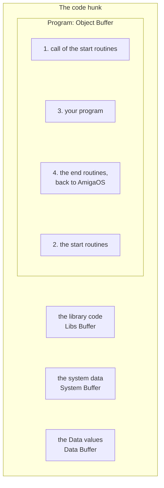

Before this page you should know the kinds of libraries ([Libraries:
acidlibs, deflibs, userlibs]()).

This page follows a program through the compiler. It starts with what you
can see from the outside, the size of the executable and the effect of
the options, and ends with the inner layout, for readers who write
libraries.

## Why a small program is several kilobytes

Take this program:

```
a$="Hello"
Print Left$(a$,2)
End
```

Its own code is a few dozen machine instructions, yet the executable is
several kilobytes long. Almost all of it is library code. `Print` brings
its whole library and the libraries that library needs (console output,
the DOS library, floating point for numbers), `Left$` brings the string
library, and the runtime libraries come in for the variables, the memory,
the string handling and the end of the program. Each library is copied
whole, once, however many of its commands you use
([The whole library, not just the command]()).

So the size of an executable grows in steps: a little with every line,
and a lot with the first command of a library you have not used before.

## Make Smallest Code

The compiler works on a block of memory whose parts have fixed sizes,
taken from the compiler options (**Object Buffer**, **Libs Buffer** and
the others). With **Make Smallest Code** on, it compiles the program
twice: the first pass shows how much of each part the program really
needs, the second compiles again into parts of exactly that size. Without
it, the unused space of each part would be in the program as well.
CREATE EXECUTABLE always uses it.

If a part is too small for the program, the compiler stops with the
requester "Not Enough Object Memory Available!" and offers three ways
on: make the buffers larger and compile again, use the smallest sizes and
compile again, or cancel.

## What runtime error checking adds

With the option **Runtime Error Debugger** on, the compiler adds three
things to the program:

* **A check point before every statement.** It tells the runtime which
  line and statement is running, so that an error can be reported at the
  right place. It costs a few bytes and an exception on every statement,
  which makes the program noticeably slower.
* **The libraries' check routines.** Each library has an area with checks
  of its arguments (an index out of range, an object that does not exist).
  Without runtime error checking that area is cut off when the library is
  copied; with it, it is copied and called around every command.
* **The runtime error libraries.** Run from the editor, the program gets
  the connection to the debugger; as an executable it gets a small handler
  that shows the error in a requester and ends the program.

The check points contain addresses of the source lines in the editor's
memory. So two executables compiled from the same source with runtime
error checking on are usually not identical byte for byte; without it,
they are.


Try it: compile the program above with CREATE EXECUTABLE twice, once
with **Runtime Error Debugger** on and once with it off, and compare the
two file sizes in the Shell with `List`.


## The layout of the executable

An executable of blitz2 has exactly one hunk, a code hunk, with
everything in it: your program, the libraries and the data. It is the
compiler's block of memory written out as it is, part after part, so its
layout follows the buffers of the compiler options:



The libraries lie in the order of their first use; the system data
holds the string literals and tables, and the last part the values of
the `Data` statements. The numbers give the order in which the parts of
the program part run. The program starts
at the top of the hunk with a call of the start routines, which come
back to your first line. When your program ends, at its last line or at
an `End` anywhere, it goes on with the end routines, which return to
AmigaOS. If no library in the program has a start routine, the call is
left out and the hunk starts with your first line.

Around the hunk the file has what AmigaOS needs to load it: the header
in front, and behind the code the table of every place that holds an
address, which AmigaOS corrects when it loads the program. With the
option **Create Debug Info for Executable Files** on, the names of the
labels follow as symbols for a debugger. In AB3 mode the directives
`BSS` and `Chip` can add a hunk of their own each
([Directives]()).

## One pass, one block, one hunk

{}

**One pass.** The compiler reads the source once, from top to bottom, and
writes machine code as it goes. A label that is used before it is defined
is remembered and filled in when the definition comes. There is no
optimiser across statements.

**One block of memory.** The compiler divides one block of memory into
four parts, each with its own write position:

| Part | Holds | Size from the option |
|---|---|---|
| program | the code of your statements | Object Buffer |
| libraries | the copied library code | Libs Buffer |
| system data | string literals, tables | System Buffer |
| data | the values of `Data` statements | Data Buffer |

Every address in this code is an absolute address inside the block, and
the compiler keeps a list of all places that hold one. That is why RUN
can start the program right in the block, and why writing an executable
is simple: the compiler turns each listed address into an offset from the
start and writes the list as the relocation table of the file.

**One code hunk.** There is no data or BSS hunk. Variables and the string work area are
allocated when the program starts: the first start routine to run is the
one of the variables library, which allocates the memory for all global
variables and points register a5 into it. Global variables are then
addressed relative to a5, the local variables of a procedure relative to
a4, and a3 points into the string work area while strings are built.

**Start and end.** The start routines run in descending order of library
number, the end routines in ascending order. A library whose start
routine returns a value (an AmigaOS library base, a memory pointer) gets
a global variable for it, which its commands use later. `End` in the
middle of a program jumps to the end routines, so the libraries clean up
in every case.

{}
