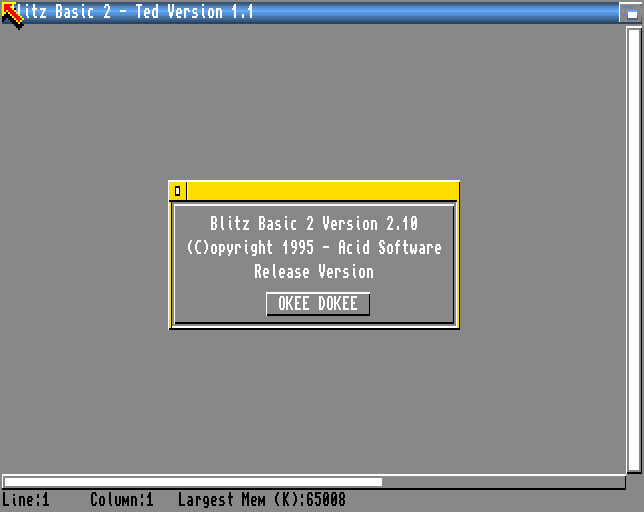

Before this page you should have built the port
([Building the BB2 C port]()).

The files you built are Amiga programs. This page sets up an emulated
Amiga for them: Amiberry with Kickstart and Workbench from Amiga Forever,
the build's `blitz2` directory as a drive, and the first start of blitz2.

{}

* **Kickstart** is the part of AmigaOS in the Amiga's ROM; an emulator
  needs it as a ROM file. **Workbench** is the rest of the system, on a
  disk; an emulator boots it from a *hardfile*, an image of a hard disk.
* A **volume** is a disk by its name, such as `Workbench:` or `RAM:` (a
  disk in memory). An **assign** is a name of your own for a directory:
  after `Assign blitz2: BB2C:` the name `blitz2:` means the volume `BB2C:`.
  Programs of the port find their files through `blitz2:`.
* The **Shell** is the command line of AmigaOS.
* An Amiga **executable** is made of *hunks*, blocks of code and data that
  the system loads; Blitz Basic 2 writes executables with one code hunk.
* A **library** is two different things: an AmigaOS library (such as
  `dos.library`) is part of the system; a Blitz library is a file with
  commands that the compiler copies into programs.

{}

## What you need

* **Amiberry**, the Amiga emulator for Linux, from your distribution or
  [its project page](https://github.com/BlitterStudio/amiberry). The port
  is tested with Amiberry 8.5.
* **Kickstart and Workbench.** They are not part of the port and cannot be
  shipped with it. The route described here uses
  [Amiga Forever 11](https://www.amigaforever.com/) by Cloanto, which
  comes with a licence for them. Its ROM files are encrypted and need the file
  `rom.key` next to them; the setup below copies both.
* The build of the port, for its tool that prepares the hardfile.

The machine used here is an A1200 with Kickstart 3.1 and Workbench 3.1.
blitz2 and its editor also run on Kickstart 1.3; the command line of
blitz2-ab3 needs Kickstart 2.0 or newer.

{}

### Copy Kickstart and Workbench from Amiga Forever

The repository has a script that copies the ROMs and the Workbench
hardfiles from the Amiga Forever medium, or from an installation of it,
checks them, and prepares the hardfiles for use without Amiga Forever's
own emulator. Give it the directory that contains `Amiga Files` and a
directory of your own for the results:

```
cmake -DAMIGA_FOREVER=/run/media/$USER/AmigaForever -DDEST=$HOME/amiga \
      -P cmake/setup-amiga-forever.cmake
```

It accepts only the files of Amiga Forever 11 and checks every file it
writes. The ones used here are `amiga-os-310-a1200.rom` with `rom.key`,
and `workbench-311.hdf`.

### Configure Amiberry

Make a new configuration in Amiberry: an A1200 with the Kickstart ROM
`amiga-os-310-a1200.rom`, the hardfile `workbench-311.hdf` as the first
hard drive, and the build's `blitz2` directory as a second drive with the
volume name `BB2C`. The hardfile is the bare partition, without a disk
header, so Amiberry needs its geometry: 32 sectors, 1 surface, 2 reserved
blocks, blocks of 512 bytes.

In the saved configuration file, these are the lines that matter (with
your own paths); everything else can stay as Amiberry's A1200 settings
have it:

```
chipset=aga
chipset_compatible=A1200
cpu_model=68020
kickstart_rom_file=/home/you/amiga/amiga-os-310-a1200.rom
hardfile2=rw,DH0:/home/you/amiga/workbench-311.hdf,32,1,2,512,0,,uae0
uaehf0=hdf,rw,DH0:/home/you/amiga/workbench-311.hdf,32,1,2,512,0,,uae0
filesystem2=rw,DH1:BB2C:/home/you/bb2-c/build/amiga/blitz2,0
uaehf1=dir,rw,DH1:BB2C:/home/you/bb2-c/build/amiga/blitz2,0
```

Since the drive `BB2C:` is the build directory itself, a new build is in
the emulator at once.

### Start the Amiga and open a Shell

Start the configuration. Workbench 3.1 boots; open a Shell from the
Workbench.

### Start blitz2

In the Shell:

```
Assign blitz2: BB2C:
blitz2:blitz2
```

blitz2 loads its editor and libraries and shows its version requester:



Click **OKEE DOKEE**, and the editor is ready.

{}

To have `blitz2:` after every start, put the `Assign` line into the file
`S:User-Startup` of the Workbench.

## The debugger module

blitz2 also looks for a debugger module, `blitz2:defaultdbug`, a program
that shows runtime errors of a program run from the editor and lets you
look at it. The build does not make it, and blitz2 runs without it; but
then a program run from the editor with runtime error checking on stops at
its first runtime error without any message.

You can build the module with the port itself, from its Blitz Basic
source in the archive of the original sources:

{}

### Fetch the original sources

On the host, in the repository:

```
cmake -P cmake/fetch-originals.cmake
```

The source is then `archive/aminet/amibl2src/bblibsrc/dhandler.bb2`,
with its `.xtra` file.

### Compile it in the emulator

Make that directory visible in the emulator, for example as a third drive
`ORIG:`, and compile the source into the `blitz2` directory:

```
Cd ORIG:
blitz2:blitz2-ab3 -s dhandler.bb2 -e blitz2:defaultdbug
```

{}

The next start of blitz2 loads it. LOAD DEBUG MODULE in the editor's
COMPILER menu loads a module from another place, also while blitz2 runs.

## If it does not start

* **The screen stays black, or Amiberry reports an unknown ROM:** the
  encrypted ROM needs `rom.key` in the same directory. The setup script
  puts it there; keep the two together when you move them.
* **A requester says the volume Workbench is write-protected:** the
  hardfile is mounted read-only. Set it to writable (`rw`) in the
  configuration.
* **`blitz2:` is not known:** the `Assign` was not made in this Shell or
  since the last start, or the drive is not called `BB2C`.
* **blitz2-ab3 from the Shell does nothing useful on an old machine:**
  its command line needs Kickstart 2.0 or newer.
