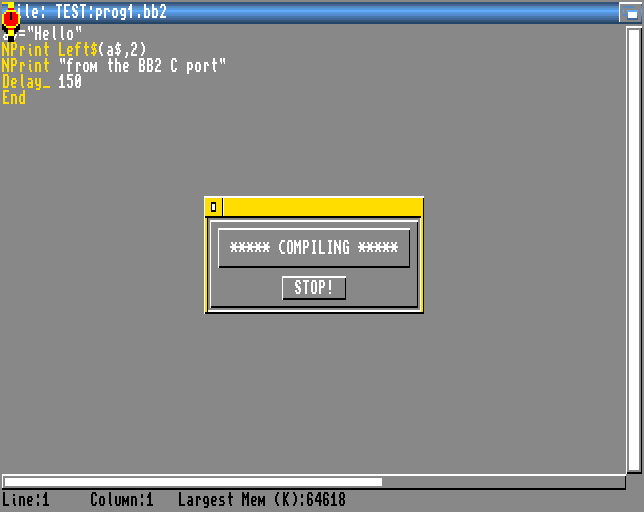
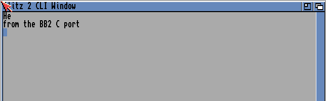
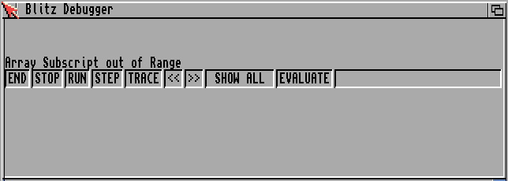

Before this page you should have blitz2 running in the emulator, with its
editor on the screen
([Running it in an emulator]()).

This page writes a small program in the editor, runs it, saves it and
makes an executable of it, and then compiles a text file from the Shell
without the editor.

## Typing a program

The editor works like most text editors: type, move the cursor with the
cursor keys, delete with Backspace and Del. **Return** opens a new line
below the cursor line; it does not split the line at the cursor. When you
leave a line, the editor turns its keywords and commands into tokens and
shows them in another colour
([Tokenised sources]()
explains why).

Type this program:

```
a$="Hello"
NPrint Left$(a$,2)
NPrint "from the BB2 C port"
Delay_ 150
End
```

`NPrint` prints its arguments and a line end, and `Left$` takes the first
characters of a string. `Delay_` is a call of AmigaOS: it waits 150
ticks, three seconds, so that the output stays on the screen long enough
to read it.


Put the cursor on `NPrint` and press the **HELP** key: the screen's title
bar shows the command with its arguments, `NPrint Expression[,Expression...]`.
That works for every command of every loaded library, and it is the
quickest way to look one up.


## Running it

Choose **COMPILE AND RUN** in the COMPILER menu, or press the right Amiga
key with **X**. blitz2 compiles the program, with a small requester that
shows `COMPILING` and a STOP button:



Then the program runs. Its output appears in a window of its own, the
"Blitz 2 CLI Window":



When the program ends, the window closes and you are back in the
editor.

If the program has an error, the compiler shows the message in a
requester and puts the cursor on the line with the error. It reports one
error at a time.

### Runtime error checking

The compiler options have runtime error checking on by default: the
program is compiled with checks that stop it at errors such as an array
index out of range. What happens then depends on the debugger module
([The debugger module]()):

* **With the debugger module**, the program stops and the debugger shows
  the error:

  

* **Without it**, the program simply ends at the error, without a message.

Change the option in **COMPILER OPTIONS**, the switch **Runtime Error
Debugger**, or build the debugger module as described on the previous
page.

## Saving and loading

The PROJECT menu has the file commands:

| Item | Key | What it does |
|---|---|---|
| NEW | | Clears the editor for a new program. |
| LOAD | Amiga-L | Loads a source with the file requester. |
| SAVE | Amiga-S | Saves the source; the file requester asks for the name. |
| QUIT | Amiga-Q | Leaves the editor and blitz2; with unsaved changes, a requester asks first. |

Saving a source also writes a second file next to it, with `.xtra`
appended to its name. It holds the compiler options of this source
([Residents and the .xtra file]()).

## Making an executable

Choose **CREATE EXECUTABLE** in the COMPILER menu (Amiga-**E**). A file
requester asks for the name of the executable, blitz2 compiles the
program into it, and you can start it from the Shell like any other
program.

The whole COMPILER menu is described in
[The editor and the compiler]().

## Compiling from the Shell

blitz2-ab3 compiles a source without the editor. The source can be a
text file, written with any editor on your host, in a directory the
emulator shows as a drive. With a file `hello.bb` that holds the lines
`a$="Hello"`, `NPrint Left$(a$,2)` and `End`:

```
1> blitz2:blitz2-ab3 -s hello.bb -e RAM:hello
1> RAM:hello
He
```

The text is tokenised when it is loaded, as the editor would do it. A
compile error is printed with the file name and the line:

```
1> blitz2:blitz2-ab3 -s broken.bb -e RAM:broken
broken.bb:2: Syntax Error
```

The return code is 0 when the program compiled, 10 for a compile error
and 20 for wrong options, so it can be used in scripts. Two things are
needed for this: Kickstart 2.0 or newer, and the program `ab3cli` in the
same directory as blitz2-ab3, as it is in the build's `blitz2` directory.
The options are described in
[Compiling from the command line]().


Try it: run the program from the editor, save it, quit, start blitz2
again and load it; make an executable and start it from the Shell; then
break a line on purpose and read the error.


## Learning the language

This site does not teach Blitz Basic itself; the original manual of Blitz
Basic 2 is not part of the project. The commands of the libraries and
their arguments can be looked up with the HELP key and in the
[Libraries]() chapter. The constant
`#__debug`, which tells a program whether it was compiled with runtime
error checking, is the one addition of the port to the language
([Extensions]()).
