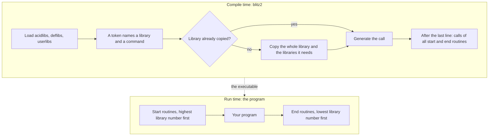

The command reference lists what each library offers. This page explains
what happens to a library when you compile a program: when its code is
copied into the program, what brings in a library you never name, and
when its code runs. The running example is the library for the start
from the Workbench, which has no commands and is still part of many
programs.

The basics are on other pages: the kinds of libraries in
[Libraries: acidlibs, deflibs, userlibs](),
the tokens in
[Tokenised sources](),
and the parts of a library file in
[Anatomy of a Blitz library]().

## Compile time and run time

A library's code is used at two different times. While blitz2 compiles,
it only reads the library: the table of commands tells it how to call a
command, and the code is copied into the program. The copied code runs
later, when the program runs, as part of it.



One exception to this split: in a constant expression, such as the value
of a constant or the condition of `CNIF`, the compiler runs library code
while it compiles, in its own copy of the library. Only libraries marked
as usable in constants may be used there; any other gives the error
"Illegal Constant Expression". Nothing is copied into the program for it, and
no start routine runs.

## What a library declares

A library file starts with a header and a table, followed by its code
([Anatomy of a Blitz library]()
explains every part). For this page four things in it matter:

* **The library number.** It identifies the library. The compiler finds
  a library by its number, and the token of every command contains the
  number of the library it belongs to.
* **The table of commands.** One entry per command, with its argument
  forms. An entry can name *other libraries* whose values the command
  needs, such as the base of an AmigaOS library in register a6.
* **A start routine and an end routine**, both optional. The start
  routine can return a value, which the program keeps in a global
  variable for the library's commands. Both routines can name other
  libraries they need, the same way a command does.
* **The error check area** at the end: the routines that check arguments
  when runtime error checking is on, and their messages.

The library for the Workbench start, wbstartuplib, declares only a
header and its two routines. In the C source of the BB2 C port its table
reads:

```c
BLITZ_SYSLIBHEADER7(LIB_wbstartuplib, 0xbf00, 0xbf01, init, BL_LONGRET, finit,
                    BLITZ_ERROR_AREA);
BLITZ_NULLSUB(0, 0, 0);                         /* $BF00 */
BLITZ_NULLSUB_AT(init, wbstartuplib_codeinit, 0, 0);
BLITZ_NULLSUB_AT(finit, wbstartuplib_codefinit, 0, 0);
BLITZ_LIBFIN();
```

It has the number 65533, a start routine that returns a long value, an
end routine, and one entry without a name and without code, with the
internal number `$BF00`. That entry is the handle the compiler uses to
pull the library in. The whole file is
[the wbstartuplib source](https://github.com/fubar-coder/bb2-c/blob/main/libs/acidlibs/wbstartuplib.c)
on GitHub.

A command library such as stringfunclib (number 185) has a table with an
entry for each of its commands, `Left$`, `Mid$`, `Instr` and the others,
and a start routine without any other library. windowslib (number 138)
also has an end routine, and its start routine names the AmigaOS
libraries graphics and intuition, whose bases it receives in registers
a0 and a1. It manages *objects*, the windows, so its table ends with the
routine that frees one window.

An AmigaOS library in `deflibs`, such as doslib (number 252), is almost
only a table: one entry per AmigaOS function, with its offset and the
registers of its arguments. Its start routine opens `dos.library` and
returns the base, its end routine closes it again.

## How blitz2 finds a library

When blitz2 starts, it loads `acidlibs`, then `deflibs`, then the files
in the directories under `blitz2:userlibs/`, and links them into one list.
It then numbers the commands: the commands of library number *n* get the
tokens from *n*·128+1 on, in the order of the table, and their names go
into the list the editor tokenises with. The libraries without commands
keep the internal numbers written in their file, such as `$BF00` for
wbstartuplib; these numbers have no names, and only the compiler uses
them.

To compile a command, the compiler looks for the library whose range of
tokens holds the command's token, and takes the entry from its table. To
use a library by its number, it takes the first library in the list with
that number. A library that is needed but not loaded stops the compile
with "Library not Found" and the number in hexadecimal.

## When a library is copied into the program

The compiler copies a library into the program at the moment the
program first needs it, in **one piece**: from the start of its code to
its end, or to the start of its error check area if runtime error
checking is off. A second use copies nothing. The libraries lie in the
program in the order of their first use.

A library is needed when one of these happens:

1. **A command of it is compiled.** `Left$` in a line brings in
   stringfunclib.
2. **A command names it.** A command whose entry names other libraries
   brings those in as well. `Par$`, for example, names wbstartuplib,
   whose value it reads.
3. **Another library's start or end routine names it.** When
   windowslib is copied, the compiler immediately copies the AmigaOS
   libraries graphics and intuition, which its start routine names.
4. **Another library's code calls one of its routines.** Such calls are
   marked in the library's code. When the compiler copies that code, it
   brings in the library that holds the routine, and fills in the
   address at the end of the compile. The print library, which `Print`
   belongs to, calls the library for console input and output this way.
5. **A library keeps a value or manages objects.** Its global variable
   is created by the variables library, the object table by the library
   for object maximums and the memory library, so these come along.
6. **The compiler itself calls it.** Assigning strings, multiplying long
   integers, `Read` and `Data`, `End`, runtime error checking: for each
   of these the compiler generates a call into a library without
   commands, which brings that library in.

Nothing is in a program just because blitz2 has loaded it. A library
that none of these asks for stays out, and an AmigaOS library is opened
only by a program that uses it, directly or through another library.

Every pass of a compile starts with no library in use, so the second
pass of **Make Smallest Code** copies the libraries afresh, in the same
order.

## What pulls in wbstartuplib

wbstartuplib has no commands, so you never write its name. It comes into
a program in exactly two ways:

* **The statement `WBStartup`.** This word of the compiler asks for the
  entry `$BF00`, which has no code. So `WBStartup` generates no code at
  all: its only effect is that wbstartuplib is copied into the program,
  and with it the library's start and end routines.
* **A command that names it.** The four commands of cliargslib,
  `NumPars`, `Par$`, `FromCLI` and `ParPath$`, read the list of arguments
  that wbstartuplib's start routine prepares, so each of them brings
  wbstartuplib in.

Because the library's start routine runs before the program, it does
not matter where `WBStartup` stands in the source; the first line is
the usual place.

```
WBStartup                     ; the program can be started from the Workbench
NPrint "Started with ",NumPars," arguments"
```

A program started from the Workbench gets a message from the Workbench
and must answer it when it ends. wbstartuplib's start routine takes that
message, makes the program's drawer the current directory and collects
the icons given with the program; its end routine answers the message.
A program without wbstartuplib leaves the message unanswered; the
original documentation warns that such a program crashes when it is
started from the Workbench. A program that uses one of the commands of
cliargslib has the library anyway and needs no `WBStartup`.

wbstartuplib's start routine returns a long value, the address of the
argument list. The program keeps it in a global variable, so the
library also brings in the variables library, which holds all global
variables.

## When start and end routines run

After the last line, the compiler writes one call to the start routine
of every library in the program, and one to every end routine. They run:

* **Start routines** before the first line of your program, **highest
  library number first**.
* **End routines** after the last line, or when the program stops with
  `End` anywhere, **lowest library number first**. Before the end
  routine of a library with objects, the program frees every object of
  it that is still in use, for example closes every open window.

The library numbers make this order. Most runtime libraries, the ones
the compiler calls by itself, have the highest numbers (64040 to 65534),
almost all AmigaOS libraries of `deflibs` come next (200 to 255), and
the command libraries have the lowest. For a program that uses `WBStartup`, `Left$` and a window,
the order is this:

| Library | Number | Start (top first) | End (top first) |
|---|---|---|---|
| windowslib | 138 | 6. message port for the windows | 1. close the open windows, free the port |
| stringfunclib | 185 | 5. its start routine | (none) |
| graphics library | 254 | 4. open `graphics.library` | 2. close it |
| intuition library | 255 | 3. open `intuition.library` | 3. close it |
| wbstartuplib | 65533 | 2. take the arguments, the Workbench message | 4. free the arguments, answer the message |
| variables library | 65534 | 1. allocate the global variables | 5. free them |

The table shows only these libraries; a real program has more in
between, such as the memory library and the libraries of the commands
`Window` itself names. Their place follows the same rule.

So the variables library runs first, because every other start routine
stores its value in a global variable. wbstartuplib runs next, before
any command library, so the current directory of a program started from
the Workbench is set before any of your commands runs. The AmigaOS
libraries are open before the command libraries whose start routines
use them, and they are closed after those libraries have cleaned up.

If no library in the program has a start routine, the program starts
directly with its first line.

## The AmigaOS libraries

An AmigaOS function such as `Delay_` or `Open_` is not copied into the
program: the compiler generates the call itself, with the base of the
AmigaOS library from the global variable of its `deflibs` library. That
use brings the `deflibs` library in, so its start routine opens the
AmigaOS library when the program starts and its end routine closes it
when the program ends. Of a library like doslib, only these two routines
end up in the program.

The same happens when a command library needs an AmigaOS library: the
library for console input and output, which `Print` uses, names the DOS
library in its start routine. That is why a program can open
`dos.library` without a single call ending in an underscore.

If an AmigaOS library cannot be opened, its start routine returns 0 and
the program runs on; only a call of that library then crashes. A program
that can do without an optional library checks for it itself before it
uses its functions
([Fixed original bugs]()).

## In AB3 mode

In AB3 mode blitz2-ab3 loads AmiBlitz3's four library files and its
userlibs instead of `acidlibs` and `deflibs`, and a userlib replaces a
loaded library with the same number
([Libraries, tokens and includes]()).
Everything on this page from the token on works the same way: the
libraries are copied whole on their first use, with the libraries they
name, and their start and end routines run in the same order of library
numbers. Which libraries exist, and what their routines do, are
AmiBlitz3's.

## Going further

* [From source to executable]()
  shows where the calls of the start and end routines lie in the
  executable, and what runtime error checking adds.
* [Libraries in C]()
  and [Writing your own userlib]()
  show how to declare a start routine, an end routine and the libraries
  a command needs in a library of your own.

The warning about programs without `WBStartup` is from the Blitz Basic 2
documentation by Acid Software.
