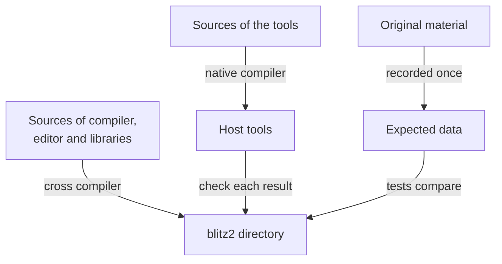

This chapter is the map of the repository: what its parts are, how one
build makes both the Amiga programs and the tools that check them, how
the tests compare the port with the original, and which original
material the project uses and why most of it is not in the repository.

## One build, two compilers

The repository holds two kinds of programs, and one CMake build makes
both:



* **The Amiga side** is built with the cross compiler for 68000 AmigaOS:
  the compiler, the editor, the libraries, and some small Amiga programs
  the tests use.
* **The host side** is built with the normal compiler of your machine: the
  tools that join, read and check library files and executables, the
  emulator runner, and the host tests. The Amiga build needs these tools,
  so it builds the host side first, as a project of its own inside its
  build directory.

## The original material

The project relies on original material in three ways:

* **The sources of Blitz Basic 2 and TED** are in the repository,
  unchanged: the compiler's source of version 1.95 and the editor's source
  of TED 1.1, from the archive of the original sources on Aminet. Acid
  Software released them under the GNU licence; that is where the GPL of
  the port comes from.
* **The Blitz Basic 2.1 CD and the rest of the Aminet archive** are not in
  the repository, because the licence of much of their content, above all
  third-party contributions, is unclear. One command downloads them for
  the tests, checks them by their checksums and unpacks them:

  ```
  cmake -P cmake/fetch-originals.cmake
  ```

  The tests compare the port with expected data recorded from these
  originals, so only the runs that compare with the originals
  themselves, the recording of expected data, a few tests and some
  optional build targets need them; the build of the port does not.
* **Some files of AmiBlitz3** (Apache licence) are downloaded the same way,
  for the tests of AB3 mode.

What each downloaded part is, where it comes from and what is known about
its licence is listed in the repository's
[description of the originals](https://github.com/fubar-coder/bb2-c/blob/main/archive/README.md).


  
  
  
  
  

