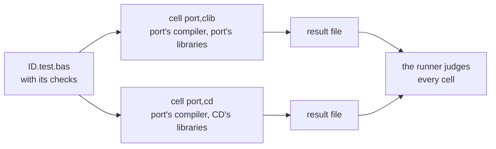

Before this page you should know how the tests are run and what the
presets are ([Tests]()).


To run one test or one of its cases, directly or with CTest, see
[Running a single test](). Every macro of
the test library testlib that a test source can use is described in
[The test library]().


Most emulator tests compare what a program prints with a file of
expected output. A *test that judges itself* works the other way round:
the Blitz Basic program checks its results with the port's test library,
the user library **testlib** (user library 81, the file `testlib.obj`)
and its macros in `shared/basictest/macros.bas`, and the expected values
are written in the program itself. A
configuration file next to it says how the program is run, with which
compiler and which libraries, and what else the run must show. This
page explains how such a test is written and every setting of its
configuration.

## What such a test is

A test is a source file `ID.test.bas`. `ID` is the test's name, in lower
case with `-` between words, for example `stringfunclib-mid-overflow`.
The source holds one or more *cases*: blocks of code with checks in them.

```basic
!TestCase{sizes}
  w.l=16
  !CheckEq{w,16,"width"}
!EndTestCase
```

`!CheckEq{w,16,"width"}` is a check: it compares the value of `w` with
16, and the last argument gives the check a name. When the program
runs, the test library writes one line per check into a result file, and
the test runner on your machine reads that file after the run. So the
runner knows which checks passed, which failed, and the actual value of
each failed one.

The same source can be run in several ways: compiled by the port's
compiler or by an original one, linked with the port's libraries or the
original libraries from the Blitz Basic 2.1 CD, with or without runtime
error checking. Each such combination is a *cell*. The configuration
decides which cells a test has. A test with the port's compiler and both
library sets has two cells, for instance:



The build registers the tests by itself: it finds every `ID.test.bas`
in the test directories, reads its configuration and registers one
CTest test per case and *side*. A side is a group of cells: the cells
that need original material (an original compiler, or the CD's
libraries) form the side `originals`, all others the side `port`. A
case of a test therefore becomes at most two CTest tests, named like
this:

| CTest name | Cells | Run by the preset |
|---|---|---|
| `blitz2_ID__CASE` | those without original material | `all` |
| `blitz2_ID__CASE_originals` | those with an original compiler or the CD's libraries | `originals` |

The name begins with the directory's prefix (`blitz2_`, `bug_orig_` or
`regression_`, below), `-` in the test's name becomes `_`, and two
underscores separate it from the case. A test of an original bug that
is not fixed yet runs in the preset `bug-orig` instead of `all`.

## The configuration files

The configuration of a test comes from two kinds of files, both in a
small subset of [TOML](https://toml.io/):

* **The test's own file**, `ID.test.toml`, next to `ID.test.bas`. It is
  optional and holds what only this test needs.
* **The directory files**, `tests.toml`, one per directory at most. A
  directory file applies to every test in its directory and in the
  directories below it.

To find a test's configuration, the build starts with the test's own
file, then reads the `tests.toml` of the test's directory, then that of
the directory above, and so on, until it reaches a `tests.toml` with the
line `root = true`. The repository has that file at `tests/tests.toml`;
it holds only `root = true`. A test with no such file above it is
refused.


  
    
    
      
        
        
        
      
    
  


The files combine key by key, and **the nearest file wins**: a key set
in the test's own file beats the same key in a `tests.toml`, and a key
in `bug-orig/libs/tests.toml` beats the same key in a file further up.
A key that no file sets has its default. The tables (the matrix, the
assertions, the deviations, all below) combine the same way, one key of
the table at a time. A list is one value: a nearer list replaces a list
from further up, it never adds to it.

So a directory file can give all its tests a time limit, and one test
can change it for itself:

```toml
# tests/bug-orig/libs/tests.toml
timeout = 90
```

```toml
# tests/bug-orig/libs/slow-load.test.toml
timeout = 180
```

### The format

The files are valid TOML, but only a strict part of it is accepted, so
that every line can be read on its own:

* One `KEY = VALUE` per line. A key is a bare word of letters, digits,
  `-` and `_`, or a quoted string. A key that contains a dot must be
  quoted: `"end.case" = "exists"`.
* A value is a string, a whole number, `true` or `false`, or a list of
  strings on one line. A string is written `"..."`, with the escapes
  `\"`, `\\`, `\t`, `\n` and `\r`, or `'...'` without escapes. A number is
  written in decimal without leading zeros; where a list holds numbers,
  they are written as strings (`["60", "120"]`).
* A table begins with a header line `[NAME]` or `[NAME."SELECTOR"]`; the
  keys below it belong to it, up to the next header.
* `#` starts a comment, also at the end of a line.

Everything else of TOML is refused: dotted keys, lists over several
lines, inline tables, multi-line strings, decimal fractions, dates. The
message names the file, the line and the reason. Some examples, with the path shortened (each message is one
line; the long ones are wrapped here):

```
.../slow-load.test.toml:3: dotted keys are not part of the subset
    (one key per line, tables by their header)
.../slow-load.test.toml:1: "1.5" is no value of the subset
    (string, integer, boolean or a list of strings)
.../slow-load.test.toml:2: libs must be one of cd|clib, not "cdx"
.../slow-load.test.toml:1: unknown key tiemout
```

The build reads and checks every file before it registers the tests,
so a mistake fails the build with such a message, before any test runs.

## What to run

These keys choose the programs and the machine a cell uses. Each may
also be an *axis* of the matrix (below), so that a test runs with
several of its values.

**`compiler`** is the compiler that compiles the test: `port` for the
port's compiler (the default), `orig195` for Blitz Basic 2 version 1.95
built from the original source, or `orig210` for the version 2.10
compiler of the CD.

**`libs`** is the set of libraries the program is linked with: `clib`
for the port's libraries (the default) or `cd` for the original
libraries of the CD.

**`machine`** is the emulated Amiga: `a1200` (the default, with
Kickstart and Workbench 3.1), `a500`, `a500-68010`, `a500-204` or
`a600`. The older machines are there for bugs that only show on them;
the emulator setup must provide them
([Tests]()).

**`runtime-errors`** switches the compiler's runtime error checking on
or off: `off` (the default) or `on`. A test that expects a runtime error
needs `on`.

**`rwe`** is a list of the RWE user libraries the program needs, by
their names, for example `rwe = ["rireqlib"]`. The port's compiler and
version 1.95 get the C build of these libraries, version 2.10 gets the
original build.

```toml
compiler = "orig210"
libs = "cd"
machine = "a500"
runtime-errors = "on"
```

Without any of these keys, a test runs once: the port's compiler with
the port's libraries on the A1200, without runtime error checking.

## How to run it

These keys change the emulator session and what the program finds in
it. Most tests need none of them.

**`timeout`** is the time limit of an emulator session in seconds. The
build's default is 90 seconds. The CTest test gets a limit made from
the time limits of its cells, plus a margin.

**`hang-after`** ends a session as a hang when the program has been
silent for this many seconds, counted from the start of the program.
The build's default is 8 seconds, so that a program that hangs does not
wait for the whole time limit. A test whose program is slow on purpose
raises it: `hang-after = 60`.

**`stack`** is the stack size, in bytes, of the compiler and the
program.

**`serial`**, `off` (the default) or `on`, connects a remote end to the
emulated serial port that answers the program with canned replies, for
the tests of the serial commands.

**`rtg`**, `off` or `on`, uses the variant of the emulator with a
graphics card, for screens larger than the native modes.

**`pad`**, `off` or `on`, starts the program through the helper `inject`,
which puts 64 zeroed bytes behind every memory block the program
allocates and reports a write behind a block. It cannot be combined
with `runwrap`.

**`isolate`** gives cells an emulator session of their own. Normally the
runner runs all cells of a side whose session settings agree in one
session, one after the other. `isolate = "on"` gives every cell its own
session; a list of cell selectors (below), such as
`isolate = ["libs=cd"]`, only the cells it names. When the runner runs
all cases of a source together, every case of such a cell runs on its
own as well. It is a way around a test that disturbs, or is disturbed
by, what runs before it in the same session. Unlike the keys above,
`isolate` cannot be an axis.

**`wrap`** and **`runwrap`** start the compiler (`wrap`) or the compiled
program (`runwrap`) through a helper program: `PATH` or `PATH|OPTIONS`,
where the text after the `|` is passed to the helper. The test helpers
are given by placeholders (below), for example
`runwrap = "@INJECT@|guard"` or `runwrap = "@WBRUN@"`, which starts the
program the way the Workbench does.

**`runargs`** are the arguments of the program, as on the command line.
**`launcherargs`** are options of the small launcher that starts the
program and watches its requesters.

**`editor-run`**, `off` (the default) or `on`, runs the program from the
editor, as its COMPILE/RUN does, instead of from the shell. The compiler
then starts the program itself, and the runtime error checking also goes
through the debugger. The test is compiled as in any other
cell and its result file is judged the same way; what the program prints
is what it wrote to the editor's console. The exit code and the
requesters of such a run are not captured, so in its cells the queries
`rc` and `requester` have no default and must not be asserted, and the
keys of the shell start (`runwrap`, `runargs`, `launcherargs`,
`pad = "on"`) are refused there, as is an `!ExpectError` anywhere in the
test.

**`defaultdbug`** is the path of the debugger module such a run uses,
the file `blitz2:defaultdbug`; `@CD_BLITZ2@/DEFAULTDBUG` is the CD's.
Without it, the cells with original material get the CD's module and
the others none; when the module is missing (no CD), the side is
skipped. The key is refused without `editor-run = "on"`.

**`files`** is a list of files to copy into the session before the run,
each `DEST|SRC`: the file `SRC` on your machine becomes `CORPUS:DEST`
in the emulator, the volume the program runs in. A third part,
`DEST|SRC|SELECTOR`, copies the file only into the cells the cell
selector names. **`dirs`** is a list of empty directories to create
there, **`remove`** a list of files to delete after the copying.

```toml
files = ["data/song.mod|@TESTDATA@/mymod-song.mod"]
dirs = ["empty"]
```

**`mount`** is a list of read-only volumes, `NAME|DIR`: the directory
`DIR` on your machine appears as the volume `NAME:`. **`floppy`** puts
disk images into the drives, `N|SRC` for drive `DFN:`; a session with a
floppy starts with a cold boot.

**`uae`** is a list of changes of the emulator's configuration, each
`KEY=VALUE` in Amiberry's own terms, for example a CD image for the
emulated SCSI device. **`jobline`** is a list of extra lines for the job
list of the small program that drives the compiler in the emulator, as
TED does: they set options of the compile such as the size of the macro
buffer or the maximum of a library's objects (`"macrobuf=128"`).

A line of `jobline` can also add a *job* of its own: `job=` compiles a
source, `run=` compiles and runs one as the editor's COMPILE/RUN does,
`menu=` chooses an item of the compiler's menu and `resident=` compiles a
source into a resident file. The first field behind the `=` is the job's name, which
the assertions use (`compile.NAME`, `compile.log.NAME`, below). It
consists of lower-case letters, digits and `_`, starts with a letter,
has at most 15 characters and appears once in the list. The runner keeps
some names for itself: `j000` is the compile of the test, `b` followed
by three digits is the compile of a data source, `r001` the run from the
editor of a cell with `editor-run = "on"`, and `log` and `inject` are
taken by queries.

Two placeholders stand only in an element of `jobline`: `@DRIVER@` is
the test's own program as the runner wrote it, so that a job can compile
it again, and `@DATA:FILE@` is the Blitz Basic source `FILE` of the
test's own data (below), ready for the compiler:

```toml
# an example, not a file of the tree
jobline = ["progress=on", "job=j001|@DRIVER@|CORPUS:out/again"]
```

A path in `files`, `mount`, `floppy`, `wrap`, `runwrap` or `defaultdbug`
that is relative is taken from the directory of the file that sets it;
an absolute path, or an Amiga path with a `:`, stays as it is.

### Placeholders

A string may contain a placeholder `@NAME@`, which the build replaces
with a path of its own. The ones the tests use most:

| Placeholder | What it is |
|---|---|
| `@TESTDATA@` | the directory of the test data the build generates (sounds, pictures, modules) |
| `@INJECT@` | the helper `inject`: memory checks behind allocations, simulated clicks and key presses |
| `@WBRUN@`, `@WBRUNT@` | the helper that starts a program as the Workbench does (`@WBRUNT@` with a time limit of 5 seconds for its reply) |
| `@USERLIB@` | a small user library for the tests of the compiler |
| `@REQLIB@` | the real `req.library`, from the downloaded original material |
| `@CD@`, `@CD_BLITZ2@` | the Blitz Basic 2.1 CD, and its directory `BLITZ2` |
| `@ANCIENT@` | real data files of the downloaded original material |

An unknown placeholder is an error with the file and line. In the
test's source, `@TESTDATA@` stands for `CORPUS:data`, where the files of
`files = ["data/NAME|@TESTDATA@/NAME"]` arrive, and `@TESTDIR@` for
`CORPUS:ID.test`, where the test's own data arrive.

## Data of a test

A test can bring its own files: the directory `ID.test/` next to
`ID.test.bas`. Its own file declares every file of that directory in the
table `[data]`, by its path inside `ID.test/` (subdirectories are
allowed, `..`, `:` and absolute paths are not), with the action that
builds it:

| Action | The file | What the cell gets |
|---|---|---|
| `basic-compile` | `NAME.bas`, a Blitz Basic source | the program `CORPUS:ID.test/NAME`, compiled in the cell's session before the test |
| `copy` | any file | the file as it is |
| `mktestdata` | `NAME.spec` | the file `NAME`, made on your machine by the test data generator |

Each cell finds the built files under `CORPUS:ID.test/`, the
placeholder `@TESTDIR@`, before its program starts. The short form
`"FILE" = "ACTION"` takes the action with its defaults; a table
`[data."FILE"]` sets the action and its options, one per line. A source
of `basic-compile` is compiled with the cell's compiler, libraries and
runtime error checking unless its options `compiler`, `libs` or
`runtime-errors` say otherwise (their default `same` is the cell's
value). It gets the placeholders of a test source, but it is a plain
program: it has no checks.

```toml
# an example, not a file of the tree
[data]
"input.txt" = "copy"

[data."child.bas"]
action = "basic-compile"
runtime-errors = "on"
```

A file of `ID.test/` that the table does not declare, a declared file
that is missing, an unknown action or option, and an option that needs
original material (a compiler other than `port`, or `libs = "cd"`) in a
test with a cell of the side `port` are errors of the build. The data
belong to one test, so the table is refused in a `tests.toml`. A
changed, added or removed file of `ID.test/` registers the test again
in the next build.

The compile of each data source is the query `data.FILE` (below). It
must succeed by default: when it does not and no assertion asks for that
result, the cases of the cell are broken, and the report names the line
of the data source and the compiler's message.

## Registering in CTest

Three keys do not change the run, only the CTest tests the build
registers:

* **`labels`**, a list: further CTest labels, besides `emulator`,
  `originals` and `bug-orig`, which the build gives by itself.
* **`fixtures`**, a list: CTest fixtures the tests require, so that
  CTest runs the fixture's setup first.
* **`cost`**, a number: the CTest cost, which makes CTest start a long
  test earlier.
* **`flaky`**, a text, only in a test's own file: what is known of a
  test that fails in full runs but passes when it runs alone. Say in
  which cell and run it failed and how, what the test does about it and
  whether the cause is known. The CTest tests get the label `flaky`, so
  `ctest -L flaky` finds them; the verdict does not change. A way around
  the failure, such as `isolate`, is set with its own key.

```toml
labels = ["libs"]
cost = 3
```

## Several cells: the matrix

The table `[matrix]` turns settings into axes. Each key is a setting,
each value the list of values to run, as strings. The cells are every
combination of the values:

```toml
[matrix]
compiler = ["port", "orig195"]
libs = ["cd", "clib"]
```

These are four cells: `port,cd`, `port,clib`, `orig195,cd` and
`orig195,clib`. A cell is named by its values, separated by commas, in
the order of the keys in the [overview](#all-keys-at-a-glance) below. A
test without axes has one cell, `default`.

Any setting of the sections above that holds one value can be an axis:
`compiler`, `libs`, `machine`, `runtime-errors`, `timeout`, `stack`,
`wrap`, `editor-run` and so on. A list setting (`rwe`, `files`, `mount`,
...) cannot, and neither can `isolate`, the keys for CTest or the keys
of the next sections.

**`exclude`** removes cells from the product. It is a list of *cell
selectors*. A selector is one or more `KEY=VALUE` terms joined by
commas, without blanks, and names every cell whose setting `KEY` has
the value `VALUE`, for every term. Here the compiler 1.95 with the
port's libraries is left out, which leaves three cells:

```toml
exclude = ["compiler=orig195,libs=clib"]

[matrix]
compiler = ["port", "orig195"]
libs = ["cd", "clib"]          # cells: port,cd  port,clib  orig195,cd
```

The rule "the nearest file wins" also holds between a setting and an
axis. If a directory file makes `libs` an axis and a test's own file
sets `libs = "clib"`, that test has no `libs` axis; the other way round,
a test's own `[matrix]` can make an axis of a setting from a directory
file. Setting a key and making it an axis in the same file is an error.

## Assertions: what else a run must show

The checks in the source judge what the program can see itself. What it
cannot see, such as its own exit code or a requester, the configuration
judges with *assertions*. An assertion is a key in the table
`[asserts]`: the key is the *query*, what is looked at, and the value
the *predicate*, what must hold for it.

```toml
[asserts]
rc = "== 20"
output = "contains \"done\""
```

Without assertions, every cell must meet these defaults:

```toml
[asserts]
rc = "== 0"                   # the program ends with exit code 0
requester = "count == 0"      # it shows no requester
"end.case" = "exists"         # the case ran to its end
"end.run" = "exists"          # the program ran to its end
```

and every check in the source that ran must have passed. An assertion
in a file replaces the default of its query only; a test that ends with
exit code 20 on purpose sets `rc = "== 20"` and keeps the rest. In a
cell that runs the program from the editor (`editor-run = "on"`), `rc`
and `requester` have no default. The compile of the test and of each of
its data sources must succeed by default, and every program a case
started with `!RunProgram` must have returned.

The queries:

| Query | What it looks at | Predicates |
|---|---|---|
| `rc` | the program's exit code | a comparison with a number, `exists` |
| `requester` | the requesters the program showed, apart from the runtime errors the case announced; only the first line of each text (below) | `contains`, `matches`, `exists`, `count` |
| `compile` | the compiler's result for the test: `ok`, `error LINE MESSAGE` or `none` | `==`, `!=`, `contains`, `matches` |
| `compile.log` | what the compiler wrote, then the log of the program that drives it | `==`, `!=` a string, `contains`, `matches`, `exists` |
| `compile.log.JOB` | the part of that log that belongs to the job `JOB` | as `compile.log` |
| `compile.JOB` | the result of the `job=` or `resident=` job `JOB` of `jobline`, as for `compile`; no default | as `compile` |
| `compile.inject` | the report of the helper `inject` on the compiler, in a cell with `wrap = "@INJECT@"` | as `compile.log` |
| `data.FILE` | the result of the compile of the data source `ID.test/FILE`, as for `compile` | as `compile` |
| `output` | what the program printed | as `compile.log` |
| `serial` | the data the program sent to the serial port | as `compile.log` |
| `inject` | the report of the helper `inject` on the program, in a cell with `pad` or a `runwrap` of `@INJECT@` | as `compile.log` |
| `session` | how the session ended: `done`, `timeout` or `halt` | `==`, `!=` |
| `end.case`, `end.run` | whether the case, the program reached its end | `exists`, `not exists` |
| `check.NS.NAME` | the verdict of a check: `ok`, `fail`, or `not-run` if it never ran; of a named `!ExpectError`: `ok` if its requester came | `==`, `!=` |
| `check.NS.NAME.expected`, `.actual` | the expected and the actual value of that check (of its first failed run, else its first) | a comparison with a number or a string, `contains`, `matches` |
| `run.NS.NAME` | the program the `!RunProgram` named `NAME` started: `done` if it returned, `open` if it hung or crashed, `not-run` | `==`, `!=` |
| `run.NS.NAME.rc` | its return code; no default, since the case checks it itself | a comparison with a number, `exists` |
| `run.NS.NAME.output` | everything it printed, also when it did not return | as `compile.log` |

A predicate is one of:

* a comparison `==`, `!=`, `<`, `<=`, `>` or `>=` with a value: a number
  (`20`, `-1`, or `$7FFFFFFF` in hexadecimal), a string in `"..."`, or
  one of the words `ok`, `fail`, `not-run`, `done`, `open`, `timeout`,
  `halt`, `none`;
* `contains "TEXT"` or `not contains "TEXT"`;
* `matches "PATTERN"`, which holds if a line matches the pattern: `*`
  stands for any characters, `#` for a decimal number, `\c` for the
  character `c` itself;
* `exists` or `not exists`;
* `count` with a comparison, for requesters: `count == 1`.

Inside the TOML string, the quotes of a string value are escaped:
`output = "contains \"done\""`. There is no `and` or `or`: two
conditions are two assertions on two queries, or the alternatives of an
alternative end (below).

The query `requester` sees only the first line of each requester's
text. A requester whose text has several lines ends there for the query;
its further lines, its buttons and the answer given to it are in
`output`. Write a `contains` or `matches` on the first line, or count
the requesters with `count`.

A case that starts a program with `!RunProgram` checks the return code
and the start of the printed text itself. The `run.` queries are for the
rest: a program that is expected to hang, or an output longer than the
1024 bytes the case can see:

```toml
# an example, not a file of the tree
[asserts."case=hang"]
"run.hang.child" = "== open"
"run.hang.child.output" = "contains \"before the hang\""
session = "== timeout"
rc = "not exists"
"end.case" = "not exists"
"end.run" = "not exists"
```

### Several compile jobs

`compile` is the result of the compile of the test itself, `data.FILE`
that of a data source and `compile.JOB` that of a job the test adds with
`jobline`. `compile.log` is the whole log of all of them;
`compile.log.JOB` cuts out the part of one job, so that a test that
judges several jobs writes one assertion per job. `JOB` is the job's
name: `j000` for the test's own compile, `r001` for the run from the
editor, a name from `jobline`, or the file of a data source
(`compile.log.child.bas`). A job that did not run has no part:
`not exists` holds for it. A name that is no job of the test is refused.

```toml
# an example, not a file of the tree
jobline = ["job=j001|@DRIVER@|CORPUS:out/again"]

[asserts]
"compile.j001" = "== ok"
"compile.log.j001" = "contains \"RESULT\tj001\tok\""
```

A check is named by its *namespace* and its name: `NS` is the case it
stands in, the procedure it stands in, `init` for the batch init or
`cleanup` for the batch cleanup (below), and `NAME` is the name given as its
last argument. A check that a configuration names must have a name, and
the build refuses an assertion that names a check the source does not
have. A check named by an assertion is judged by that assertion only,
not by the default "every check passed".

### Assertions for some cells only

A table `[asserts."SELECTOR"]` holds assertions for the cells that the
cell selector names. In this selector, the term `case=NAME` also limits
it to one case:

```toml
[asserts."runtime-errors=off"]
requester = "count == 0"

[asserts."case=out_of_range"]
rc = "== 0"
```

Only one assertion applies to a query in a cell. It is the one from the
nearest file, and within that file the one with the most terms in its
selector. Two different assertions of the same rank are an error that
names both.

## Tests of original bugs: deviations and the fixed issue

The tests in `tests/bug-orig/` show bugs of the original Blitz Basic 2.
Such a test describes the **correct** behaviour in its checks, so the
original fails them. Its own file declares how the original's faulty
part deviates from the correct behaviour, in a table
`[deviations."SELECTOR"]`. The selector names the cells that contain the
faulty part: `libs=cd` for a bug of the original libraries,
`compiler=orig195` for a bug of the original compiler. Each key is an
assertion that replaces the assertion of its query in those cells:

```toml
[deviations."libs=cd"]
"check.mid_overflow.length" = "== fail"                # the check fails ...
"check.mid_overflow.length.actual" = "== $7FFFFFFF"    # ... with this value
```

The first line says that the check fails with the original libraries;
the second says how, so that the test notices if the original does
something else. A deviation applies to every case of the test, unless
its selector has a `case=` term or it names a check of another case.

How the cells are judged depends on whether the bug is fixed in the
port:

* **The bug is open** (the port still has it): every cell must show the
  declared deviation, also the cells without the faulty part. The test
  comes out *reproduced*, and it is registered with the label
  `bug-orig`, so it runs in `ctest --preset bug-orig` and not in `all`.
  If the port's cells no longer show the bug, the test fails: the bug is
  gone, but the configuration does not say it is fixed.
* **The bug is fixed**: the test's own file gets the key
  **`fixed-orig = N`**, where `N` is the number of the bug's issue. Now
  the cells with the faulty part must show the deviation, and all
  others must pass the checks. The test comes out *passed* and runs in
  `all`; its side `originals` keeps checking that the original still
  behaves as declared.

**`fixed = N`** is for a bug that is not in the original, a bug of the
port. A test with `fixed` declares no deviation.

**`extension = N`** is for an extension of the port: behaviour the port
adds where the original refuses or does something else, `N` the number
of the extension's issue. Its deviations declare what the original does
instead, in the cells with the original's part. The test is judged like
one with `fixed-orig`: the cells with that part must show the deviation,
all others must pass the checks, and it runs in `all`. An example is
`tests/bug-orig/libs/shapeslib-loadshape-anim-interleave.test.toml`:

```toml
extension = 1166
exclude = ["compiler=orig195,libs=clib"]
files = ["anim.iff|@TESTDATA@/shapeslib-loadshape-anim-interleave.anim"]

[matrix]
compiler = ["port", "orig195"]
libs = ["cd", "clib"]

[deviations."libs=cd"]
"check.interleave.no_error" = "== fail"   # the original stops with an error
"end.case" = "not exists"                 # ... and ends the program there
```

A test has at most one of `fixed-orig`, `fixed` and `extension`.

A test in `tests/bug-orig/` (outside `regression/`) must declare at
least one deviation. Without one it is reported *broken*, because it
would not show its bug. `fixed-orig` or `extension` without a deviation
is refused, and so is `fixed` with one. An alternative end (below)
counts as a deviation.

`fixed-orig`, `fixed`, `extension`, `flaky`, the deviations, the
alternative ends and the data belong to a single test: they may stand
only in its `ID.test.toml`. `root` may stand only in a `tests.toml`.

### Alternative ends

Some originals do not end the same way every time: whether the faulty
part returns or hangs, crashes or not, depends on what lies in memory.
Such a test declares the possible ends in a table `[ends."SELECTOR"]`
of its own file. It needs a key `reason`, which says why the end
varies; every other key is a named *alternative*, a list of assertions
written as `QUERY PREDICATE`:

```toml
# an example, not a file of the tree
[ends."libs=cd"]
reason = "reads behind the table; returns or hangs by memory"
returns = ["session == done", "rc == 0", "end.case exists", "end.run exists"]
hangs = ["session == timeout", "rc not exists", "end.case not exists", "end.run not exists"]
```

The cells pass that point if one alternative holds completely, and the
report names the one that held, or each alternative with the assertion
that failed. The queries an alternative can use are `session`, `rc`,
`requester`, `end.case`, `end.run`, `output`, `check.NS.NAME` and `run.NS.NAME`; the
queries it names are taken out of the other assertions and the defaults.
An alternative end is a declared deviation: it applies where the
deviations apply, counts for `fixed-orig` and `extension`, and is
refused with `fixed`.

**An original that corrupts memory** (a wild write, a jump into data, a
free of memory it does not own) has no defined end at all: it may crash
with a requester, hang, halt the CPU or return, and the end changes from
run to run. Its test declares the general abnormal end, the built-in
alternative `abnormal = ["any"]`, and nothing else about how the
program ends: no requester text, exit code or end entry of its own.

```toml
# an example, not a file of the tree
[ends."libs=cd"]
reason = "writes behind the string: no defined end"
abnormal = ["any"]
```

The runner expands `any` into four alternatives, for an end before the
end of the case, after it, after the end of the run, and after the end
of the run without the end of the case. Each requires that the session
did not end normally (a crash runs into the time limit, a hang, a halt)
and takes the exit code, the requesters and the end entries out of the
defaults. A check that the crash can hide or the bug can fail is named
behind `any` with `!= ok`, so that it goes into all four and need not
pass: `abnormal = ["any", "check.box.width != ok"]`. Further elements
may name `output`, `check.NS.NAME` and `run.NS.NAME`. The word `any` anywhere else
is refused.

If the original has also been seen to return, add an alternative
`returns` with an observation only the bug gives, such as a failed
check with its actual value. Keep a specific end (a requester text, a
single `session == timeout` or `halt`) only where that end is the bug
itself and not a consequence of corrupted memory: an odd address on the
68000, a call that Kickstart 1.3 does not have, a division by zero, a
loop that never ends.

## A complete example

This is the bug of `Mid$` in the original libraries, written as a test
that judges itself: with a length near 2³¹, the original adds the start
and the length, the sum overflows, and `Mid$` returns the whole
requested length instead of the rest of the string. The directory
`tests/bug-orig/libs/` gets a `tests.toml` for all its tests:

```toml
# tests/bug-orig/libs/tests.toml
timeout = 90
exclude = ["compiler=orig195,libs=clib"]

[matrix]
compiler = ["port", "orig195"]
libs = ["cd", "clib"]
```

The source, `stringfunclib-mid-overflow.test.bas`, checks the correct
result, the four characters of `"ello"`:

```basic
; stringfunclib-mid-overflow: Mid$(s$,start,len) with a len whose sum
; with start-1 overflows. Correct: the length is cut to the rest of the
; string.
!TestCase{mid_overflow}
  a$="Hello"
  !CheckEq{Len(Mid$(a$,2,$7FFFFFFF)),4,"length"}
!EndTestCase
```

Its own file, `stringfunclib-mid-overflow.test.toml`, declares what the
original libraries do instead, and, since the bug is fixed in the port,
the issue of the fix. With the original libraries the call runs longer
than the 8 seconds of silence a session allows by default, so the test
raises that limit:

```toml
# the CD's libraries return the whole requested length
fixed-orig = 286
hang-after = 60

[deviations."libs=cd"]
"check.mid_overflow.length" = "== fail"
"check.mid_overflow.length.actual" = "== $7FFFFFFF"
```

The test has three cells and one case, so the build registers two CTest
tests:

| CTest name | Cells | Must show |
|---|---|---|
| `bug_orig_stringfunclib_mid_overflow__mid_overflow` | `port,clib` | every check passes |
| `bug_orig_stringfunclib_mid_overflow__mid_overflow_originals` | `port,cd`, `orig195,cd` | the declared deviation |

Before the fix, the same file without the line `fixed-orig = 286` makes
the test an open bug: all three cells must then show the deviation, and
the test comes out reproduced.

## Seeing the effective configuration

With so many files and defaults, it helps to see what a test really
gets. The test runner prints it, without running anything. After the
build:

```
build/amiga/host/corpus-runner/corpusrun case --env build/amiga/tests/model-env.toml \
    --source tests/bug-orig/libs/stringfunclib-mid-overflow.test.bas --print-config
```

It lists the files it read, nearest first, then every setting with its
value and the file and line it comes from, the matrix, the assertions
and deviations, the defaults, the axes and the cells with their side.
For the example above, shortened:

```
test stringfunclib-mid-overflow (tests/bug-orig/libs/stringfunclib-mid-overflow.test.bas)
files, nearest first:
  .../stringfunclib-mid-overflow.test.toml
  .../libs/tests.toml
  .../tests/tests.toml
settings:
  compiler: an axis, below
  libs: an axis, below
  machine = "a1200"    # (default)
  runtime-errors = "off"    # (default)
  timeout = 90    # .../libs/tests.toml:1
  hang-after = 60    # .../stringfunclib-mid-overflow.test.toml:3
  exclude = ["compiler=orig195,libs=clib"]    # .../libs/tests.toml:2
  root = true    # .../tests/tests.toml:1
  fixed-orig = 286    # .../stringfunclib-mid-overflow.test.toml:2
matrix:
  matrix.compiler = ["port", "orig195"]    # .../libs/tests.toml:5
  matrix.libs = ["cd", "clib"]    # .../libs/tests.toml:6
deviations:
  deviations."libs=cd".check.mid_overflow.length = "== fail"    # .../stringfunclib-mid-overflow.test.toml:6
  deviations."libs=cd".check.mid_overflow.length.actual = "== $7FFFFFFF"    # .../stringfunclib-mid-overflow.test.toml:7
default assertions (where no file names the query):
  rc = "== 0"
  requester = "count == 0"
  end.case = "exists"
  end.run = "exists"
  every check with entries passed, unless an assertion names it
axes:
  compiler: port orig195    # .../libs/tests.toml:5
  libs: cd clib    # .../libs/tests.toml:6
cells:
  port,cd    # side originals
  port,clib    # side port
  orig195,cd    # side originals
```

`--case NAME --print-driver` instead prints the program the runner
really compiles for a case: the test library's macros, the source and
the calls of the blocks.

## Writing the source

A source holds blocks and declarations, nothing else; the build refuses
other code outside the blocks and names its line. The blocks are, in
this order:

* at most one **batch init**, `!TestBatchInit` ... `!EndTestBatchInit`,
  which runs first and prepares data the cases read;
* one or more **cases**, `!TestCase{NAME}` ... `!EndTestCase`; the run
  of a CTest test runs one case;
* at most one **batch cleanup**, `!TestBatchCleanup` ... `!EndTestBatchCleanup`,
  which runs last.

Each block macro stands on a line of its own. Outside the blocks only
declarations are allowed: constants, `Macro`, `Statement` and
`Function` definitions, `NEWTYPE`, the compiler directives such as
`CNIF` ... `CEND`, labels and data statements. A helper is a procedure,
or a subroutine inside a case.

Inside a block, the checks of the test library compare long, quick,
float and string values, `!Require` checks a precondition,
`!ExpectError` announces a runtime error and `!RunProgram` starts
another program. A check may have a name, its
last argument; a check that a configuration names needs one. Every
macro, with its arguments, what it records and the rules for case names,
is described in [The test library]().

This example runs in the repository as a test of its own. It has a
batch init, two cases and a procedure with a check:

```basic
; readme-example: a batch init, two cases and a procedure that checks
Statement check_width{w.l}
  !CheckEq{w,16,"width"}
End Statement

!TestBatchInit
  w.l=16
  !Require{w=16,"set_up"}
!EndTestBatchInit

!TestCase{sizes}
  check_width{w}
  q.q=w/32
  !CheckQEq{q,0.5,"half"}
  !CheckFltNear{w*1.5,24,0.01,"float"}
  a$="a"+Chr$(9)+"b"
  !CheckStrEq{a$,"a"+Chr$(9)+"b","tab"}
!EndTestCase

!TestCase{out_of_range}               ; the runtime error is the correct result
  Dim a(5)
  !ExpectError{"Array Subscript out of Range"}
  a(9)=1
!EndTestCase
```

```toml
# readme-example.test.toml: runtime error checking for !ExpectError, and
# the cells with the CD's libraries and with the port's libraries
runtime-errors = "on"

[matrix]
libs = ["cd", "clib"]
```

[The test library]() has the full rules
for sources, including the limits of the compiler a test can meet.

## Extending the tests

### Adding a case to a test

{}

#### Write the case

Add a block `!TestCase{NAME}` ... `!EndTestCase` to `ID.test.bas`,
after the other cases and before a batch cleanup. Give it a name that is
new in the test, and give the checks names if a configuration is to
name them.

#### Set up what it uses

The cases share the program's variables, but each run executes only
one case (after the batch init), so a case sets up what it uses itself.

#### Add assertions it needs

If the new case needs other assertions than the others, put them into
a table `[asserts."case=NAME"]` of the test's own file. In a test of an
original bug, a new case that the bug does not touch must pass in every
cell; restrict the existing deviations to their case with a `case=`
term in the selector if they would otherwise apply to it.

#### Build and run it

While you write the case, run it directly with the test runner; no build
step is needed for that. Then build: the changed source is registered
again, and the case gets its CTest tests. Run them by name, for example
`ctest --preset all -R 'ID__NAME$'` with `-` of the test's name written
as `_` ([Running a single test]()).

{}

### Adding a new test

{}

#### Choose the place

Put `ID.test.bas` into one of the directories the build searches:

* `tests/blitz2/` for tests of the compiler and the libraries (CTest
  prefix `blitz2_`; only the directory itself is searched, not its
  subdirectories);
* `tests/bug-orig/AREA/` for a test of an original bug, where `AREA`
  is the part it is about, such as `compiler` or `libs` (prefix
  `bug_orig_`; the test must declare a deviation);
* `tests/bug-orig/regression/` for a test that guards the port against
  a mistake of its own (prefix `regression_`; no deviation).

#### Name it

`ID` is lower case with `-` between words. A test of an original bug is
named after the bug: the library or part, then what goes wrong, as in
`stringfunclib-mid-overflow`.

#### Write the source and, if needed, its own file

Write the cases with their checks. Add `ID.test.toml` only for what the
directory files do not already give: other cells, a longer time limit,
files, assertions, and for a bug test its deviations. Files that only
this test uses, such as a small program it starts, go into `ID.test/`
and its table `[data]`.

#### Check the configuration

Print the effective configuration with `--print-config` (above) and
look at the cells and their sides. Nothing runs yet.

#### Build and run it

No CMake file needs to change: the build finds the new file by its
name and registers its tests. `ctest -N` lists them only after the
build. Run all cases of the test with `ctest --preset all -R ID__`
(and `--preset originals` for the side with original material,
`--preset bug-orig` for an open bug).

#### Read the result

When a case does not pass, the report names every cell that failed,
each failed check with its case, name, line of `ID.test.bas`, the
expression and the expected and actual value, and every assertion that
does not hold, with the file and line it comes from. The files of the
run (the compiled program, the compiler's log, the result file) stay in
`build/amiga/tests/model-runs/`.

{}

The test runner can also run one case directly, with the same report,
before the test is registered at all; how, and what its exit status
means, is on the page
[Running a single test]().

### Adding a directory with its own settings

{}

#### Create the directory

Under `tests/bug-orig/`, a new area directory is searched like the
others; the build picks it up the next time it runs. In `tests/blitz2/`
only the directory itself is searched, so a subdirectory there is not
found.

#### Write its `tests.toml`

Put the settings all its tests share into `tests.toml`: a matrix, an
`exclude`, a time limit, labels, common assertions. Do not set
`root = true` there: the search must go on to `tests/tests.toml`, and
`fixed-orig`, `fixed`, `extension`, `flaky`, deviations, alternative ends
and data are not allowed in a directory file.

#### Check a test of it

Run `--print-config` on one of its tests and check where each value
comes from.

{}

### A test for a bug of the original

{}

#### Write the correct behaviour

Write the checks so that they describe what is correct, from the
documentation of the command or the bug's issue, not what the original
does.

#### Declare the deviation

In `ID.test.toml`, add a table `[deviations."SELECTOR"]` with the
selector of the cells that have the faulty part (`libs=cd` or
`compiler=orig195`): the verdict of the failing check, and its actual
value, so that the test notices if the original does something else.
Make sure the cells include both sides, for example with the matrix of
the example above.

#### Run it while the bug is open

`ctest --preset bug-orig -R ID__` must report the test as reproduced;
`ctest --preset originals -R ID__` checks the original's side. A test
that passes without its deviation does not show the bug.

#### Fix the bug and add `fixed-orig`

In the commit that fixes the bug, add `fixed-orig = N` to `ID.test.toml`
and change nothing else in the test. Now the test must pass in
`ctest --preset all`, and the original's side must still show the
deviation.

#### Check the scope of the fix

The build target `fix-scope` compares the tests with the main branch
and reports every check, setting, assertion or deviation that changed,
added or removed, with the test and the key. For a test of this kind,
the line `fixed-orig = N` is the only change a fix of issue `N` is
expected to make; everything else it reports is reviewed and explained
in the commit.

{}

The other parts of a fix, its commit and its entry on this website,
are described in the repository's
[development notes](https://github.com/fubar-coder/bb2-c/blob/main/docs/development.md#fixing-an-original-bug).

## All keys at a glance

| Key | Values | Default | What it does |
|---|---|---|---|
| `compiler` | `port`, `orig195`, `orig210` | `port` | the compiler |
| `libs` | `clib`, `cd` | `clib` | the libraries |
| `machine` | `a1200`, `a500`, `a500-68010`, `a500-204`, `a600` | `a1200` | the emulated Amiga |
| `runtime-errors` | `off`, `on` | `off` | runtime error checking |
| `rwe` | list of names | none | RWE user libraries the program needs |
| `timeout` | seconds, at least 1 | 90 (the build's) | time limit of a session |
| `hang-after` | seconds, at least 1 | 8 (the build's) | silence of the program that ends the session as a hang |
| `stack` | bytes | the runner's | stack of the compiler and the program |
| `serial` | `off`, `on` | `off` | remote end on the serial port |
| `rtg` | `off`, `on` | `off` | emulator with a graphics card |
| `pad` | `off`, `on` | `off` | zeroed bytes behind every allocation (through `inject`) |
| `isolate` | `off`, `on`, list of cell selectors | `off` | an emulator session of its own for every cell, or for the cells named; no axis |
| `wrap` | `PATH[\|OPTIONS]` | none | start the compiler through a helper |
| `runwrap` | `PATH[\|OPTIONS]` | none | start the program through a helper |
| `runargs` | string | none | arguments of the program |
| `launcherargs` | string | none | options of the launcher |
| `editor-run` | `off`, `on` | `off` | run the program from the editor instead of from the shell |
| `defaultdbug` | path | see above | the debugger module of a run from the editor; only with `editor-run = "on"` |
| `files` | list of `DEST\|SRC[\|SELECTOR]` | none | files copied to `CORPUS:DEST` |
| `dirs` | list | none | empty directories in `CORPUS:` |
| `remove` | list | none | files deleted after the copying |
| `mount` | list of `NAME\|DIR` | none | read-only volumes |
| `floppy` | list of `N\|SRC` | none | disk images in drive `DFN:` |
| `uae` | list of `KEY=VALUE` | none | changes of the emulator's configuration |
| `jobline` | list | none | extra lines and jobs of the compiler's job list |
| `labels` | list | none | further CTest labels |
| `fixtures` | list | none | CTest fixtures the tests require |
| `cost` | number | none | CTest cost |
| `flaky` | text, not empty | none | what is known of a test that fails only in full runs; the label `flaky`; only in an `ID.test.toml` |
| `exclude` | list of cell selectors | none | cells left out of the matrix |
| `root` | `true`, `false` | `false` | the search for files stops here; only in a `tests.toml` |
| `fixed-orig` | issue number | none | the original bug is fixed by this issue; only in an `ID.test.toml` |
| `fixed` | issue number | none | a bug of the port is fixed by this issue; only in an `ID.test.toml` |
| `extension` | issue number | none | the test shows this extension of the port; only in an `ID.test.toml` |
| `[matrix]` | `KEY = ["VALUE", ...]` | none | the axes |
| `[asserts]`, `[asserts."SELECTOR"]` | `QUERY = "PREDICATE"` | the defaults above | assertions |
| `[deviations."SELECTOR"]` | `QUERY = "PREDICATE"` | none | how the original's faulty part deviates; only in an `ID.test.toml` |
| `[ends."SELECTOR"]` | `reason = "TEXT"`, `NAME = ["QUERY PREDICATE", ...]` | none | the alternative ends of the original; only in an `ID.test.toml` |
| `[data]`, `[data."FILE"]` | `"FILE" = "ACTION"`, or `action` and options | none | the test's own files in `ID.test/`; only in an `ID.test.toml` |

Every key may stand in a test's own file and in a directory file,
except where the table says otherwise. A key the build does not know, or a key in the wrong kind of
file, is an error naming the file, the line and the key.
