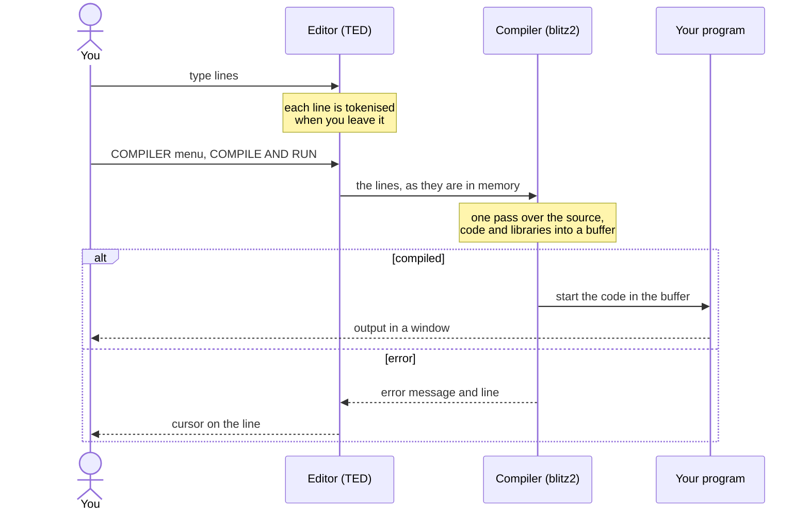

import { CardGrid, LinkCard } from "@astrojs/starlight/components";

Blitz Basic 2 is not a compiler in the usual sense, with source files,
object files and a linker. It is one program, blitz2, that brings its own
editor and keeps everything in memory. This chapter explains what happens
between typing a line and getting a program, so that the menu items, the
files next to your sources and the size of your executables make sense.

## The whole picture

When you start blitz2, it loads the editor and all libraries, then hands
control to the editor. Everything you do from then on happens in the
editor. The compiler only runs when you pick an item of the editor's
COMPILER menu:

Three ideas carry the whole design:

* **The editor stores the program tokenised.** Keywords and library
  commands are kept as short numbers, not as text. The compiler never sees
  the text you typed, only these numbers and the rest of the line.
* **There is no linker.** The compiler writes machine code straight into
  one block of memory and copies the code of every library the program
  uses next to it. To run the program it simply jumps into that block; to
  create an executable it writes the block to a file.
* **The compiler runs code while it compiles.** Constant expressions are
  evaluated by generating code for them and running it. That is one reason
  why blitz2 runs only on a 68000-family processor, on an Amiga or in an
  emulator.

## The pages of this chapter

<CardGrid>
  <LinkCard title="The editor and the compiler" href="/docs/how-blitz2-works/editor-and-compiler/" description="How blitz2 and TED share one program, and what each item of the COMPILER menu does." />
  <LinkCard title="Tokenised sources" href="/docs/how-blitz2-works/tokens/" description="What a token is, how library commands get theirs, and why the numbers matter." />
  <LinkCard title="Libraries: acidlibs, deflibs, userlibs" href="/docs/how-blitz2-works/libraries/" description="The kinds of libraries, where they come from and what ends up in your program." />
  <LinkCard title="From source to executable" href="/docs/how-blitz2-works/compiling/" description="Why a small program becomes an executable of several kilobytes, and what runtime error checking adds." />
  <LinkCard title="Residents and the .xtra file" href="/docs/how-blitz2-works/residents/" description="The companion file of a source, and precompiled types, macros and constants." />
</CardGrid>
